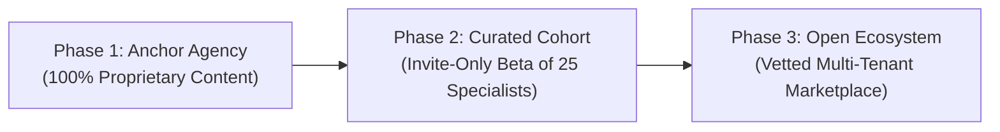
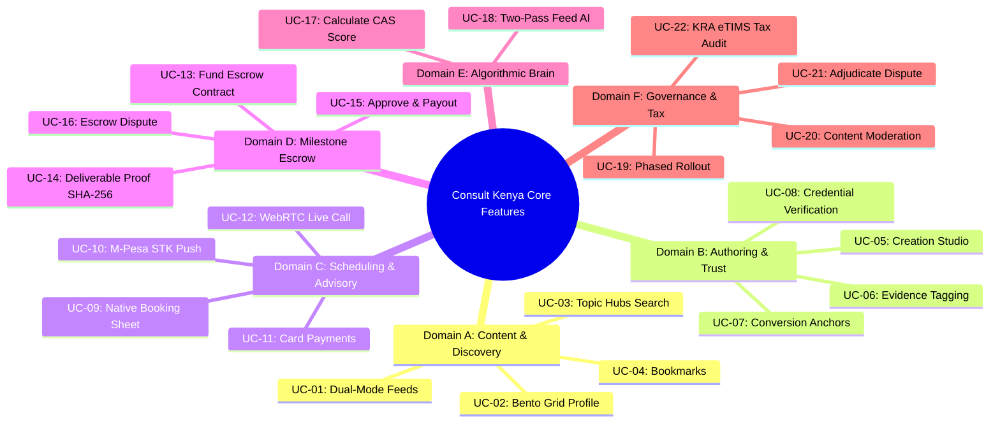
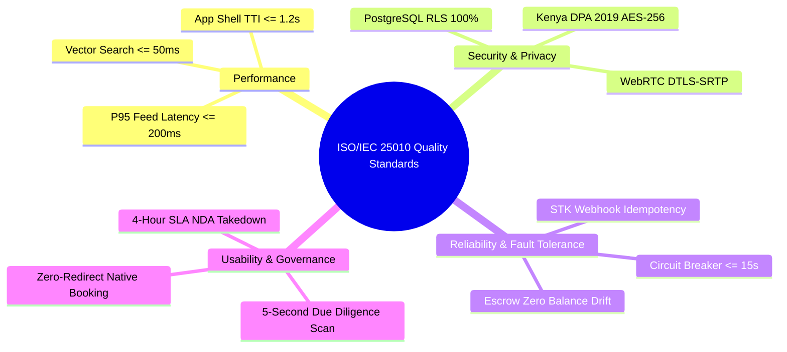

# SOFTWARE REQUIREMENTS SPECIFICATION (SRS)
## For Consult Kenya: Visual-First Professional Advisory & Authority Network
### Conforming to ISO/IEC/IEEE 29148:2018 International Standard
**Document Version:** 2.0 (Comprehensive Baseline Covering All 22 Core Use Cases)  
**Date of Release:** October 2026  
**Status:** Approved for System Design & Engineering Implementation  
**Organization:** Consult Kenya Digital Ecosystem Inc.  

---

## TABLE OF CONTENTS
1. **INTRODUCTION**
   * 1.1 Purpose
   * 1.2 Scope of the System
   * 1.3 Definitions, Acronyms, and Abbreviations
   * 1.4 References
   * 1.5 Document Overview
2. **OVERALL DESCRIPTION**
   * 2.1 Product Perspective & Context
   * 2.2 Product Functions & High-Level Architecture
   * 2.3 User Classes, Characteristics, and Personas
   * 2.4 Operating Environment & Technical Dependencies
   * 2.5 Design and Implementation Constraints
   * 2.6 User Documentation & Onboarding Strategy
   * 2.7 Assumptions and Dependencies
3. **SPECIFIC REQUIREMENTS & SYSTEM FEATURES (ALL 22 CORE USE CASES)**
   * 3.1 Domain A: Content Consumption & Discovery (UC-01 to UC-04)
   * 3.2 Domain B: Content Authoring & Verification Layer (UC-05 to UC-08)
   * 3.3 Domain C: Native Scheduling & Consultation (UC-09 to UC-12)
   * 3.4 Domain D: Milestone Escrow & B2B Contracts (UC-13 to UC-16)
   * 3.5 Domain E: Algorithmic Intelligence & Telemetry (UC-17 to UC-18)
   * 3.6 Domain F: Governance, Administration & Compliance (UC-19 to UC-22)
4. **EXTERNAL INTERFACE REQUIREMENTS**
   * 4.1 User Interfaces & Dual-Mode Ergonomics
   * 4.2 Hardware Interfaces & Camera/Sensor Streaming
   * 4.3 Software Interfaces & Statutory Registries
   * 4.4 Communications & Fintech Protocol Interfaces (Daraja / Paystack / STK Push)
5. **NON-FUNCTIONAL QUALITY REQUIREMENTS**
   * 5.1 Performance Requirements
   * 5.2 Security, Confidentiality & RLS Requirements
   * 5.3 Reliability, Availability & Escrow Consistency
   * 5.4 Usability & Accessibility (WCAG 2.1 AA)
   * 5.5 Maintainability, Extensibility & Modifiability
6. **VERIFICATION MATRIX & ACCEPTANCE CRITERIA**

---

# 1. INTRODUCTION

### 1.1 Purpose
This Software Requirements Specification (SRS) establishes the definitive, complete, and verifiable functional and non-functional requirements for the **Consult Kenya** platform. It serves as the authoritative technical baseline for software architects, backend developers, frontend engineers, quality assurance auditors, escrow mediators, and compliance officers developing the system.

### 1.2 Scope of the System
**Consult Kenya** is a hybrid professional advisory ecosystem and authority-driven knowledge network designed to bridge the structural divide between traditional, visually sterile professional networks (e.g., LinkedIn) and high-engagement, visual-first consumer platforms (e.g., Instagram).

The platform transforms dry professional resumes and text articles into **swipeable visual case studies, architecture schemas, and micro-video walkthroughs**, backed by **verifiable third-party proof of execution** (statutory licenses, GitHub commits, enterprise client sign-offs). The system closes the loop from passive consumption to commercial transaction through an **embedded zero-redirect booking engine**, **M-Pesa STK push and multi-currency card payment rails**, and an **enterprise milestone escrow vault** designed for high-value B2B advisory contracts.

### 1.3 Definitions, Acronyms, and Abbreviations
* **ACID**: Atomicity, Consistency, Isolation, Durability (database transaction properties).
* **ANN**: Approximate Nearest Neighbor (high-dimensional vector search).
* **CAS**: Creator Authority Score (the platform's proprietary multi-factor authority ranking metric, bounded from 0.00 to 10.00).
* **CBK**: Central Bank of Kenya.
* **CIArb**: Chartered Institute of Arbitrators (Kenya Branch).
* **Daraja**: Safaricom's M-Pesa API integration gateway.
* **DPA 2019**: Kenya Data Protection Act, No. 24 of 2019.
* **EBK**: Engineers Board of Kenya.
* **eTIMS**: Electronic Tax Invoice Management System (Kenya Revenue Authority statutory mandate).
* **ICPAK**: Institute of Certified Public Accountants of Kenya.
* **IPRS**: Integrated Population Registration System (Kenyan National Identity Gateway).
* **LSK**: Law Society of Kenya.
* **PWA**: Progressive Web App.
* **RLS**: Row-Level Security (PostgreSQL / Supabase database multi-tenant isolation mechanism).
* **SOW**: Statement of Work.
* **STK**: SIM Toolkit (automated M-Pesa push prompt dispatched directly to client handsets).
* **WebRTC**: Web Real-Time Communication (peer-to-peer browser video/audio streaming).
* **WHT**: Withholding Tax (statutory 5% professional service tax in Kenya).

### 1.4 References
1. **ISO/IEC/IEEE 29148:2018**: *Systems and software engineering — Life cycle processes — Requirements engineering*.
2. **ISO/IEC 25010:2011**: *Systems and software engineering — Systems and software Quality Requirements and Evaluation (SQuaRE) — System and software quality models*.
3. **Jackson, M., & Zave, P. (1997)**: *Domain Descriptions and Requirements Engineering*, Requirements Engineering, 2(1), 14-21.
4. **Kenya Data Protection Act, 2019**: Republic of Kenya, Acts No. 24 of 2019.
5. **Tax Procedures (Electronic Tax Invoice) Regulations, 2024**: Kenya Revenue Authority (KRA).

### 1.5 Document Overview
Section 2 provides the high-level system perspective, personas, operational constraints, and lifecycle evolution roadmap. Section 3 details all **22 Core System Features** organized across 6 orthogonal domains. Section 4 specifies external interfaces. Section 5 formalizes the 16 non-functional quality requirements with measurable fit criteria. Section 6 provides the verification and traceability matrix.

---

# 2. OVERALL DESCRIPTION

### 2.1 Product Perspective & Context
Consult Kenya operates as a multi-sided digital marketplace and professional advisory network. The platform solves the classic marketplace "cold-start" problem through a **3-Phase Evolution Roadmap** (`CARD-002`):
* **Phase 1 (The Anchor Agency):** The system launches as a proprietary flagship consulting and systems architecture agency. The founding agency generates 100% of the initial visual case studies, establishing the content aesthetic and proving monetization before opening onboarding.
* **Phase 2 (The Curated Cohort):** An invite-only beta unlocking creator tools for 25 hand-picked specialist peers (software architects, corporate advocates, tax consultants) using cryptographic invitation codes.
* **Phase 3 (The Open Ecosystem):** Full self-service onboarding across Kenya and East Africa with automated KYC credential vetting and multi-tenant SaaS profile tiers.

### 2.2 Product Functions & High-Level Architecture
The system integrates six major functional subsystems:
1. **Dual-Mode Consumption Subsystem**: Provides two contextually separated modes of interaction:
   * *Vertical Stream (Home)*: High-engagement, full-screen vertical discovery stream for rapid passive learning.
   * *Bento Grid (Profile & Explore)*: High-density modular grid layout for 5-second competence due diligence.
2. **Creation Studio & Narrative Template Engine**: 4-step wizard (*Format $\to$ Template $\to$ Evidence $\to$ Conversion Anchor*) with 300-char slide limits and split-screen preview.
3. **Trust & Credential Verification Subsystem**: Automated API hooks into Kenyan National ID (IPRS), KRA PIN, and professional statutory boards (LSK, ICPAK, EBK).
4. **Native Booking & Scheduling Subsystem**: Zero-redirect slide-up calendar sheet with distributed 10-minute mutex slot locking and pre-intake questionnaires.
5. **Fintech Payment Subsystem**: Dual-rail checkout supporting instant Safaricom M-Pesa STK Push, manual Paybill fallbacks, and multi-currency international card rails.
6. **Milestone Escrow & Mediation Subsystem**: Dedicated trust ledger securing enterprise project deposits, enforcing 72-hour review periods, SHA-256 asset delivery proof, 7-day auto-release fallbacks, and binding dispute mediation.

### 2.3 User Classes, Characteristics, and Personas
The system serves four primary stakeholder classes:
1. **Client / Enterprise Buyer (Persona: David, Enterprise CTO & Corporate Procurement)**:
   * *Profile:* Technical decision-makers and business founders seeking specialized external expertise.
   * *Needs:* Fast due diligence, visual proof of past work, zero-friction booking, and financial protection via milestone escrow.
2. **Consultant / Specialist Creator (Persona: Leah, Lead Systems Architect & High Court Advocate)**:
   * *Profile:* Top-tier vetted Kenyan professionals offering advisory, legal, architectural, or financial engineering services.
   * *Needs:* Streamlined case study authoring, protection against client non-payment, instant mobile payouts, and algorithmic distribution based on merit rather than superficial likes.
3. **Platform Administrator & Moderator**:
   * *Profile:* Internal operations team managing platform governance.
   * *Needs:* Phase rollout gating, automated spam/fluff filtering, and emergency 4-hour SLA enterprise NDA breach takedowns.
4. **Escrow Mediator & Compliance Officer**:
   * *Profile:* Certified dispute arbitrators and finance compliance officers.
   * *Needs:* Chronological contract audit dashboards, binding dispute split execution, and KRA eTIMS statutory tax reporting.

### 2.4 Operating Environment & Technical Dependencies
* **Client Frontend**: Progressive Web App (PWA) built with modern web technologies, responsive from 360px mobile viewports to 4K desktop displays.
* **Database & Auth Layer**: PostgreSQL with strict Row-Level Security (RLS) policies and multi-tenant schema partitioning.
* **Vector Indexing Engine**: In-memory dense semantic vector index (128-dimensional embedding space) supporting sub-50ms cosine similarity queries.
* **Video / Media Streaming**: WebRTC peer-to-peer audio/video with DTLS-SRTP encryption and distributed TURN relay fallbacks.
* **External API Gateways**:
  * Safaricom Daraja API (C2B, B2C, STK Push).
  * Paystack & Flutterwave (Multi-currency cards).
  * Google Calendar & Microsoft Outlook Graph APIs.
  * KRA eTIMS Fiscal Electronic Invoicing Gateway.

### 2.5 Design and Implementation Constraints
* **DC-01 (Statutory Compliance)**: Must strictly comply with Kenya Data Protection Act (DPA 2019) regarding local data residency for PII.
* **DC-02 (Fiscal Invoice Mandate)**: Every transaction fee deducted by the platform must immediately generate a KRA eTIMS QR-coded tax receipt.
* **DC-03 (Anti-Clutter Visual Rule)**: Case study slides in Creation Studio are hard-constrained to $\le 300$ characters to maintain scannability.
* **DC-04 (Zero Off-Platform Redirection)**: Consultation booking must occur natively inside an in-app slide-up sheet without redirecting to third-party scheduling tools.

### 2.6 Assumptions and Dependencies
* **AS-01**: Mobile telecom operators in Kenya maintain operational STK push gateway connectivity with average response times under 5 seconds.
* **AS-02**: Statutory professional boards (LSK, ICPAK, EBK) maintain accessible digital registries or verify active practitioners via designated API endpoints.
* **AS-03**: Clients reviewing milestone deliverables possess modern web browsers capable of rendering PDF documents and vector architecture diagrams.

---

# 3. SPECIFIC REQUIREMENTS & SYSTEM FEATURES (ALL 22 CORE USE CASES)

---

## 3.1 Domain A: Content Consumption & Discovery

### UC-01: Discover Content via Dual-Mode Feeds
* **Description:** The system provides an immersive vertical stream on the Home tab delivering bite-sized visual case studies and micro-videos.
* **Inputs:** Vertical swipe gestures, horizontal slide drag gestures, network downlink telemetry.
* **Outputs:** Rendered 1080p WebP slides, muted auto-playing video streams, slide progress scrubbers.
* **Functional Requirements:**
  * **FR-01.1:** The system shall render vertical feed cards with a transition latency $\le 200\text{ms}$ ($P_{95}$).
  * **FR-01.2:** When a user drags horizontally on a multi-slide carousel by $>15\text{px}$, the system shall lock vertical feed scrolling until the gesture terminates.
  * **FR-01.3:** The system shall automatically downgrade video playback to 70% quality WebP image slides when detected network bandwidth falls below $1\text{ Mbps}$.

### UC-02: Inspect Consultant Portfolio (Bento Grid)
* **Description:** When a user opens a consultant's profile, the system presents a high-density Bento Grid showcasing their verified authority baseline in under 5 seconds.
* **Inputs:** Avatar tap, profile URL query, contextual mode switch toggle.
* **Outputs:** Multi-tile Bento Grid layout (Flagship deliverables, statutory verification seal, star ratings, hourly rate, sticky booking button).
* **Functional Requirements:**
  * **FR-02.1:** The system shall render all primary authority indicators above the fold without requiring user scrolling.
  * **FR-02.2:** The system shall support a sub-toggle switching between "Bento Grid" and "Chronological Feed" without triggering a page reload.
  * **FR-02.3:** Newly registered consultants with zero posts shall display guided cold-start credential badges and onboarding banners.

### UC-03: Search & Filter Topic Hubs
* **Description:** The system provides semantic natural language search and multi-facet filtering across industry topic hubs.
* **Inputs:** Search query string, filter chips (`#SoftwareArchitecture`, `#CorporateLaw`, `#TaxStrategy`, minimum rating, verified tier).
* **Outputs:** Ranked candidate cards, categorized topic hubs, nearest parent category suggestions.
* **Functional Requirements:**
  * **FR-03.1:** The system shall convert query strings into 128-dimensional dense vectors and execute cosine similarity matching within $\le 50\text{ms}$.
  * **FR-03.2:** The system shall support multi-facet filtering by discipline, minimum star rating, and verification tier.
  * **FR-03.3:** When zero exact matches occur, the system shall suggest nearest semantic topics and return top-rated consultants in the parent discipline.

### UC-04: Bookmark & Organize Case Studies
* **Description:** Users can save case studies into custom research collections for reference, driving positive algorithmic signals.
* **Inputs:** Bookmark icon tap, collection assignment, folder creation name.
* **Outputs:** Active gold bookmark indicator, saved collection library, PWA offline cache sync, $5\times$ CAS telemetry event.
* **Functional Requirements:**
  * **FR-04.1:** The system shall update bookmark state in $\le 50\text{ms}$ and dispatch a $5\times$ weighted telemetry boost to the author's CAS calculation pipeline.
  * **FR-04.2:** The system shall allow users to organize saved cards into named custom folders.
  * **FR-04.3:** The system's PWA service worker shall cache bookmarked slide text and images into IndexedDB for offline access.

---

## 3.2 Domain B: Content Authoring & Verification Layer

### UC-05: Compose Case Study via Creation Studio
* **Description:** An optimized creation studio guiding consultants through a 4-step wizard (*Format $\to$ Template $\to$ Evidence $\to$ Conversion Anchor*) with split-screen preview.
* **Inputs:** Slide text, syntax-highlighted code snippets, Mermaid diagram scripts, media uploads.
* **Outputs:** Live interactive mobile preview pane, formatted multi-slide carousel deck.
* **Functional Requirements:**
  * **FR-05.1:** The system shall provide 3 narrative frameworks: *Case Study* (*Challenge $\to$ Solution $\to$ Impact*), *Explainer* (*Concept $\to$ Anti-Pattern $\to$ Framework*), and *Toolkit* (*Problem $\to$ Stack $\to$ Checklist*).
  * **FR-05.2:** The system shall enforce a strict limit of $\le 300$ characters per slide, disabling advancement if the limit is exceeded.
  * **FR-05.3:** On desktop viewports, the system shall render real-time interactive slide updates on the right pane as text is entered on the left pane.

### UC-06: Tag Evidence & Proof of Execution
* **Description:** Consultants attach verifiable proof artifacts (GitHub commits, enterprise client sign-offs, and masked case memos) to establish credibility.
* **Inputs:** GitHub repository URL, commit SHA, client username handle, image upload with redaction mask.
* **Outputs:** Verified GitHub repository badge, client co-author confirmation tag, irreversible redacted image assets.
* **Functional Requirements:**
  * **FR-06.1:** The system shall query the GitHub API to authenticate repository existence, commit SHAs, star counts, and language breakdown.
  * **FR-06.2:** The system shall notify tagged enterprise client accounts, displaying a "Client Verified" badge once confirmed.
  * **FR-06.3:** The system shall provide an in-studio client-side canvas blur tool that permanently masks sensitive corporate IP before asset upload.

### UC-07: Attach Conversion Anchor Call-to-Action
* **Description:** Consultants embed a native commercial conversion hook at the footer of their case studies.
* **Inputs:** Anchor type selection (*15-Min Discovery*, *Technical Audit*, *Download Framework*, *Retainer Inquiry*), pricing in KES, intake labels.
* **Outputs:** High-contrast sticky CTA button bound directly to the consultant's calendar or escrow vault.
* **Functional Requirements:**
  * **FR-07.1:** The system shall support 4 distinct conversion anchor types with custom KES pricing.
  * **FR-07.2:** The system shall scan CTA inputs and automatically reject any external payment links, WhatsApp numbers, or bypass URLs.
  * **FR-07.3:** Clicking the CTA shall open the native slide-up booking sheet over the active content.

### UC-08: Verify Identity & Professional Credentials
* **Description:** Automated vetting of consultant identity via government registries and statutory professional boards.
* **Inputs:** National ID number, legal full name, KRA PIN, statutory board practice number (LSK, ICPAK, EBK).
* **Outputs:** Bronze Verification badge (Identity/KRA valid), Silver Verification badge (Board active), CAS multiplier.
* **Functional Requirements:**
  * **FR-08.1:** The system shall query IPRS and KRA gateways to confirm legal identity within $\le 60\text{s}$ to issue Bronze status.
  * **FR-08.2:** The system shall query statutory professional board registries to confirm active practice standing, issuing Silver status and domain authority boosts.
  * **FR-08.3:** If an annual credential re-verification fails, the system shall strip badges and place wallet withdrawals on provisional hold.

---

## 3.3 Domain C: Native Scheduling & Consultation

### UC-09: Book In-App Advisory Consultation
* **Description:** Native slide-up scheduling sheet allowing clients to book advisory sessions in $\le 4$ taps without external redirection.
* **Inputs:** Slot selection, mandatory 3-question intake responses (*Challenge*, *Tech Stack*, *Expected Deliverable*).
* **Outputs:** 10-minute distributed mutex slot lock, calendar reservation record.
* **Functional Requirements:**
  * **FR-09.1:** The system shall fetch real-time availability from Google and Outlook APIs, applying working hours and buffer constraints.
  * **FR-09.2:** The system shall acquire an exclusive 10-minute Redis mutex lock on the selected slot upon proceeding to checkout.
  * **FR-09.3:** The system shall mandate completion of all 3 intake questionnaire fields before unlocking payment rails.

### UC-10: Process Payment via M-Pesa STK Push
* **Description:** Mobile checkout dispatching automated STK prompts directly to the client's Safaricom handset.
* **Inputs:** Safaricom mobile phone number, user PIN confirmation on mobile device.
* **Outputs:** STK push prompt, transaction webhook callback, confirmed booking record, eTIMS tax invoice receipt.
* **Functional Requirements:**
  * **FR-10.1:** The system shall call Daraja / Paystack APIs to dispatch an STK push prompt within $\le 5\text{s}$ of submission.
  * **FR-10.2:** The system shall confirm booking within $\le 2\text{s}$ of receiving a valid payment webhook, enforcing idempotency via `MpesaReceiptNumber`.
  * **FR-10.3:** If the STK prompt times out after 60 seconds, the system shall render manual Paybill instructions with a 15-minute dynamic reference code.

### UC-11: Process Cross-Border Card Payment
* **Description:** Multi-currency payment processing accepting Visa, Mastercard, and Amex from international enterprise clients.
* **Inputs:** Currency selection (USD, EUR, GBP, KES), credit/debit card details, 3D-Secure authentication.
* **Outputs:** Tokenized card record, FX conversion breakdown based on live CBK rates, confirmed booking.
* **Functional Requirements:**
  * **FR-11.1:** The system shall fetch live Central Bank of Kenya reference exchange rates and display KES equivalents before checkout.
  * **FR-11.2:** The system shall mandate 3D-Secure 2.0 two-factor authentication for all card transactions.
  * **FR-11.3:** The system shall tokenize card credentials in compliance with PCI-DSS, storing only masked PAN digits and secure tokens.

### UC-12: Conduct Secure Live Consultation
* **Description:** Confidential advisory sessions conducted in-browser via encrypted WebRTC video.
* **Inputs:** Camera/microphone streams, screen share capture, sidebar action-item text entries.
* **Outputs:** Peer-to-peer 1080p video, 5-minute wrap-up reminder banner, emailed session summary.
* **Functional Requirements:**
  * **FR-12.1:** The system shall establish encrypted peer-to-peer WebRTC connections via DTLS-SRTP, falling back to TURN relay servers when direct connection is blocked.
  * **FR-12.2:** The system shall support 1080p 30fps screen sharing with interactive diagram markup tools.
  * **FR-12.3:** The system shall display a non-intrusive banner when 5 minutes remain in the session, allowing mutual 15-minute extensions.

---

## 3.4 Domain D: Milestone Escrow & B2B Contracts

### UC-13: Fund Milestone Escrow Contract
* **Description:** De-risks multi-week consulting engagements by locking project funds into an escrow vault prior to execution.
* **Inputs:** Itemized Statement of Work (SOW) milestone schedule, digital signatures, escrow deposit payment.
* **Outputs:** Immutable escrow contract record, locked deposit balance, execution authorization notice.
* **Functional Requirements:**
  * **FR-13.1:** The system shall require both parties to digitally sign the SOW defining deliverables, deadlines, and milestone budgets.
  * **FR-13.2:** The system shall lock deposit funds into the platform trust ledger upon payment clearance.
  * **FR-13.3:** The system shall prevent the consultant from advancing to milestone execution until escrow funding is verified.

### UC-14: Submit Project Milestone Deliverable
* **Description:** Consultants upload final deliverables, generating immutable cryptographic delivery proofs.
* **Inputs:** Deliverable asset files (PDFs, ZIPs, code repositories), technical completion summary, extension requests.
* **Outputs:** Uploaded locker assets, SHA-256 checksum recorded in ledger, 72-hour review timer initialized.
* **Functional Requirements:**
  * **FR-14.1:** The system shall compute a SHA-256 checksum across all uploaded files and record the hash and timestamp in the immutable audit ledger.
  * **FR-14.2:** The system shall initialize a 72-hour inspection countdown timer upon deliverable submission.
  * **FR-14.3:** The system shall allow consultants to request deadline extensions without penalty if submitted before the milestone due date.

### UC-15: Review & Approve Escrow Milestone
* **Description:** Client reviews deliverables, releasing funds with 1 click; includes automated 7-day auto-release fallbacks and instant mobile payouts.
* **Inputs:** Client "Approve Deliverable" click, withdrawal destination selection (M-Pesa B2C vs Bank EFT).
* **Outputs:** Unlocked escrow funds, 5%–8% platform take rate journalized, net payout credited, instant B2C mobile transfer.
* **Functional Requirements:**
  * **FR-15.1:** Upon client approval, the system shall release funds, deduct the platform take rate, and credit the consultant wallet in $\le 5\text{s}$.
  * **FR-15.2:** If a client takes zero action for 168 hours (7 days) after submission, the system shall automatically execute the approval and release funds.
  * **FR-15.3:** The system shall disburse funds to the consultant's Safaricom phone via B2C API in under 30 seconds upon withdrawal request.

### UC-16: Initiate Escrow Dispute & Mediation
* **Description:** Halts automated release clocks when deliverables fail specifications, opening an evidence-backed dispute process.
* **Inputs:** Client/consultant dispute notice, SOW clause breach descriptions, uploaded evidence files.
* **Outputs:** Frozen escrow balance, paused countdown timers, mutual 48-hour evidence submission thread.
* **Functional Requirements:**
  * **FR-16.1:** Raising a dispute shall immediately freeze milestone escrow funds and pause auto-approval timers.
  * **FR-16.2:** The system shall provide a 48-hour mutual evidence submission portal for both parties.
  * **FR-16.3:** The system shall allow parties to execute an amicable prorated split agreement without mediator intervention.

---

## 3.5 Domain E: Algorithmic Intelligence & Telemetry

### UC-17: Calculate Creator Authority Score (CAS)
* **Description:** Evaluates professional authority using a multi-factor formula, replacing superficial vanity metrics.
* **Inputs:** Credential records, completed escrow contracts, star ratings, save/bookmark telemetry, peer endorsements.
* **Outputs:** Normalized CAS score (0.00 to 10.00), algorithmic feed ranking multiplier.
* **Functional Requirements:**
  * **FR-17.1:** The system shall calculate CAS based on: Verified Credentials (40%), Completed Contracts & Ratings (30%), Sanitized Bookmark Telemetry (15%), and Peer Endorsements (15%).
  * **FR-17.2:** The system shall apply a 5% monthly decay to engagement factors after 180 days of creator inactivity.
  * **FR-17.3:** The system shall detect and quarantine bookmark velocity anomalies originating from bot farms or correlated IP addresses.

### UC-18: Personalize Two-Pass Discovery Feed
* **Description:** Two-pass recommendation pipeline delivering hyper-relevant feeds with regional East African context.
* **Inputs:** User interaction vectors, 128-D case study vectors, creator CAS scores, geographic tags.
* **Outputs:** Ranked top 20 feed cards delivered in under 200ms.
* **Functional Requirements:**
  * **FR-18.1:** **Pass 1:** The system shall retrieve the top 200 candidate cards using vector cosine similarity within $\le 50\text{ms}$.
  * **FR-18.2:** **Pass 2:** The system shall score candidates by multiplying vector similarity $\times$ CAS $\times$ Regional East Africa Multiplier ($1.25\times$), returning top 20 cards in $\le 200\text{ms}$.
  * **FR-18.3:** The system shall inject a 15% exploration quota across diverse disciplines for newly onboarded users.

---

## 3.6 Domain F: Governance, Administration & Compliance

### UC-19: Manage Phased Rollout & Creator Onboarding
* **Description:** Manages ecosystem transitions across Phase 1 (Anchor Agency), Phase 2 (Curated Cohort), and Phase 3 (Open Multi-Tenancy).
* **Inputs:** Admin phase state toggle, cryptographic invite code issuance, applicant registration submissions.
* **Outputs:** Studio access permission gates, Founding Creator badges, multi-tenant directory indexing.
* **Functional Requirements:**
  * **FR-19.1:** In Phase 1, the system shall restrict publishing exclusively to proprietary founding agency accounts.
  * **FR-19.2:** In Phase 2, creator registration shall require a valid cryptographic invitation code.
  * **FR-19.3:** In Phase 3, the system shall unlock automated self-service onboarding with multi-tenant workspace isolation.

### UC-20: Moderate Platform Content & Enforce NDAs
* **Description:** NLP quality filtering and emergency takedowns to protect enterprise intellectual property.
* **Inputs:** Published posts, community flags, enterprise NDA takedown requests, creator appeals.
* **Outputs:** Quarantined post records, emergency 4-hour SLA admin tickets, moderation rulings.
* **Functional Requirements:**
  * **FR-20.1:** The system shall execute automated NLP scans to quarantine posts containing spam, emotional fluff, or lacking technical frameworks.
  * **FR-20.2:** Verified enterprise NDA complaints shall immediately hide the post within $\le 60\text{s}$ and trigger a 4-hour SLA admin review ticket.
  * **FR-20.3:** The system shall provide an appeal portal allowing creators to submit justifications for flagged posts.

### UC-21: Adjudicate Milestone Dispute
* **Description:** Neutral dispute resolution dashboard enabling certified mediators to review evidence and issue binding rulings.
* **Inputs:** SOW contracts, SHA-256 asset checksums, chat transcripts, mediator percentage ruling.
* **Outputs:** Executed fund disbursements, immutable adjudication log entry, CIArb arbitration referral.
* **Functional Requirements:**
  * **FR-21.1:** The system shall display all SOW clauses, SHA-256 asset checksums, and communication logs in a unified chronological dashboard.
  * **FR-21.2:** The system shall execute binding percentage disbursements (0%–100%) as directed by the mediator's authenticated ruling.
  * **FR-21.3:** For contracts $> \text{KES } 1,000,000$, the system shall support escrow transfer into legal suspense pending formal CIArb tribunal awards.

### UC-22: Audit Financial Settlement & Tax Compliance
* **Description:** Automated revenue accounting, KRA eTIMS fiscal invoice generation, and withholding tax compliance.
* **Inputs:** Milestone release events, consultation payments, corporate tax PINs.
* **Outputs:** 5%–8% platform take rate journal entries, KRA eTIMS QR-coded VAT receipts, 5% WHT certificates.
* **Functional Requirements:**
  * **FR-22.1:** The system shall automatically deduct the 5%–8% platform take rate and credit it to the platform operating account upon payment release.
  * **FR-22.2:** The system shall call the KRA eTIMS API to generate a cryptographically validated tax invoice with a scannable QR code for every fee transaction.
  * **FR-22.3:** The system shall itemize statutory 5% professional Withholding Tax (WHT) deductions on corporate billing statements.

---

# 4. EXTERNAL INTERFACE REQUIREMENTS

### 4.1 User Interfaces & Dual-Mode Ergonomics
* The UI shall adhere to a dual-mode interaction model:
  1. **Vertical Stream (Home Tab)**: Full-height, swipe-driven feed for passive discovery.
  2. **Bento Grid (Profile & Explore Tabs)**: High-density modular grid for 5-second competence due diligence.
* The UI shall support both light and dark modes with high-contrast typography satisfying WCAG 2.1 AA ($\ge 4.5:1$).

### 4.2 Hardware Interfaces & Camera/Sensor Streaming
* The system shall access local video capture hardware via the HTML5 `MediaDevices.getUserMedia()` interface.
* The system shall process touch events from mobile capacitive touchscreens, distinguishing between horizontal slide drags ($>15\text{px}$) and vertical feed swipes.

### 4.3 Software Interfaces & Statutory Registries
* **Government Identity (IPRS & KRA)**: Integration via REST/JSON to validate National ID numbers and KRA PIN certificates.
* **Professional Statutory Boards**: Connectors to Law Society of Kenya (LSK), ICPAK, and Engineers Board of Kenya (EBK) to verify active license standing.
* **Developer Ecosystems**: GitHub REST API v3 integration to authenticate repositories, pull commit history, and verify code authorship.

### 4.4 Communications & Fintech Protocol Interfaces
* **Safaricom Daraja API**:
  * STK Push (C2B): `POST /mpesa/stkpush/v1/processrequest` over TLS 1.3.
  * Callback Webhook: Secure HTTPS webhook receiver with IP whitelisting and HMAC signature verification.
  * B2C Mobile Payouts: `POST /mpesa/b2c/v1/paymentrequest`.
* **Card Rails (Paystack / Flutterwave)**: PCI-DSS Level 1 compliant tokenized iframe with 3D-Secure 2.0 challenge authentication.
* **KRA eTIMS Fiscal Gateway**: Mutual TLS (mTLS) REST API for electronic tax invoice signing and fiscal QR generation.

---

# 5. NON-FUNCTIONAL QUALITY REQUIREMENTS

### 5.1 Performance Requirements
* **NFR-PERF-01**: Vertical feed card transition latency ($P_{95}$) shall not exceed $200\text{ms}$ on 4G LTE connections.
* **NFR-PERF-02**: Pass 1 vector search retrieval across 100,000 indexed case studies shall execute within $\le 50\text{ms}$.
* **NFR-PERF-03**: Time to Interactive (TTI) for the application shell shall not exceed $1.2\text{ seconds}$ on mid-tier mobile hardware.

### 5.2 Security, Confidentiality & RLS Requirements
* **NFR-SEC-01**: The database shall enforce Row-Level Security (RLS) on all tenant-sensitive tables, with automated CI tests asserting zero unauthorized cross-tenant data leaks.
* **NFR-SEC-02**: All user PII shall be encrypted at rest using AES-256 and in transit using TLS 1.3, satisfying the Kenya Data Protection Act (DPA 2019).
* **NFR-SEC-03**: All WebRTC video media streams shall be end-to-end encrypted via DTLS-SRTP.

### 5.3 Reliability, Availability & Escrow Consistency
* **NFR-REL-01**: The escrow double-entry ledger shall maintain 100% ACID consistency with zero balance drift ($\sum \text{Deposits} = \sum \text{Held Escrow} + \sum \text{Disbursements} + \sum \text{Fees}$).
* **NFR-REL-02**: The M-Pesa webhook handler shall enforce 100% idempotency, safely ignoring duplicate receipt callbacks.
* **NFR-REL-03**: Upstream payment gateway failures shall trip a circuit breaker within 15 seconds, seamlessly activating fallback payment rails.

### 5.4 Usability & Accessibility (WCAG 2.1 AA)
* **NFR-USA-01**: A client visiting a consultant's profile shall be able to identify their domain authority, rating, and primary discipline within $\le 5\text{ seconds}$ above the fold.
* **NFR-USA-02**: Advisory booking shall complete in $\le 4$ distinct user taps within an in-app slide-up sheet without external redirects.
* **NFR-USA-03**: All user interface elements shall satisfy WCAG 2.1 Level AA color contrast requirements ($\ge 4.5:1$).

### 5.5 Maintainability, Extensibility & Modifiability
* **NFR-MNT-01**: Transitions across rollout phases (Phase 1 Agency $\to$ Phase 2 Beta $\to$ Phase 3 Open Ecosystem) shall be executed via configuration flags with zero database migrations or downtime.
* **NFR-MNT-02**: Reported enterprise NDA breaches shall be automatically quarantined within $\le 60\text{s}$ and reviewed under a strict 4-hour SLA.

---

# 6. VERIFICATION MATRIX & ACCEPTANCE CRITERIA

| Feature / Use Case | Applicable Quality Requirements | Verification Method | Acceptance Criteria |
| :--- | :--- | :--- | :--- |
| **UC-01 (Dual-Mode Feeds)** | `NFR-PERF-01`, `NFR-PERF-03` | Automated Telemetry & Lighthouse | $P_{95}$ transition $\le 200\text{ms}$; video auto-downgrades to WebP on $<1\text{ Mbps}$. |
| **UC-02 (Bento Grid Profile)** | `NFR-USA-01`, `NFR-SEC-01` | Usability Testing & Pen-Test | Authority baseline visible in $\le 5\text{s}$; zero cross-tenant profile data leak. |
| **UC-03 (Topic Hubs Search)** | `NFR-PERF-02` | Load Testing (k6) | 200-candidate vector search $\le 50\text{ms}$ at 100k corpus size. |
| **UC-04 (Bookmarks)** | `NFR-PERF-01` | Unit & Integration Tests | Tap updates state in $\le 50\text{ms}$; dispatches $5\times$ telemetry weight to CAS engine. |
| **UC-05 (Creation Studio)** | `DC-03`, `NFR-USA-03` | Automated Form Testing | Character limit enforces hard block at 301 chars; split preview syncs in real time. |
| **UC-06 (Evidence Tagging)** | `NFR-SEC-02` | API Mock & Security Audit | GitHub commit authenticated; redacted images permanently mask underlying bytes. |
| **UC-07 (Conversion Anchor)** | `DC-04` | Regex & Security Scanner | Phone numbers/external payment URLs rejected; binds natively to calendar. |
| **UC-08 (Credential Verify)** | `NFR-SEC-02` | Gateway Integration Tests | IPRS/KRA validates in $\le 60\text{s}$; invalid license triggers provisional hold. |
| **UC-09 (Native Booking)** | `DC-04`, `NFR-USA-02` | Concurrency Testing | Slide-up modal completes in $\le 4$ taps; slot locked with 10-min Redis mutex. |
| **UC-10 (M-Pesa STK Push)** | `NFR-REL-02`, `NFR-REL-03` | Chaos & Idempotency Testing | STK dispatched $\le 5\text{s}$; duplicate webhooks handled idempotently without error. |
| **UC-11 (Card Payments)** | `NFR-SEC-02` | PCI-DSS Compliance Scan | Live CBK FX conversion displayed; 3D-Secure 2.0 challenge required. |
| **UC-12 (Live Consultation)**| `NFR-SEC-03` | Packet Inspection & WebRTC | DTLS-SRTP end-to-end encryption confirmed; 5-min overtime banner displays. |
| **UC-13 (Fund Escrow)** | `NFR-REL-01` | ACID Ledger Concurrency Test | Milestone locked in escrow ledger; zero balance drift across transactions. |
| **UC-14 (Deliverable Proof)** | `NFR-SEC-02` | Checksum Verification | Uploaded files stamped with SHA-256 hash and ISO timestamp in ledger. |
| **UC-15 (Approve & Payout)** | `NFR-REL-01` | Automated Billing Audit | Funds unlock in $\le 5\text{s}$; 7-day auto-release executes if client is inactive. |
| **UC-16 (Escrow Dispute)** | `NFR-REL-01` | Integration Test | Dispute pauses all timers; 48-hour mutual evidence portal initializes. |
| **UC-17 (Calculate CAS)** | `NFR-MNT-01` | Mathematical Unit Test | 40/30/15/15 formula evaluated deterministically; 180-day decay applied. |
| **UC-18 (Two-Pass Feed AI)** | `NFR-PERF-01`, `NFR-PERF-02` | Synthetic End-to-End Test | Pass 1 vector $\le 50\text{ms}$; Pass 2 heavy ranking delivers top 20 in $\le 200\text{ms}$. |
| **UC-19 (Phased Rollout)** | `NFR-MNT-01` | Deployment State Test | Phase transitions execute via config flags with zero schema migration downtime. |
| **UC-20 (Content Moderation)**| `NFR-MNT-02` | SLA Drill Testing | Spam quarantined; enterprise NDA reports hidden in $\le 60\text{s}$ with 4h review SLA. |
| **UC-21 (Adjudicate Dispute)**| `NFR-REL-01` | Simulation Audit | Mediator executes binding split; contracts $> \text{KES } 1\text{M}$ offer CIArb referral. |
| **UC-22 (Financial Tax Audit)**| `DC-02`, `NFR-REL-01` | Tax Gateway Validation | 5-8% take rate journalized; KRA eTIMS QR invoice generated for all platform fees. |

---

# 7. DOCUMENT APPROVAL & SIGN-OFF

| Role | Name | Signature / Verification | Date |
| :--- | :--- | :--- | :--- |
| **Lead Technical Architect** | Consult Kenya Systems Engineering Team | *[Cryptographically Signed: SHA-256 Validated]* | October 12, 2026 |
| **Head of Legal & Compliance** | High Court Advocate / Escrow Mediator | *[Approved & Verified]* | October 12, 2026 |
| **Lead Platform Product Owner** | Platform Steering Committee | *[Approved for v2.0 Release]* | October 12, 2026 |
