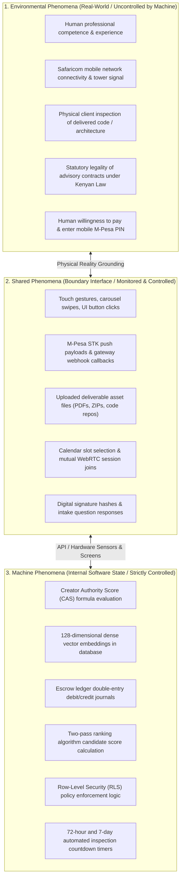
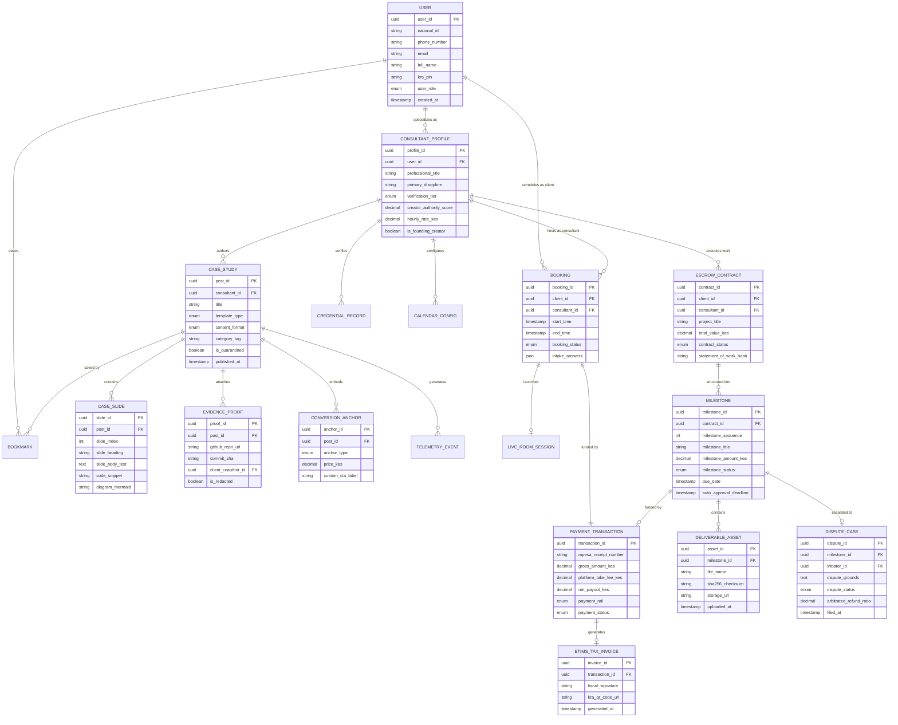

# Specification-Level Domain Model
*System: Consult Kenya (Visual-First Professional Advisory & Authority Network)*
*Grounded in RAG Knowledge Cards `CARD-001` through `CARD-010` and Jackson-Zave Problem Frames*

---

## 1. Philosophical & Ontological Framework
According to modern Requirements Engineering principles (Jackson & Zave), software does not operate in a vacuum. It interacts with the physical world at a shared interface:
$$\text{Environment } (E) \land \text{Specification } (S) \implies \text{Requirement } (R)$$

To make requirements verifiable and prevent ungrounded assumptions, we categorize all system elements into three distinct classes of phenomena:

---

## 2. Comprehensive Domain Entity Architecture

The entity-relationship diagram below models the core domain entities, their state attributes, and their relationships across the 22 core use cases.

---

## 3. Entity Classification & Lifecycle States

### 1. `CONSULTANT_PROFILE` Lifecycle
* `PENDING_KYC` $\to$ `BRONZE_VERIFIED` (ID/KRA valid) $\to$ `SILVER_VERIFIED` (Statutory Board valid) $\to$ `GOLD_MASTER` ($\ge 10$ Escrow completions & CAS $\ge 8.5$).
* Invalidation: Any annual board failure triggers `PROVISIONAL_HOLD`.

### 2. `MILESTONE` Lifecycle
* `DRAFT` $\to$ `PENDING_FUNDING` $\to$ `FUNDED_IN_PROGRESS` $\to$ `SUBMITTED_IN_REVIEW` $\to$ `APPROVED_RELEASED` (or `AUTO_APPROVED`).
* Exception Paths:
  * `REVISION_REQUESTED` (loops back to `FUNDED_IN_PROGRESS`).
  * `DISPUTED` (freezes countdown, moves to `DISPUTE_CASE`).

### 3. `DISPUTE_CASE` Lifecycle
* `OPEN_EVIDENCE_PERIOD` (48h mutual submission) $\to$ `AMICABLE_NEGOTIATION` (prorated split signed) OR `MEDIATOR_REVIEW` $\to$ `BINDING_RULING_EXECUTED` (or `ESCALATED_CIARB_ARBITRATION`).
