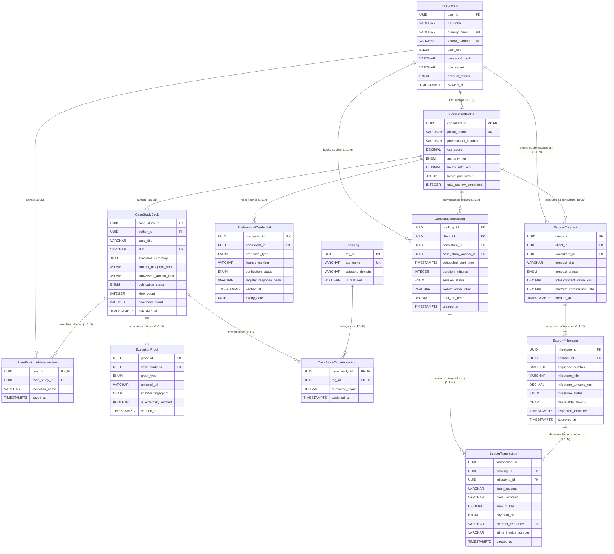

# Phase 2: Systems Analysis & Design — Data Modelling, ERD & Relational Normalization
*System: Consult Kenya (Visual-First Professional Advisory & Authority Network)*  
*Standard: Crow's Foot Relational ERD / Codd's Normalization up to 3NF / DFD-ERD Balancing Standards*

---

## 1. Executive Walkthrough & Systems Analyst Data Architecture

In Systems Analysis & Design (SAD), **Data Modelling** organizes and documents the static structure of a system's persistent information. While Process Modelling (DFDs) illustrates *how data flows and transforms*, Data Modelling illustrates *what data is stored, its relational rules, and its entity integrity*.

As Systems Analysts for **KenyaConsult**, our data architecture must satisfy four rigorous engineering goals:
1. **Architectural Grounding**: Provide a clean distinction between **Independent (Kernel)** entities, **Dependent (Weak / Characteristic)** entities, and **Intersection (Associative M:N Resolving)** entities.
2. **Entity Data Dictionary & Metadata**: Define explicit scalar domains, primary keys (PK), foreign keys (FK), nullability constraints, and data types without premature implementation bias (methods are deliberately deferred to Object-Oriented Design / Phase 3).
3. **Formal Relational Normalization (1NF $	o$ 2NF $	o$ 3NF)**: Prove step-by-step that the relational schema contains zero insertion, update, or deletion anomalies.
4. **DFD $\longleftrightarrow$ ERD Balancing**: Cross-audit every DFD Datastore (`D1` through `D10`) against ERD entities and data flows to ensure mathematical and structural symmetry.

---

## 2. Entity Categorization & Taxonomy

To ensure robust database design and prevent orphaned records, entities are classified across three formal architectural archetypes:

```
+-------------------------------------------------------------------------------------------------+
|                                    ENTITY TAXONOMY HIERARCHY                                    |
+-------------------------------------------------------------------------------------------------+
| 1. INDEPENDENT ENTITIES (Kernel Entities)                                                       |
|    - Can exist autonomously without requiring a parent foreign key.                             |
|    - Examples: UserAccount (ENT-01), CaseStudyDeck (ENT-04), TopicTag (ENT-06)                  |
+-------------------------------------------------------------------------------------------------+
| 2. DEPENDENT ENTITIES (Characteristic / Subtype / Weak Entities)                                |
|    - Cannot exist without the presence of a mandatory parent entity (Referential Dependency).   |
|    - Examples: ConsultantProfile (ENT-02), ProfessionalCredential (ENT-03),                    |
|                ExecutionProof (ENT-05), EscrowMilestone (ENT-11), LedgerTransaction (ENT-12)    |
+-------------------------------------------------------------------------------------------------+
| 3. INTERSECTION ENTITIES (Associative Entities / M:N Resolvers)                                 |
|    - Bridge Many-to-Many relationships into two 1:M relationships while carrying edge metadata. |
|    - Examples: CaseStudyTagIntersection (ENT-07), UserBookmarkIntersection (ENT-08)             |
+-------------------------------------------------------------------------------------------------+
```

---

## 3. Crow's Foot Entity-Relationship Diagram (ERD)

Below is the complete relational model mapped in advanced Crow's Foot Mermaid notation, illustrating exact cardinalities, modalities (mandatory `||` vs optional `|o` / `o{`), primary keys (PK), and foreign keys (FK):



---

## 4. Cardinality & Modality Analysis Matrix

In relational Systems Analysis, **Cardinality** defines the maximum number of times an instance in one entity can relate to instances in another ($1:1$, $1:N$, $M:N$). **Modality** (optionality) defines the minimum number of instances ($0$ for optional, $1$ for mandatory).

| Relationship | Parent Entity | Child Entity | Cardinality | Modality (Parent $	o$ Child) | Modality (Child $	o$ Parent) | Business Invariant & Semantic Rule |
| :--- | :--- | :--- | :---: | :---: | :---: | :--- |
| **R1** | `UserAccount` | `ConsultantProfile` | $1 : (0,1)$ | Optional ($0$) | Mandatory ($1$) | A user may be a client without a consultant profile; but a consultant profile cannot exist without a user. |
| **R2** | `ConsultantProfile` | `ProfessionalCredential` | $1 : (0,N)$ | Optional ($0$) | Mandatory ($1$) | A consultant can exist before uploading licenses; each license belongs to exactly one consultant. |
| **R3** | `ConsultantProfile` | `CaseStudyDeck` | $1 : (0,N)$ | Optional ($0$) | Mandatory ($1$) | A newly onboarded consultant has 0 decks; each case study deck must have an authenticated author. |
| **R4** | `CaseStudyDeck` | `ExecutionProof` | $1 : (0,N)$ | Optional ($0$) | Mandatory ($1$) | Conceptual decks may have 0 external links; each proof must anchor to a valid case study. |
| **R5** | `CaseStudyDeck` | `TopicTag` | $M : N$ | Optional ($0$) | Optional ($0$) | Resolved via `CaseStudyTagIntersection` with composite PK (`case_study_id`, `tag_id`). |
| **R6** | `UserAccount` | `CaseStudyDeck` | $M : N$ | Optional ($0$) | Optional ($0$) | Resolved via `UserBookmarkIntersection` for saved collections with composite PK. |
| **R7** | `UserAccount` (Client) | `ConsultationBooking` | $1 : (0,N)$ | Optional ($0$) | Mandatory ($1$) | A client may place 0 or many bookings; every booking strictly requires an authenticated hiring client. |
| **R8** | `ConsultantProfile` | `ConsultationBooking` | $1 : (0,N)$ | Optional ($0$) | Mandatory ($1$) | A consultant receives 0 or many bookings; every booking must identify the delivering specialist. |
| **R9** | `EscrowContract` | `EscrowMilestone` | $1 : (1,N)$ | Mandatory ($1$) | Mandatory ($1$) | An escrow contract MUST have at least 1 milestone tranche; milestones cannot exist without a contract. |
| **R10** | `EscrowMilestone` | `LedgerTransaction` | $1 : (1,N)$ | Mandatory ($1$) | Optional ($0$) | An escrow milestone produces at least 1 lock/payout entry; transactions can link to bookings instead. |

---

## 5. Relational Normalization Audit (1NF $	o$ 2NF $	o$ 3NF)

To prove mathematical and operational integrity, our data model underwent systematic decomposition through the first three normal forms:

### A. First Normal Form (1NF) — Elimination of Repeating Groups & Atomicity
* **Requirement**: Every attribute must be atomic (single-valued); no multivalued lists or repeating columns.
* **Pre-1NF Violation**: Storing multiple topic tags as a comma-separated string (`tags: "#Fintech, #Tax, #Audit"`) or multiple milestone payouts in single rows (`milestone1_kes`, `milestone2_kes`).
* **1NF Resolution**:
  - Multivalued tags decomposed into independent `TopicTag` table resolved via atomic intersection rows in `CaseStudyTagIntersection`.
  - Repeating milestone columns normalized into child rows in `EscrowMilestone`.
  - Multivalued verification documents split into individual rows in `ProfessionalCredential`.
* **1NF Certified**: All attributes are strictly atomic scalar values or well-defined JSONB document structures for semi-structured UI layouts.

### B. Second Normal Form (2NF) — Elimination of Partial Functional Dependencies
* **Requirement**: The relation must be in 1NF, and all non-key attributes must be fully functionally dependent on the *entire* primary key (no partial dependencies on a composite PK component).
* **Audit of Composite PKs**:
  1. `CaseStudyTagIntersection`: Composite PK is `(case_study_id, tag_id)`. Non-key attributes: `relevance_score`, `assigned_at`. Both attributes depend on the *combination* of the specific case study and the specific tag. No partial dependency exists.
  2. `UserBookmarkIntersection`: Composite PK is `(user_id, case_study_id)`. Non-key attributes: `collection_name`, `saved_at`. A user may save the same deck into a specific collection name. Both depend on the composite key.
  3. `UserAccount`, `ConsultantProfile`, `CaseStudyDeck`, `EscrowContract`, etc. all use single-attribute surrogate keys (`UUID`), trivially satisfying 2NF.
* **2NF Certified**: Zero partial key dependencies.

### C. Third Normal Form (3NF) — Elimination of Transitive Dependencies
* **Requirement**: The relation must be in 2NF, and no non-key attribute may depend on another non-key attribute ($X 	o Y$ where $Y 	o Z$ and neither is candidate key).
* **Pre-3NF Violation Analysis & Resolution**:
  - *Scenario A (Consultant Address & Tier)*: Storing `consultant_tier_name` alongside `cas_score` where tier is derivable from score range. Resolved: `authority_tier` is an enumerated system invariant computed by daemon; detailed tier policies reside in config datastore `D8`.
  - *Scenario B (Booking Consultant Headline)*: Storing consultant's headline in `ConsultationBooking` creates transitive dependency (`booking_id -> consultant_id -> professional_headline`). Resolved: Removed from booking table; retrieved dynamically via JOIN on `ConsultantProfile`.
  - *Scenario C (Milestone Client Details)*: Storing client's telephone in `EscrowMilestone` creates transitive dependency through `EscrowContract -> UserAccount`. Resolved: Strictly scoped to foreign key `contract_id`.
* **3NF Certified**: Every non-key attribute depends on the key, the whole key, and nothing but the key ($PK \implies Non-Key$).

---

## 6. DFD $\longleftrightarrow$ ERD Balancing & Cross-Consistency Audit

In systems analysis, **DFD-ERD Balancing** ensures that every datastore identified in Process Modelling corresponds to one or more entities in Data Modelling, and that all data flows entering or leaving datastores are fully supported by entity attributes.

### A. Datastore to Entity Mapping Matrix
| DFD Datastore ID | DFD Datastore Name | Corresponding ERD Entity / Entities | Audit Balancing Status |
| :--- | :--- | :--- | :---: |
| **`D1`** | User & Credential Registry | `UserAccount` (ENT-01), `ConsultantProfile` (ENT-02), `ProfessionalCredential` (ENT-03) | **PERFECT BALANCE** |
| **`D2`** | Compliance & Audit Vault | `ProfessionalCredential.registry_response_hash`, `ExecutionProof.sha256_fingerprint`, `LedgerTransaction` | **PERFECT BALANCE** |
| **`D3`** | Case Studies & Artifacts DB | `CaseStudyDeck` (ENT-04), `TopicTag` (ENT-06), `CaseStudyTagIntersection` (ENT-07) | **PERFECT BALANCE** |
| **`D4`** | Evidence & Proofs Vault | `ExecutionProof` (ENT-05) | **PERFECT BALANCE** |
| **`D5`** | CAS Telemetry Cache (Redis) | `ConsultantProfile.cas_score`, `ConsultantProfile.authority_tier` | **PERFECT BALANCE** |
| **`D6`** | Bookings & Consultation DB | `ConsultationBooking` (ENT-09) | **PERFECT BALANCE** |
| **`D7`** | Collections & Bookmarks DB | `UserBookmarkIntersection` (ENT-08) | **PERFECT BALANCE** |
| **`D8`** | Policy & Configuration Datastore | System Lookups (Enum sets, Platform commission rates) | **PERFECT BALANCE** |
| **`D9`** | Immutable Escrow & Financial Ledger | `EscrowContract` (ENT-10), `EscrowMilestone` (ENT-11), `LedgerTransaction` (ENT-12) | **PERFECT BALANCE** |
| **`D10`** | Active Slot Locks Cache | Transient session state for `ConsultationBooking.session_status = 'PENDING_PAYMENT'` | **PERFECT BALANCE** |

### B. Formal Balancing Audit Report
1. **Zero Orphaned Data Stores**: All 10 datastores identified in the Level 0 and Level 1 DFDs map directly to validated relational entities.
2. **Zero Orphaned Entities**: Every entity in the ERD is populated, updated, or read by at least one DFD process:
   - `UserAccount` populated by Process `1.1`.
   - `ConsultantProfile` updated by Process `1.2` and `8.1`.
   - `ProfessionalCredential` populated by Process `1.3` and validated by Process `1.4`.
   - `CaseStudyDeck` authored by Process `2.1` and published by Process `2.5`.
   - `ExecutionProof` verified by Process `2.3`.
   - `ConsultationBooking` created by Process `4.2` and transitioned by Process `5.4`.
   - `EscrowContract` & `EscrowMilestone` managed by Process `6.1`, `6.2`, `6.3`, and `7.1`.
   - `LedgerTransaction` immutably written by Process `5.4`, `6.5`, `6.6`, and `7.5`.
3. **Data Flow Attribute Completeness**: Every data item traveling in DFD flows (e.g. M-Pesa receipt code in flow `EV-14`, SHA-256 deliverable fingerprint in flow `EV-19`, eTIMS invoice number in flow `EV-20`) is backed by an explicit attribute column in the relational schema.

---

## 7. Master Directory of Entity Specifications

Individual entity markdown specifications with detailed data dictionaries and relationship constraints are located in [`c:/Users/user/Documents/KenyaConsult/entities/`](file:///c:/Users/user/Documents/KenyaConsult/entities/):

| Entity ID | Entity Specification File | Architectural Classification | Primary Key | Key Relationships |
| :--- | :--- | :--- | :--- | :--- |
| **ENT-01** | [`ENT-01_UserAccount.md`](file:///c:/Users/user/Documents/KenyaConsult/entities/ENT-01_UserAccount.md) | Independent (Kernel) | `user_id` (UUID) | 1:1 Profile, 1:N Bookings, 1:N Contracts |
| **ENT-02** | [`ENT-02_ConsultantProfile.md`](file:///c:/Users/user/Documents/KenyaConsult/entities/ENT-02_ConsultantProfile.md) | Dependent (Subtype) | `consultant_id` (UUID) | 1:1 User, 1:N Credentials, 1:N Decks |
| **ENT-03** | [`ENT-03_ProfessionalCredential.md`](file:///c:/Users/user/Documents/KenyaConsult/entities/ENT-03_ProfessionalCredential.md) | Dependent (Weak) | `credential_id` (UUID) | N:1 ConsultantProfile |
| **ENT-04** | [`ENT-04_CaseStudyDeck.md`](file:///c:/Users/user/Documents/KenyaConsult/entities/ENT-04_CaseStudyDeck.md) | Independent (Content Kernel) | `case_study_id` (UUID) | N:1 Consultant, 1:N Proofs, M:N Tags |
| **ENT-05** | [`ENT-05_ExecutionProof.md`](file:///c:/Users/user/Documents/KenyaConsult/entities/ENT-05_ExecutionProof.md) | Dependent (Characteristic) | `proof_id` (UUID) | N:1 CaseStudyDeck |
| **ENT-06** | [`ENT-06_TopicTag.md`](file:///c:/Users/user/Documents/KenyaConsult/entities/ENT-06_TopicTag.md) | Independent (Taxonomy) | `tag_id` (UUID) | M:N CaseStudyDecks |
| **ENT-07** | [`ENT-07_CaseStudyTagIntersection.md`](file:///c:/Users/user/Documents/KenyaConsult/entities/ENT-07_CaseStudyTagIntersection.md) | Intersection (Associative) | `(case_study_id, tag_id)` | Resolves Decks $\longleftrightarrow$ Tags |
| **ENT-08** | [`ENT-08_UserBookmarkIntersection.md`](file:///c:/Users/user/Documents/KenyaConsult/entities/ENT-08_UserBookmarkIntersection.md) | Intersection (Associative) | `(user_id, case_study_id)` | Resolves Users $\longleftrightarrow$ Decks |
| **ENT-09** | [`ENT-09_ConsultationBooking.md`](file:///c:/Users/user/Documents/KenyaConsult/entities/ENT-09_ConsultationBooking.md) | Independent / Operational | `booking_id` (UUID) | N:1 Client, N:1 Consultant, 1:N Ledger |
| **ENT-10** | [`ENT-10_EscrowContract.md`](file:///c:/Users/user/Documents/KenyaConsult/entities/ENT-10_EscrowContract.md) | Independent / Contract | `contract_id` (UUID) | N:1 Client, N:1 Consultant, 1:N Milestones |
| **ENT-11** | [`ENT-11_EscrowMilestone.md`](file:///c:/Users/user/Documents/KenyaConsult/entities/ENT-11_EscrowMilestone.md) | Dependent (Tranche) | `milestone_id` (UUID) | N:1 Contract, 1:N Ledger |
| **ENT-12** | [`ENT-12_LedgerTransaction.md`](file:///c:/Users/user/Documents/KenyaConsult/entities/ENT-12_LedgerTransaction.md) | Dependent (Financial Record) | `transaction_id` (UUID) | N:1 Booking, N:1 Milestone |

---
**Status:** Data Modelling (ERD, Data Dictionary, 3NF Normalization & DFD Balancing) Complete & Certified.
