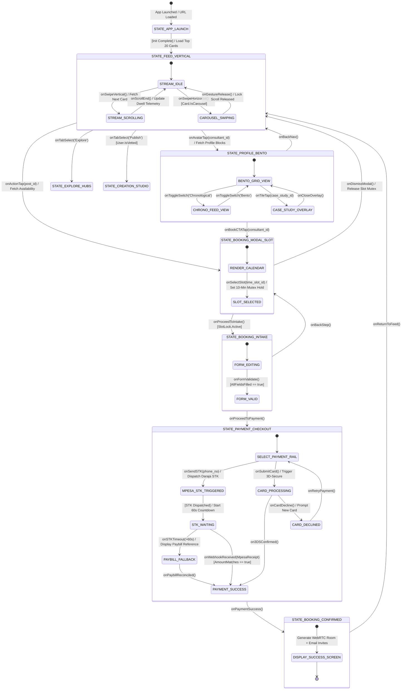

# Phase 9.2: Navigation State Machine Diagram
*System: Consult Kenya (Visual-First Professional Advisory & Authority Network)*
*Formal State-Machine Specification of UI Navigation for Core Use Cases*

---

## 1. State Machine Overview & Mathematical Model

The navigation model represents the formal state space of the Consult Kenya user interface, focusing on the three highest-priority use cases:
1. `UC-01: Discover Content via Dual-Mode Feeds`
2. `UC-02: Inspect Consultant Portfolio (Bento Grid)`
3. `UC-09: Book In-App Advisory Consultation` (with `UC-10` M-Pesa STK payment)

The state machine is formally defined as the 5-tuple:
$$M = (S, \Sigma, T, s_0, F)$$
* $S$: Finite set of UI screen states.
* $\Sigma$: Finite set of navigation transition triggers (UI events, sensor inputs, network callbacks).
* $T$: State transition function: $S \times \Sigma \to S$.
* $s_0$: Initial state (`STATE_APP_LAUNCH`).
* $F$: Terminating/Confirmed states (`STATE_BOOKING_CONFIRMED`).

---

## 2. Formal Navigation State Machine Diagram

---

## 3. Formal Navigation State Machine Legend

### 1. State Table & Definitions
| State Identifier | UI Screen / Modal | Phenomenological Nature | Description |
| :--- | :--- | :--- | :--- |
| `STATE_APP_LAUNCH` | Splash / Shell Loader | Machine | Initial application bootstrapping and authentication state verification. |
| `STATE_FEED_VERTICAL` | Home Discovery Feed | Shared (Screen) | Immersive full-screen vertical feed rendering 1080p carousels and micro-videos. |
| `STREAM_IDLE` | Feed Card Centered | Shared (Display) | Card is statically viewed; dwell-time timer is actively accumulating. |
| `CAROUSEL_SWIPING` | Active Horizontal Slide Drag | Shared (Gesture) | Touch gesture locked to horizontal carousel; vertical scroll locked. |
| `STATE_PROFILE_BENTO` | Consultant Profile | Shared (Screen) | High-density Bento Grid showcasing verified credentials and flagship deliverables. |
| `BENTO_GRID_VIEW` | Profile Modular Grid | Shared (Layout) | Multi-tile layout optimized for 5-second competence audit. |
| `CHRONO_FEED_VIEW` | Profile Timeline Feed | Shared (Layout) | Single-column chronological sequence of past posts. |
| `STATE_BOOKING_MODAL_SLOT` | Slide-Up Calendar Sheet | Shared (Modal) | Calendar view rendering available 30-min slots with 10-minute mutex locking. |
| `STATE_BOOKING_INTAKE` | Project Questionnaire Sheet | Shared (Form) | Mandatory 3-question intake requirement (*Challenge*, *Stack*, *Expected Deliverable*). |
| `STATE_PAYMENT_CHECKOUT` | Checkout & Payment Rails | Shared (Fintech) | Payment rail selector supporting Safaricom STK Push, Paybill fallback, and Cards. |
| `MPESA_STK_TRIGGERED` | Mobile PIN Waiting Prompt | Shared & Env | Client handset illuminated with Safaricom M-Pesa PIN prompt. |
| `STATE_BOOKING_CONFIRMED` | Confirmation & Room Token | Shared (Screen) | Confirmed state with calendar sync, WebRTC room token, and eTIMS tax invoice receipt. |

### 2. State Variable Declarations
* `var current_user_id: UUID`: Identifier of active authenticated user (or `null` if anonymous).
* `var active_post_id: UUID`: Post currently centered in vertical feed viewport.
* `var active_consultant_id: UUID`: Consultant whose profile or booking sheet is currently open.
* `var selected_slot_id: UUID`: Time slot selected for booking.
* `var slot_mutex_lock_expiry: Timestamp`: Expiry timestamp for the 10-minute temporary reservation lock.
* `var payment_status: Enum`: `[PENDING, STK_SENT, TIMEOUT, SUCCESS, DECLINED]`.
* `var intake_answers_valid: Boolean`: Truth value asserting whether all mandatory questionnaire fields are populated.
* `var is_gesture_locked: Boolean`: Flag asserting whether vertical scroll gesture is suppressed during horizontal carousel drag.

### 3. Transition Triggers & UI Event Expressions
1. **$T_{01}: \text{STATE\_FEED\_VERTICAL} \xrightarrow{\text{onSwipeHorizontal() } [\Delta X > 15\text{px}]} \text{CAROUSEL\_SWIPING}$**
   * *Trigger:* User touches carousel card and moves finger horizontally past 15 pixels.
   * *Action:* Set `is_gesture_locked = true`; advance carousel slide index; update progress scrubber.
2. **$T_{02}: \text{STATE\_FEED\_VERTICAL} \xrightarrow{\text{onAvatarTap(consultant\_id)}} \text{STATE\_PROFILE\_BENTO}$**
   * *Trigger:* User taps consultant avatar or username handle in post header.
   * *Action:* Push `STATE_PROFILE_BENTO` to navigation stack; fetch consultant Bento blocks via API.
3. **$T_{03}: \text{STATE\_FEED\_VERTICAL} \xrightarrow{\text{onActionTap(post\_id)}} \text{STATE\_BOOKING\_MODAL\_SLOT}$**
   * *Trigger:* User taps sticky conversion anchor button (e.g. "Book 15-Min Audit").
   * *Action:* Slide up modal sheet; pull live calendar availability from Google/Outlook APIs.
4. **$T_{04}: \text{STATE\_BOOKING\_MODAL\_SLOT} \xrightarrow{\text{onSelectSlot(slot\_id)}} \text{STATE\_BOOKING\_INTAKE}$**
   * *Trigger:* User taps open calendar slot and clicks "Proceed to Intake".
   * *Condition:* Slot mutex acquired successfully in Redis (`slot_mutex_lock_expiry = NOW() + 10 MIN`).
   * *Action:* Transition to intake questionnaire form.
5. **$T_{05}: \text{STATE\_PAYMENT\_CHECKOUT} \xrightarrow{\text{onSendSTK(phone\_no)}} \text{MPESA\_STK\_TRIGGERED}$**
   * *Trigger:* User enters Safaricom number and taps "Pay Now".
   * *Action:* Dispatch Daraja STK Push payload; start 60-second client countdown timer.
6. **$T_{06}: \text{MPESA\_STK\_TRIGGERED} \xrightarrow{\text{onWebhookReceived(MpesaReceipt)}} \text{STATE\_BOOKING\_CONFIRMED}$**
   * *Trigger:* Server receives valid M-Pesa API callback with matching transaction amount.
   * *Action:* Lock booking in database; generate WebRTC video link; issue eTIMS invoice; transition UI to confirmed.
