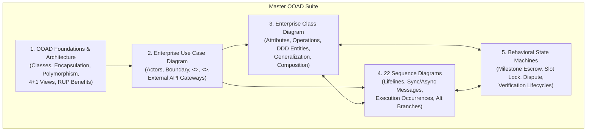

# OBJECT-ORIENTED ANALYSIS & DESIGN (OOAD / UML) MASTER SUITE
**System:** Consult Kenya (Enterprise Advisory & Authority Network)  
**Standard:** UML 2.5 (Unified Modeling Language) & Rational Unified Process (RUP)  
**Lifecycle Stage:** Object-Oriented Modeling Phase  
**Author:** Principal Object Solutions Architect  
**Date:** October 2026  
**Status:** COMPLETE & VERIFIED  

---

## 1. Executive Summary & Paradigm Transition

This suite delivers the complete **Object-Oriented Analysis & Design (OOAD)** specification for Consult Kenya, formalizing the transition from the Structured Systems Analysis & Design (SSAD) specifications developed in Phases 1–5 into unified, encapsulated object models.

---

## 2. Directory Index of Object-Oriented Modeling Deliverables

| Artifact Category | Specification File Link | Core UML Models Delivered | Primary Focus |
| :--- | :--- | :--- | :--- |
| **Foundations & Architecture** | [`OOAD_FOUNDATIONS_AND_ARCHITECTURAL_FRAMEWORK.md`](file:///c:/Users/user/Documents/KenyaConsult/ooad_modeling/OOAD_FOUNDATIONS_AND_ARCHITECTURAL_FRAMEWORK.md) | Basic characteristics, RUP principles, 4+1 views, OOAD vs SSAD comparison | Conceptual grounding, encapsulation, dynamic binding, architectural views |
| **Use Case Diagram** | [`USE_CASE_DIAGRAM_SPECIFICATION.md`](file:///c:/Users/user/Documents/KenyaConsult/ooad_modeling/use_case_diagrams/USE_CASE_DIAGRAM_SPECIFICATION.md) | Enterprise System Boundary, 4 primary actors, 4 gateway actors, `<<include>>` and `<<extend>>` links | High-level functional scoping across all 22 use cases |
| **Domain Class Diagram** | [`ENTERPRISE_CLASS_DIAGRAM_SPECIFICATION.md`](file:///c:/Users/user/Documents/KenyaConsult/ooad_modeling/class_diagrams/ENTERPRISE_CLASS_DIAGRAM_SPECIFICATION.md) | Complete enterprise class model (`User`, `Consultant`, `Client`, `Mediator`, `BookingSlot`, `EscrowContract`, `EscrowMilestone`, `TaxInvoice`, `DisputeCase`, `LedgerTransaction`) | Structural static model, private attributes (`-`), public operations (`+`), multiplicities, associations, compositions |
| **Dynamic Sequence Suite** | [`sequence_diagrams/INDEX.md`](file:///c:/Users/user/Documents/KenyaConsult/ooad_modeling/sequence_diagrams/INDEX.md) | **22 distinct sequence diagrams** (`SQ_UC01` through `SQ_UC22`) | Dynamic interaction modeling, lifelines, activation occurrences, async callbacks, guards |
| **Behavioral State Machines** | [`BEHAVIORAL_STATE_MACHINE_SPECIFICATION.md`](file:///c:/Users/user/Documents/KenyaConsult/ooad_modeling/state_machines/BEHAVIORAL_STATE_MACHINE_SPECIFICATION.md) | 4 formal state machines: `EscrowMilestone`, `BookingSlot`, `DisputeCase`, and `ConsultantVerificationProfile` | Dynamic reactive lifecycles, states, events, guards, actions, auto-approval timers |

---

## 3. Detailed Sequence Diagrams Catalog (`SQ_UC01` to `SQ_UC22`)

All 22 sequence diagram files are located in [`ooad_modeling/sequence_diagrams/`](file:///c:/Users/user/Documents/KenyaConsult/ooad_modeling/sequence_diagrams/):

1. [`SQ_UC01: Discover Content via Dual-Mode Feeds`](file:///c:/Users/user/Documents/KenyaConsult/ooad_modeling/sequence_diagrams/SQ_UC01_Discover_Content_via_Dual-Mode_Feeds.md)
2. [`SQ_UC02: Inspect Consultant Portfolio Bento Grid`](file:///c:/Users/user/Documents/KenyaConsult/ooad_modeling/sequence_diagrams/SQ_UC02_Inspect_Consultant_Portfolio_Bento_Grid.md)
3. [`SQ_UC03: Search and Filter Topic Hubs`](file:///c:/Users/user/Documents/KenyaConsult/ooad_modeling/sequence_diagrams/SQ_UC03_Search_and_Filter_Topic_Hubs.md)
4. [`SQ_UC04: Bookmark and Organize Case Studies`](file:///c:/Users/user/Documents/KenyaConsult/ooad_modeling/sequence_diagrams/SQ_UC04_Bookmark_and_Organize_Case_Studies.md)
5. [`SQ_UC05: Compose Case Study Deck via Creation Studio`](file:///c:/Users/user/Documents/KenyaConsult/ooad_modeling/sequence_diagrams/SQ_UC05_Compose_Case_Study_Deck_via_Creation_Studio.md)
6. [`SQ_UC06: Tag Evidence and Proof of Execution`](file:///c:/Users/user/Documents/KenyaConsult/ooad_modeling/sequence_diagrams/SQ_UC06_Tag_Evidence_and_Proof_of_Execution.md)
7. [`SQ_UC07: Attach Conversion Anchor Call-to-Action`](file:///c:/Users/user/Documents/KenyaConsult/ooad_modeling/sequence_diagrams/SQ_UC07_Attach_Conversion_Anchor_Call-to-Action.md)
8. [`SQ_UC08: Verify Professional Identity and Credentials`](file:///c:/Users/user/Documents/KenyaConsult/ooad_modeling/sequence_diagrams/SQ_UC08_Verify_Professional_Identity_and_Credentials.md)
9. [`SQ_UC09: Book In-App Advisory Consultation`](file:///c:/Users/user/Documents/KenyaConsult/ooad_modeling/sequence_diagrams/SQ_UC09_Book_In-App_Advisory_Consultation.md)
10. [`SQ_UC10: Process Payment via M-Pesa STK Push`](file:///c:/Users/user/Documents/KenyaConsult/ooad_modeling/sequence_diagrams/SQ_UC10_Process_Payment_via_M-Pesa_STK_Push.md)
11. [`SQ_UC11: Process Cross-Border Card Payment`](file:///c:/Users/user/Documents/KenyaConsult/ooad_modeling/sequence_diagrams/SQ_UC11_Process_Cross-Border_Card_Payment.md)
12. [`SQ_UC12: Conduct Secure Live Consultation`](file:///c:/Users/user/Documents/KenyaConsult/ooad_modeling/sequence_diagrams/SQ_UC12_Conduct_Secure_Live_Consultation.md)
13. [`SQ_UC13: Fund Milestone Escrow Contract`](file:///c:/Users/user/Documents/KenyaConsult/ooad_modeling/sequence_diagrams/SQ_UC13_Fund_Milestone_Escrow_Contract.md)
14. [`SQ_UC14: Submit Project Milestone Deliverable`](file:///c:/Users/user/Documents/KenyaConsult/ooad_modeling/sequence_diagrams/SQ_UC14_Submit_Project_Milestone_Deliverable.md)
15. [`SQ_UC15: Review and Approve Escrow Milestone`](file:///c:/Users/user/Documents/KenyaConsult/ooad_modeling/sequence_diagrams/SQ_UC15_Review_and_Approve_Escrow_Milestone.md)
16. [`SQ_UC16: Initiate Escrow Dispute and Mediation`](file:///c:/Users/user/Documents/KenyaConsult/ooad_modeling/sequence_diagrams/SQ_UC16_Initiate_Escrow_Dispute_and_Mediation.md)
17. [`SQ_UC17: Calculate Creator Authority Score (CAS)`](file:///c:/Users/user/Documents/KenyaConsult/ooad_modeling/sequence_diagrams/SQ_UC17_Calculate_Creator_Authority_Score_(CAS).md)
18. [`SQ_UC18: Personalize Two-Pass Discovery Feed`](file:///c:/Users/user/Documents/KenyaConsult/ooad_modeling/sequence_diagrams/SQ_UC18_Personalize_Two-Pass_Discovery_Feed.md)
19. [`SQ_UC19: Manage Phased Rollout and Creator Onboarding`](file:///c:/Users/user/Documents/KenyaConsult/ooad_modeling/sequence_diagrams/SQ_UC19_Manage_Phased_Rollout_and_Creator_Onboarding.md)
20. [`SQ_UC20: Moderate Platform Content and Enforce NDAs`](file:///c:/Users/user/Documents/KenyaConsult/ooad_modeling/sequence_diagrams/SQ_UC20_Moderate_Platform_Content_and_Enforce_NDAs.md)
21. [`SQ_UC21: Adjudicate Milestone Dispute`](file:///c:/Users/user/Documents/KenyaConsult/ooad_modeling/sequence_diagrams/SQ_UC21_Adjudicate_Milestone_Dispute.md)
22. [`SQ_UC22: Audit Financial Settlement and Tax Compliance`](file:///c:/Users/user/Documents/KenyaConsult/ooad_modeling/sequence_diagrams/SQ_UC22_Audit_Financial_Settlement_and_Tax_Compliance.md)

---

## 4. Key Takeaways & Architectural Soundness

1. **Seamless Alignment:** Every sequence diagram links directly to backend modules (`PROG-01` to `PROG-08`) and the 22 Dennis-Wixom use cases.
2. **Deterministic State Invariants:** The behavioral state machines formally guard against race conditions, unauthorized escrow releases, and duplicate payouts.
3. **True Object Encapsulation:** All financial ledger balances, encryption keys, and dispute allocations operate behind private attribute boundaries and public strongly-typed operations.
