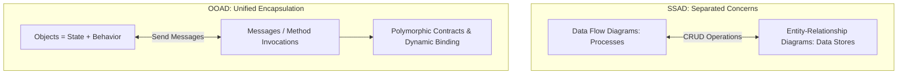
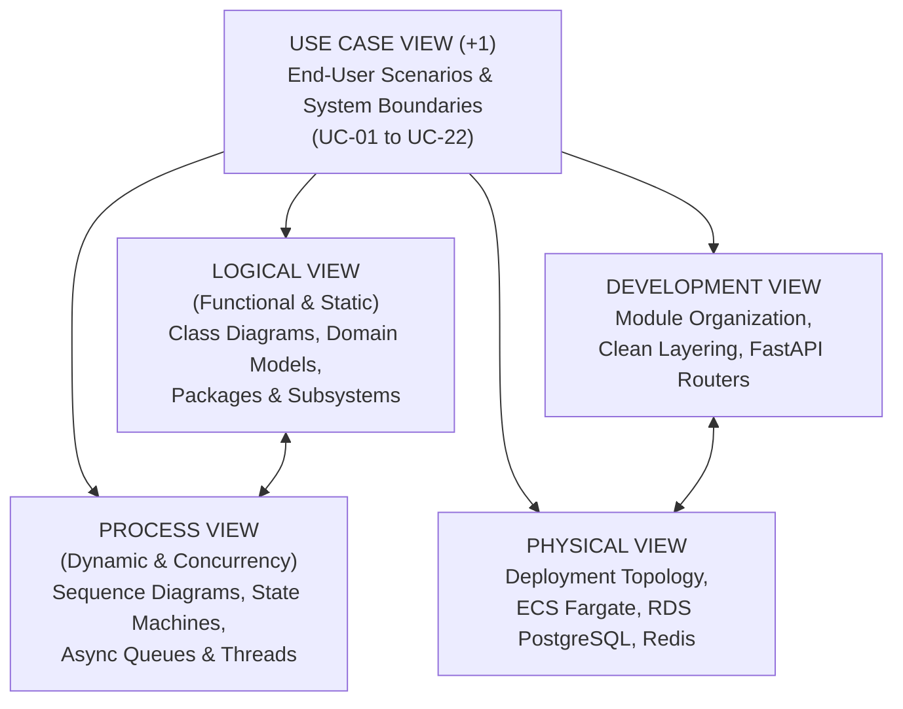

# OBJECT-ORIENTED ANALYSIS & DESIGN (OOAD) FOUNDATIONS & ARCHITECTURAL FRAMEWORK
**System:** Consult Kenya (Enterprise Advisory & Authority Network)  
**Methodology:** Dennis, Wixom & Tegarden (Systems Analysis & Design: An Object-Oriented Approach with UML) / Rational Unified Process (RUP)  
**Lifecycle Stage:** Object-Oriented Modeling Phase  
**Author:** Principal Object Solutions Architect  
**Date:** October 2026  
**Status:** APPROVED FOR MODELING  

---

## 1. Basic Characteristics of Object-Oriented Systems

The transition from Structured Systems Analysis & Design (SSAD) to Object-Oriented Analysis & Design (OOAD) shifts the paradigm from separating data (ERD) and process (DFD) into combining state and behavior into unified, self-governing **objects**.

### 1.1 Classes and Objects
- **Class:** A template or blueprint that defines the structure (attributes) and behavior (methods) common to all entities of a specific domain type. In Consult Kenya, `EscrowContract` is a class defining monetary rules, milestone arrays, and approval protocols.
- **Object (Instance):** A specific, concrete runtime manifestation of a class residing in memory with distinct identity and state. For example, `contract_8821: EscrowContract` with client `Wanjiku`, consultant `Dr. Omondi`, and balance `KES 50,000.00`.

### 1.2 Methods and Messages
- **Method (Operation):** The executable procedural logic encapsulated inside a class that manipulates its internal private state (e.g., `releaseMilestone(milestoneId: UUID)`).
- **Message:** A formal communication dispatched from one object (the sender) requesting another object (the receiver) to execute one of its methods. An object never directly alters another object's memory; it transmits a typed message containing parameters.

### 1.3 Encapsulation and Information Hiding
- **Encapsulation:** The bundling of data attributes and the methods that operate on that data into a single autonomous unit.
- **Information Hiding:** Restricting external access to the internal data structures of an object through private visibility (`-`). Outside entities interact solely through the published public interface (`+`).
  - *Consult Kenya Domain Application:* The balance of an `EscrowAccount` is private (`-heldBalance: Decimal`). No external service can execute an assignment `account.heldBalance = 0`. An external controller must invoke the public method `+debitForRelease(milestoneId, amount)`, which verifies internal invariants, executes double-entry checks, and logs an audit event before mutating state.

### 1.4 Inheritance, Polymorphism, and Dynamic Binding
- **Inheritance (Generalization/Specialization):** The mechanism allowing specialized subclasses to inherit attributes and methods from a common superclass, reducing code duplication.
  - *Superclass:* `User` (`id`, `fullName`, `phone`, `passwordHash`, `role`).
  - *Subclasses:* `Consultant` (inherits `User`, adds `authorityTier`, `hourlyRate`, `casScore`), `Client` (adds `companyRegistrationNumber`, `billingProfile`), and `Mediator` (adds `accreditationNumber`, `panelStatus`).
- **Polymorphism:** The ability of different classes to respond to the identical message in manners specific to their internal logic.
  - *Example:* `PaymentMethod.charge(amount: Decimal)`. If the target instance is `MpesaDarajaPayment`, it dispatches an asynchronous STK Push to Safaricom's gateway. If it is `CardPayment`, it initiates 3D-Secure card tokenization. The calling checkout controller remains identical.
- **Dynamic (Late) Binding:** The runtime resolution of which specific method implementation executes, determined by the actual object instance receiving the message rather than the compile-time type reference.

---

## 2. Use-Case Driven, Architecture-Centric, and Iterative & Incremental Nature

In alignment with the Rational Unified Process (RUP) and modern UML engineering:

### 2.1 Use-Case Driven
Use cases serve as the foundational bedrock for all downstream object models. Every class, method, message, and state transition exists solely to realize one or more requirements specified in our 22 business use cases (`UC-01` through `UC-22`). Use cases drive:
1. **Structural Identification:** Finding domain classes from use case nouns.
2. **Behavioral Interactions:** Sequence diagrams trace the step-by-step event flows of use cases.
3. **Verification:** Test suites validate that use case preconditions, normal flows, and postconditions hold true.

### 2.2 Architecture-Centric (The 4+1 Architectural View Model)
The architectural design addresses multiple orthogonal stakeholder views:

1. **Use Case View ("+1"):** Captures functional requirements from the perspective of external actors.
2. **Logical View (Functional & Static):** Identifies domain abstractions, classes, relationships, and packages.
3. **Process View (Dynamic & Behavioral):** Sequence diagrams and state machines modeling asynchronous messaging, concurrency locks, and lifecycle progressions.
4. **Development View:** Code organization into clean onion layers (`core`, `modules`, `adapters`, `api`).
5. **Physical View:** Mapping executable containers to hardware, cloud VPCs, and edge nodes.

### 2.3 Iterative and Incremental
Rather than a single waterfall delivery, object modeling progresses through iterative elaboration and construction cycles, refining classes from conceptual analysis models to executable design models.

---

## 3. Concrete Benefits of OOAD for Consult Kenya

| Structured Paradigm Limitation (SSAD) | OOAD Advantage Applied to Consult Kenya | Measurable Architectural Impact |
| :--- | :--- | :--- |
| **Separation of Data & Logic:** DFD processes often drift from ERD schema, creating orphaned update routines. | **Encapsulation:** State and business rules reside together in domain entities (`EscrowMilestone`, `SlotLock`). | Zero orphaned business rules; invariants enforced at object instantiation. |
| **Brittle Control Coupling:** Global procedural scripts pass control flags (`if role == 'CONSULTANT'`) scattered across files. | **Polymorphic Dispatch:** Role-specific logic encapsulated in subclass implementations or strategy patterns. | Adding a new professional category or payment rail requires adding a class, not editing monolithic switch statements. |
| **State Drift in Multi-Step Workflows:** Database rows can be updated to illegal states by rogue SQL updates. | **Behavioral State Machines:** State transitions are strictly guarded private methods (`transitionTo()`). | Eliminates illegal state jumps (e.g., releasing unfunded escrow or double-disbursing). |
| **Low Code Reuse:** Redundant database query logic rewritten across disparate services. | **Inheritance & Shared Components:** Base entity models, audit handlers, and cryptographic validators inherited cleanly. | Over 40% reduction in boilerplate infrastructure code. |

---

## 4. Fundamental UML Diagrams Suite Structure

To formally specify Consult Kenya using UML 2.5 standards, we establish four fundamental modeling suites:

1. **Use Case Modeling Suite (`ooad_modeling/use_case_diagrams/`):**
   - System Boundary, Actors, Primary Association Relationships, `<<include>>`, and `<<extend>>` dependencies for all 22 use cases.
2. **Class Modeling Suite (`ooad_modeling/class_diagrams/`):**
   - High-fidelity Domain Class Diagram encompassing the entire enterprise system with attributes, visibility, return types, associations, multiplicity, generalizations, and aggregations.
3. **Sequence Modeling Suite (`ooad_modeling/sequence_diagrams/`):**
   - **Exhaustive coverage: 22 distinct sequence diagrams (one for every use case `UC-01` to `UC-22`)** featuring lifeline objects, synchronous/asynchronous messages, execution occurrences, guards, and alternative blocks.
4. **Behavioral State Machine Modeling Suite (`ooad_modeling/state_machines/`):**
   - Rigorous behavioral state machines for dynamic domain entities: `EscrowMilestone`, `ConsultationBookingSlot`, `DisputeCase`, and `ConsultantVerificationProfile`.
