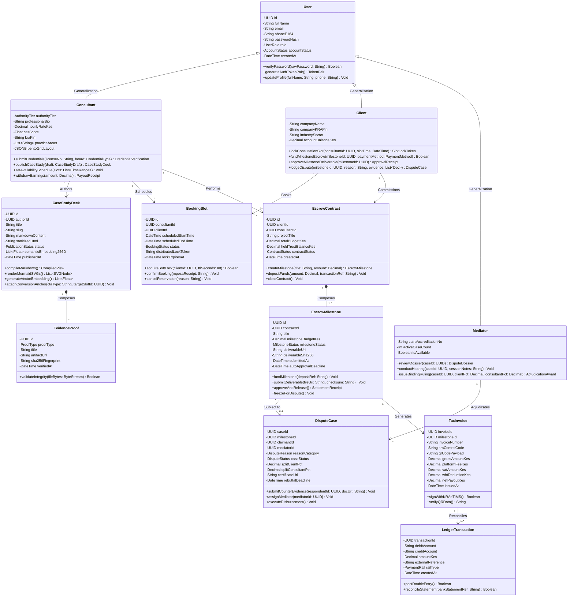

# ENTERPRISE DOMAIN CLASS DIAGRAM SPECIFICATION
**System:** Consult Kenya (Enterprise Advisory & Authority Network)  
**Standard:** UML 2.5 (Class Modeling)  
**Lifecycle Stage:** Object-Oriented Analysis & Design  
**Author:** Principal Object Solutions Architect  
**Date:** October 2026  

---

## 1. Domain Class Architecture & Design Principles

The Consult Kenya domain model is architected following **Domain-Driven Design (DDD)** and Object-Oriented principles:
- **Entity Abstractions:** Domain classes with distinct identity (`User`, `ConsultantProfile`, `CaseStudyDeck`, `BookingSlot`, `EscrowContract`, `EscrowMilestone`, `DisputeCase`, `LedgerTransaction`).
- **Encapsulated Invariants:** Methods enforce valid business logic transitions. Attribute mutations are strictly private (`-`) and accessed through public (`+`) typed operations.
- **Inheritance Hierarchies:** A generalized `User` base class specialized into `Consultant`, `Client`, and `Mediator`.
- **Composition & Aggregation:** An `EscrowContract` **composes** multiple `EscrowMilestone` instances (milestones cannot exist without a contract). A `CaseStudyDeck` **aggregates** `EvidenceProof` items.

---

## 2. High-Level UML Class Diagram

---

## 3. Class Specifications (Attributes & Operations Detail)

### 3.1 Class `User` (Abstract Domain Model)
- **Attributes:**
  - `- id: UUID`: Unique uniform identifier (UUIDv7 timestamp-ordered).
  - `- fullName: String`: Legal name verified against government records.
  - `- email: String`: Primary contact and notification address.
  - `- phoneE164: String`: Kenyan mobile subscriber number (`+2547XXXXXXXX`).
  - `- passwordHash: String`: Salted Argon2id / PBKDF2 cryptographic digest.
  - `- role: UserRole`: Enumerated privilege (`CLIENT`, `CONSULTANT`, `MEDIATOR`, `ADMIN`).
  - `- accountStatus: AccountStatus`: Active, suspended, or pending verification.
- **Operations:**
  - `+ verifyPassword(rawPassword: String): Boolean`: Constant-time hash comparison.
  - `+ generateAuthTokenPair(): TokenPair`: Issues HMAC-SHA256 JWT access and refresh tokens.

### 3.2 Class `Consultant` (Specialization of `User`)
- **Attributes:**
  - `- authorityTier: AuthorityTier`: `TIER_1_EMERGING`, `TIER_2_ESTABLISHED`, `TIER_3_AUTHORITY`.
  - `- hourlyRateKes: Decimal`: Hourly consultation tariff in Kenya Shillings.
  - `- casScore: Float`: Dynamic Creator Authority Score (0.0 to 1000.0).
  - `- kraPin: String`: Verified 11-character taxpayer PIN (`A012345678W`).
  - `- bentoGridLayout: JSONB`: Visual portfolio cards and evidence widgets.
- **Operations:**
  - `+ submitCredentials(licenseNo: String, board: CredentialType): CredentialVerification`: Queries statutory registry APIs (LSK, ICPAK, EBK) and auto-upgrades authority tier upon verification.
  - `+ publishCaseStudy(draft: CaseStudyDraft): CaseStudyDeck`: Triggers Markdown parsing, Mermaid SVG compilation, and 256-dim embedding generation.

### 3.3 Class `EscrowMilestone` (Component of `EscrowContract`)
- **Attributes:**
  - `- id: UUID`: Primary milestone identifier.
  - `- milestoneBudgetKes: Decimal`: Cent-precise milestone financial allocation.
  - `- milestoneStatus: MilestoneStatus`: `PENDING_FUNDING`, `FUNDED_LOCKED`, `SUBMITTED`, `APPROVED_RELEASED`, `REVISIONS_REQUESTED`, `FROZEN_DISPUTE`.
  - `- deliverableSha256: String`: Cryptographic checksum of delivered work.
  - `- autoApprovalDeadline: DateTime`: Timestamp 72 hours post-submission.
- **Operations:**
  - `+ fundMilestone(depositRef: String): Void`: Transitions state to `FUNDED_LOCKED` upon verified M-Pesa receipt.
  - `+ submitDeliverable(fileUri: String, checksum: String): Void`: Locks deliverable payload, starts 72-hour auto-approval clock.
  - `+ approveAndRelease(): SettlementReceipt`: Computes 7% platform fee, 5% WHT, 16% VAT, executes ledger entries, and triggers Safaricom B2C payout.

### 3.4 Class `TaxInvoice` (KRA Fiscal Entity)
- **Attributes:**
  - `- invoiceNumber: String`: Sequential unique electronic tax invoice ID.
  - `- kraControlCode: String`: Cryptographic fiscal signature from KRA OSCU.
  - `- qrCodePayload: String`: Official KRA URL verification string.
  - `- platformFeeKes: Decimal`: 7% gross commission.
  - `- vatAmountKes: Decimal`: 16% VAT assessed on platform fee.
  - `- whtDeductionKes: Decimal`: 5% statutory professional Withholding Tax.
  - `- netPayoutKes: Decimal`: Net disbursed consultant balance.
- **Operations:**
  - `+ signWithKRAeTIMS(): Boolean`: Communicates with eTIMS fiscal control unit.
  - `+ verifyQRData(): String`: Returns scannable public tax validation link.
