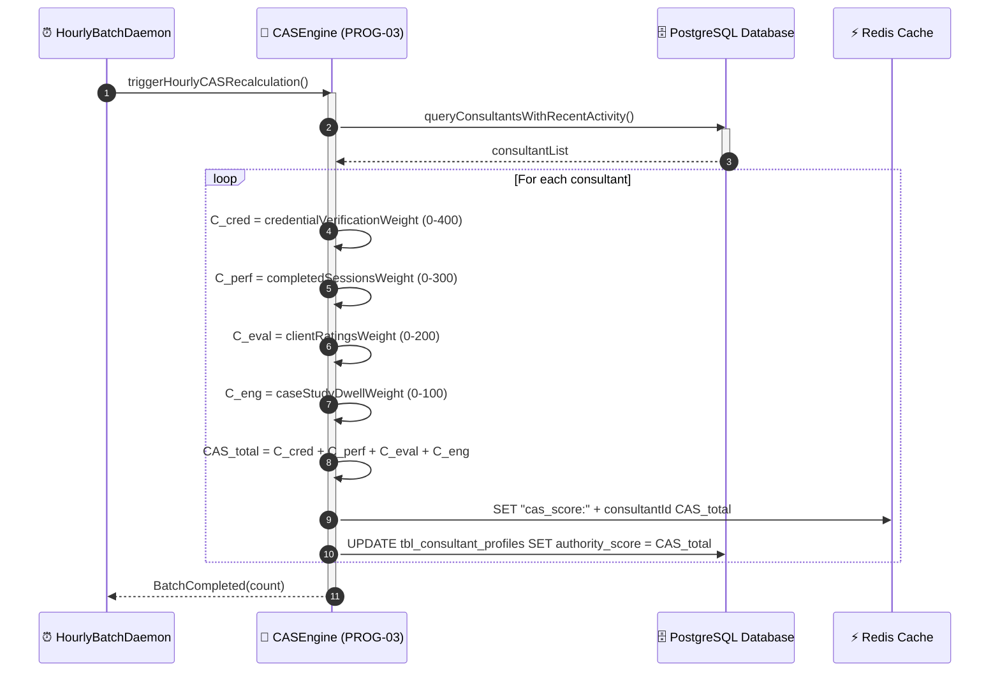

# Sequence Diagram: SQ_UC17 — Calculate Creator Authority Score (CAS)
**System:** Consult Kenya (Enterprise Advisory & Authority Network)  
**Standard:** UML 2.5 Sequence Modeling  
**Associated Use Case:** `UC17`  
**Author:** Principal Object Solutions Architect  
**Date:** October 2026  

---

## 1. Interaction Overview & Lifelines
- **Primary Actor:** Initiating user or scheduled daemon trigger.
- **Boundary / UI:** Web interface or modal dialogue receiving keystrokes and rendering feedback.
- **Control / Domain Services:** Orchestrates business invariants and invokes algorithms.
- **Entity / Persistence:** Persistent relational data stores, Redis caches, and S3 vaults.
- **External Gateways:** Third-party integrations (Safaricom Daraja, KRA eTIMS, LiveKit SFU).

---

## 2. UML Sequence Diagram

---

## 3. Message Sequence Table & Operational Descriptions
1. **Message Invariants:** All requests carry typed DTO parameters and are validated at boundary.
2. **Asynchronous Execution:** Background jobs (e.g. Celery CAS recalculation, Daraja callbacks) operate non-blocking.
3. **Transactional Guarantees:** Financial ledger state mutations execute within atomic, serializable database transactions.
