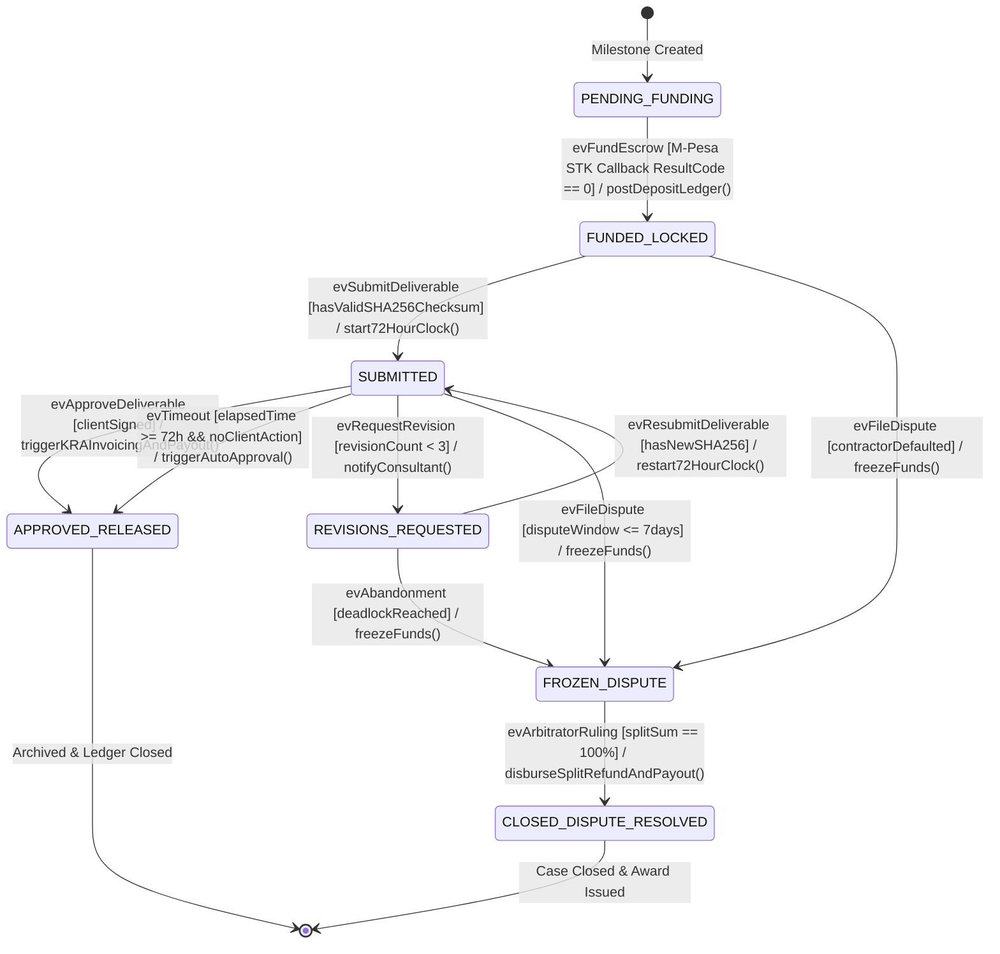
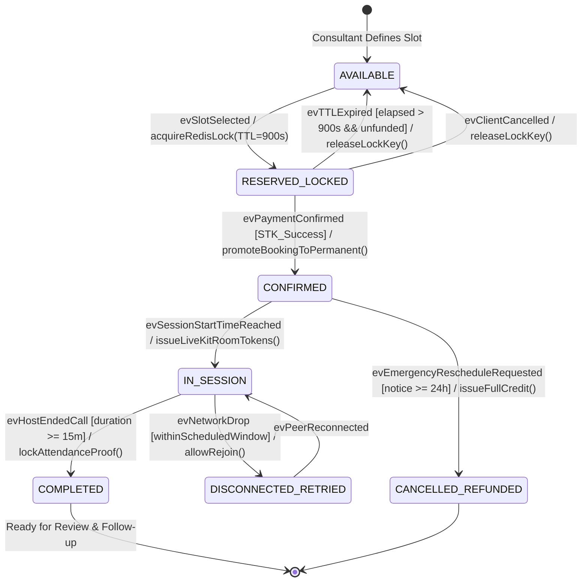
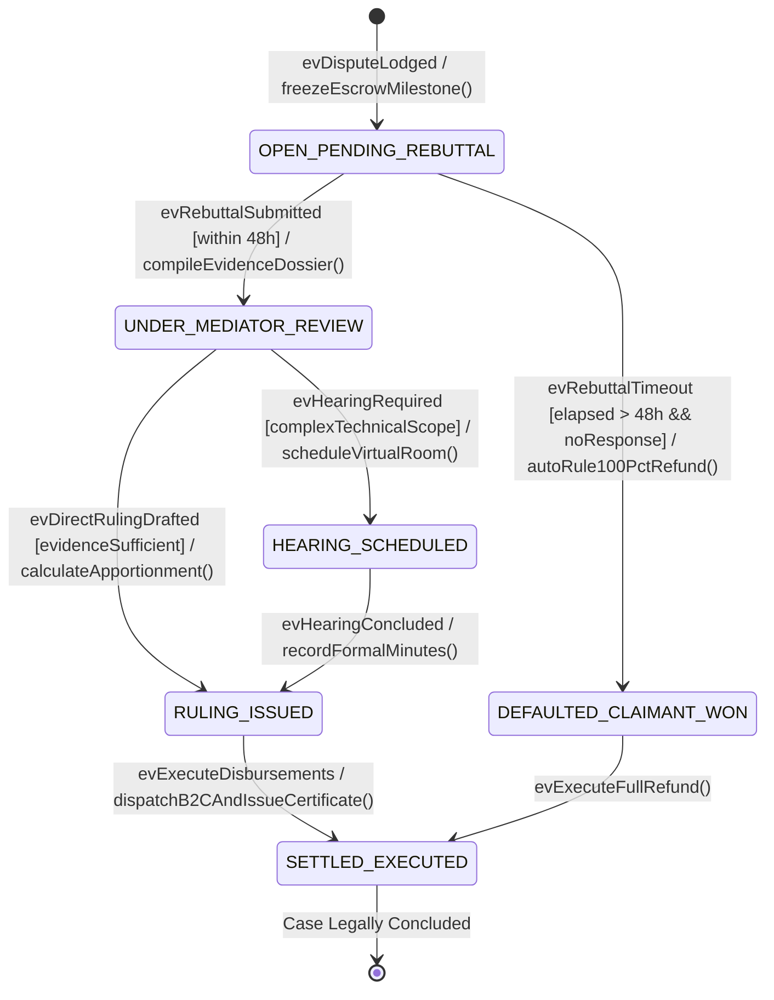
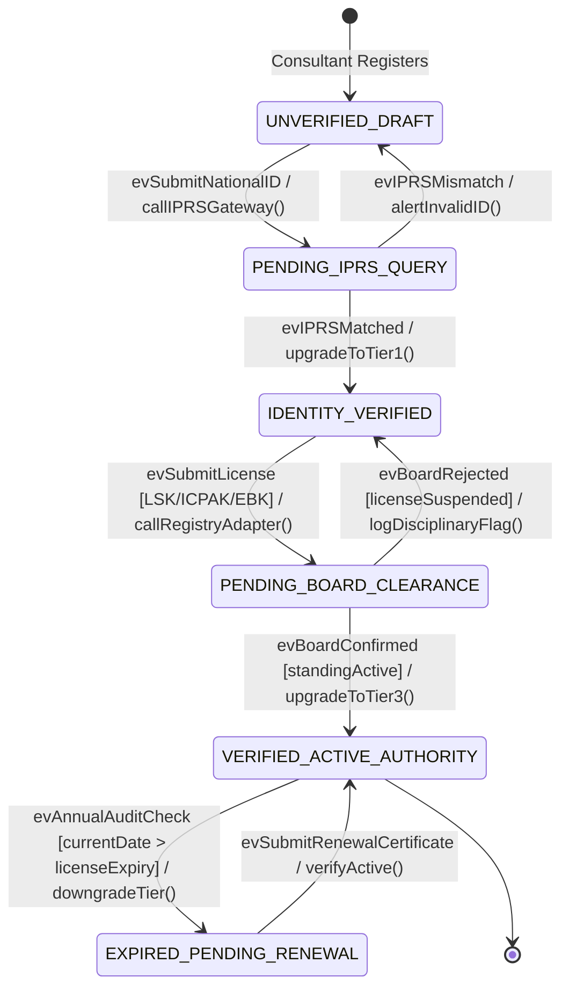

# BEHAVIORAL STATE MACHINE MODELING & LIFECYCLE SPECIFICATION
**System:** Consult Kenya (Enterprise Advisory & Authority Network)  
**Standard:** UML 2.5 Behavioral State Machines  
**Methodology:** Dennis, Wixom & Tegarden (Behavioral State Modeling)  
**Lifecycle Stage:** Object-Oriented Analysis & Design  
**Author:** Principal Object Solutions Architect  
**Date:** October 2026  

---

## 1. What is a Behavioral State Machine? (Concepts & Elements Explained)

A **Behavioral State Machine** models the dynamic lifecycle of a single reactive object as it moves through various **states** in response to external **events**, executing internal **actions** and enforcing **guard conditions**.

### 1.1 Core Elements of a State Machine:
1. **State:** A condition or situation during the life of an object during which it satisfies some condition, performs some activity, or waits for some event. Represented as a rounded rectangle.
   - *Initial Pseudostate:* A filled black circle (`(*)`) indicating where the lifecycle starts upon instantiation.
   - *Final State:* A bullseye (`(( ))`) indicating object termination or archival.
2. **Transition:** A relationship between two states indicating that an object in the first state will enter the second state when a specified event occurs and specified conditions are satisfied.
   - Formally written as: `Trigger [Guard] / Action`
3. **Event (Trigger):** A stimulus that can trigger a state transition (e.g., `MpesaCallbackReceived`, `DeliverableUploaded`, `TimerExpired_72h`).
4. **Guard Condition:** A boolean expression enclosed in square brackets `[Guard]` that must evaluate to `TRUE` for the transition to fire (e.g., `[paymentAmount == milestoneBudget]`).
5. **Action:** An atomic, non-interruptible computation executed during a transition or upon state entry/exit (e.g., `/ postLedgerEntry()`, `/ notifyParties()`).

---

## 2. Primary Domain State Machine: `EscrowMilestone` Lifecycle

The `EscrowMilestone` entity represents the highest financial risk in Consult Kenya. It strictly implements the state transitions codified in backend module `PROG-06`:

### 2.1 State Transition Table: `EscrowMilestone`

| Current State | Event Trigger | Guard Condition | Target State | Executed Action |
| :--- | :--- | :--- | :--- | :--- |
| **`PENDING_FUNDING`** | `evFundEscrow` | `[ReceiptValid && Amount == Budget]` | `FUNDED_LOCKED` | Posts double-entry credit to `CLIENT_DEPOSIT_LIABILITY`. |
| **`FUNDED_LOCKED`** | `evSubmitDeliverable` | `[fileChecksum != null]` | `SUBMITTED` | Persists S3 artifact hash; starts 72h auto-approval clock. |
| **`FUNDED_LOCKED`** | `evFileDispute` | `[milestonePassedDueDate]` | `FROZEN_DISPUTE` | Locks funds against unilateral withdrawal. |
| **`SUBMITTED`** | `evApproveDeliverable`| `[caller == Client]` | `APPROVED_RELEASED` | Deducts 7% fee + 5% WHT; triggers KRA eTIMS & M-Pesa B2C payout. |
| **`SUBMITTED`** | `evTimeout_72h` | `[noClientResponse && elapsed >= 72h]` | `APPROVED_RELEASED` | Auto-approves deliverable; dispatches funds. |
| **`SUBMITTED`** | `evRequestRevision` | `[revisions < 3]` | `REVISIONS_REQUESTED` | Pauses 72h clock; opens feedback thread for consultant. |
| **`SUBMITTED`** | `evFileDispute` | `[timeSinceDelivery <= 7 days]` | `FROZEN_DISPUTE` | Freezes escrow; prompts consultant for 48h counter-rebuttal. |
| **`REVISIONS_REQUESTED`**| `evResubmitDeliverable`| `[newChecksum != oldChecksum]` | `SUBMITTED` | Restarts 72h inspection clock. |
| **`FROZEN_DISPUTE`** | `evArbitratorRuling` | `[clientPct + consultantPct == 100%]`| `CLOSED_DISPUTE_RESOLVED`| Dispatches split refunds via B2C; issues sealed award PDF. |

---

## 3. Secondary Domain State Machine: `BookingSlot` Lifecycle

Governs the distributed reservation lock and appointment lifecycle (`PROG-04`):

---

## 4. Tertiary Domain State Machine: `DisputeCase` Arbitration Lifecycle

Governs formal arbitration proceedings between clients, consultants, and chartered arbitrators (`PROG-08`):

---

## 5. Quaternary Domain State Machine: `ConsultantVerificationProfile`

Governs statutory credentials, IPRS checks, and authority tier promotion (`PROG-01`):

