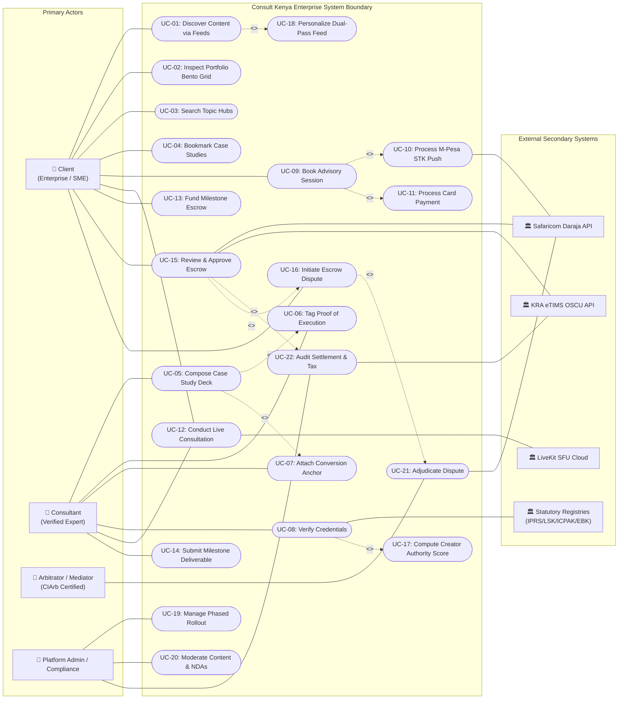

# USE CASE DIAGRAM SPECIFICATION & SYSTEM BOUNDARY MODEL
**System:** Consult Kenya (Enterprise Advisory & Authority Network)  
**Standard:** UML 2.5 / Rational Unified Process (RUP)  
**Lifecycle Stage:** Object-Oriented Analysis & Design  
**Author:** Principal Object Solutions Architect  
**Date:** October 2026  

---

## 1. System Boundary & Actor Taxonomy

### 1.1 Primary & Supporting Actors
- **Client (Enterprise / SME Seeker):** Searches authority content, reviews verified profiles, books advisory sessions, funds milestone escrows via M-Pesa, attends WebRTC sessions, approves deliverables, and lodges disputes.
- **Consultant (Verified Authority Creator):** Composes rich case-study briefs, uploads proof of execution, synchronizes advisory availability, conducts live advisory video calls, delivers work packages, and receives net mobile disbursements.
- **Mediator / Arbitrator (CIArb Panelist):** Reviews conflicting dispute evidence dossiers, conducts formal arbitration, issues binding awards, and allocates escrow split funds.
- **Compliance Officer / Administrator:** Verifies professional certificates, moderates published briefs for NDA/confidentiality compliance, and oversees statutory reporting.
- **External Secondary Systems (Gateways):**
  - **`Safaricom Daraja Gateway`**: Lipa Na M-Pesa STK Push and B2C mobile payouts.
  - **`KRA eTIMS OSCU System`**: Electronic fiscal device signing, QR generation, and withholding tax validation.
  - **`Statutory Registries (IPRS, LSK, ICPAK, EBK)`**: National population database and professional license registries.
  - **`LiveKit SFU Cloud`**: WebRTC media routing, selective forwarding, and call encryption.

---

## 2. High-Level Enterprise Use Case Diagram (System Boundary)

---

## 3. Detailed Subsystem Breakdown & Relationship Dictionary

| Subsystem Group | Primary Use Cases | Actors Involved | Key `<<include>>` and `<<extend>>` Relationships |
| :--- | :--- | :--- | :--- |
| **1. Authority Discovery & Feeds** | `UC-01`, `UC-02`, `UC-03`, `UC-04`, `UC-18` | Client, System Daemon | `UC-01` **includes** `UC-18` (Every feed query automatically invokes two-pass algorithmic personalization & CAS re-ranking). |
| **2. Creation Studio & Credentials** | `UC-05`, `UC-06`, `UC-07`, `UC-08`, `UC-17` | Consultant, Admin, Statutory Registries | `UC-05` **includes** `UC-06` (Case studies require verified execution evidence); `UC-05` is **extended by** `UC-07` (Optional conversion anchor / consultation call-to-action). `UC-08` **includes** `UC-17` (Verification recalculates CAS). |
| **3. Booking & Live Consultations** | `UC-09`, `UC-10`, `UC-11`, `UC-12` | Client, Consultant, Safaricom Daraja, LiveKit | `UC-09` **includes** `UC-10` (Booking default checkout path is M-Pesa STK Push); `UC-09` is **extended by** `UC-11` (Optional card payment fallback). |
| **4. Milestone Escrow & Delivery** | `UC-13`, `UC-14`, `UC-15` | Client, Consultant, KRA, Safaricom Daraja | `UC-15` **includes** `UC-22` (Milestone release automatically generates eTIMS invoice, deducts WHT, and executes ledger settlement). |
| **5. Dispute Arbitration & Governance**| `UC-16`, `UC-21`, `UC-20`, `UC-19`, `UC-22` | Client, Consultant, Arbitrator, Admin | `UC-15` is **extended by** `UC-16` (Client rejects deliverable and raises dispute); `UC-16` **includes** `UC-21` (Dispute creation triggers mediator assignment and adjudication). |
