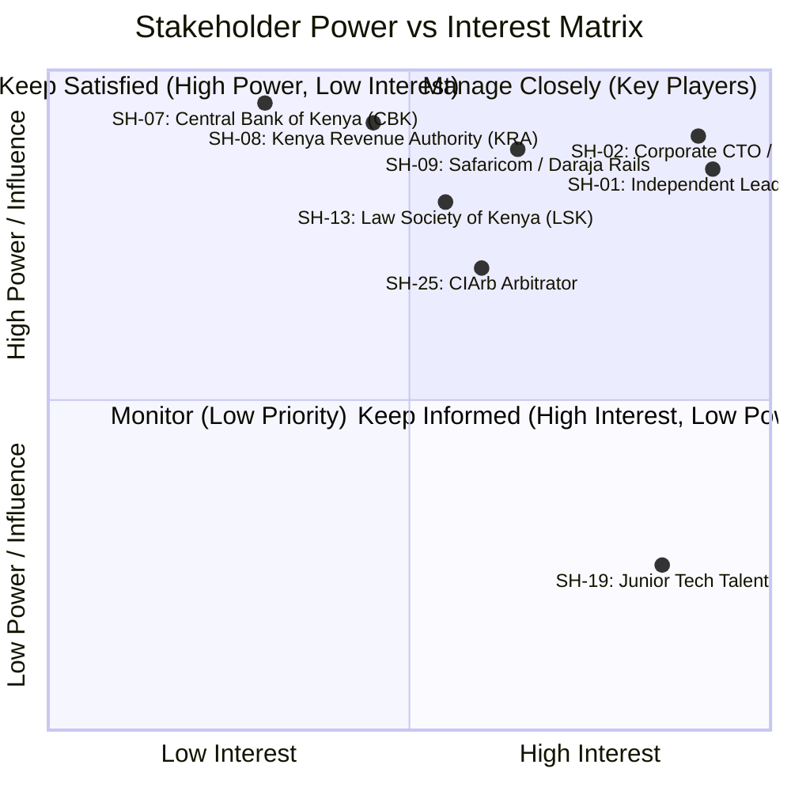

# Comprehensive Project Stakeholder Analysis Matrix
*System: Consult Kenya (Visual-First Professional Advisory & Authority Network)*
*Grounded in RAG Knowledge Cards `CARD-001` through `CARD-010` and Industry Best Practice*

---

## 1. Stakeholder Classification Framework
To ensure complete multi-sided ecosystem coverage, stakeholders are classified into five strategic tiers across an Influence vs. Interest Power Matrix:
1. **Primary Internal & Direct Users**: Direct consumers and creators who interact daily with the platform.
2. **Enterprise & Corporate Buyers**: Organizational procurement, finance, and executive buyers.
3. **Regulatory, Statutory & Legal Bodies**: Government registries, tax authorities, and professional licensing boards.
4. **Financial & Infrastructure Partners**: Mobile network operators, payment aggregators, and cloud providers.
5. **Tertiary & Community Influencers**: Industry associations, academic institutions, and peer networks.

---

## 2. Master Matrix of 30 Distinct Stakeholder Types

| ID | Stakeholder Type & Role | Category | Demographics & Characteristics | Primary Drivers & Strategic Goals | Preferred Contact Channel | Key Information to Elicit |
| :--- | :--- | :---: | :--- | :--- | :--- | :--- |
| **SH-01** | **Independent Software Architect** | Primary | Age 28–42, BSc/MSc CompSci, 7–15 yrs exp, Nairobi tech ecosystem. | High-value inbound advisory client acquisition; proof of code execution; instant M-Pesa payouts. | GitHub, Twitter/X, Tech Slack communities, direct referral. | Preferred visual deck structures; acceptable platform take rate (5–8%); typical consulting hourly rates. |
| **SH-02** | **Enterprise CTO / Tech VP** | Enterprise | Age 38–55, Executive MBA, manages KES 50M+ IT budget, banking/telco. | Rapid vetting of external audit competence; avoiding unqualified boutique firms; de-risking vendor contracts. | Executive LinkedIn, CIO East Africa summits, direct corporate email. | Diligence criteria before signing; willingness to use escrow vaults; vendor onboarding procurement hurdles. |
| **SH-03** | **Advocate of High Court of Kenya** | Primary | Age 30–50, LLB, Post-grad Dip KSL, active LSK practicing roll. | Showcasing specialized corporate/tax compliance frameworks without breaking LSK anti-touting rules. | LSK CPD seminars, WhatsApp legal groups, legal firm email. | LSK advertising regulations compliance; preferred fee arrangements (retainers vs fixed); dispute arbitration terms. |
| **SH-04** | **Corporate General Counsel** | Enterprise | Age 40–60, Senior legal counsel, Tier-1 bank/corporation. | Engaging vetted external specialists for niche regulatory filings; maintaining strict confidentiality/NDAs. | Corporate legal networks, private advisory channels. | Enterprise NDA takedown SLA expectations; invoice requirements; corporate PO workflows. |
| **SH-05** | **Certified Public Accountant (CPA-K)**| Primary | Age 32–48, BCom/BBA, ICPAK registered member, tax specialist. | Generating inbound clients for complex corporate restructuring, transfer pricing, and KRA audits. | ICPAK branch meetings, LinkedIn, financial webinars. | Common KRA audit pitfalls; average corporate retainer budgets; eTIMS integration needs. |
| **SH-06** | **Corporate Chief Financial Officer** | Enterprise | Age 42–60, Fellow CPA/ACCA, executive corporate leadership. | Statutory tax compliance; verifying eTIMS VAT invoices; mitigating vendor non-performance risk. | Board meetings, CFO forum, corporate finance office. | VAT deduction requirements; acceptable payment rails (RTGS vs card); escrow account audit guarantees. |
| **SH-07** | **Central Bank of Kenya (CBK)** | Regulatory | Statutory financial regulator, National Payment System division. | Ensuring platform does not conduct unlicensed deposit-taking or unauthorized FX intermediation. | Formal legal gazette filings, regulatory sandbox unit. | Merchant of Record legal requirements; FX rate display rules; AML/CFT transaction reporting thresholds. |
| **SH-08** | **Kenya Revenue Authority (KRA)** | Regulatory | Government revenue authority, Domestic Taxes / eTIMS unit. | Ensuring automated generation of electronic fiscal receipts and deduction of 5% professional WHT. | eTIMS technical developer support, KRA Times Tower. | Real-time eTIMS API signing protocols; fiscal QR format requirements; monthly WHT remittance reporting. |
| **SH-09** | **Safaricom Daraja API Product Team** | Infrastructure| Telecom fintech engineers, M-Pesa Enterprise Services. | High transaction success rate on STK Push; API uptime compliance; webhook reliability. | Daraja developer portal, Safaricom B2B partner managers. | STK timeout retry guidelines; B2C mobile payout bulk limits; webhook IP whitelisting rules. |
| **SH-10** | **Payment Aggregator (Paystack/Flutter)**| Infrastructure| Regional fintech partner, card processing & tokenization. | Multi-currency processing volume; fraud prevention (3D-Secure); low chargeback ratios. | Partner Slack channels, dedicated account executive. | Cross-border FX settlement timelines; chargeback dispute procedures; CBK compliance warranties. |
| **SH-11** | **Office of Data Protection Commissioner**| Regulatory | Statutory authority enforcing Kenya Data Protection Act 2019. | Protecting citizen and corporate PII; local data residency; lawful processing of identity data. | ODPC portal, formal compliance audit filings. | Requirements for registering as Data Processor/Controller; cross-border data transfer rules; 48h erasure protocol. |
| **SH-12** | **Engineers Board of Kenya (EBK)** | Statutory | Statutory engineering regulatory body under Engineers Act 2011. | Ensuring only licensed Professional Engineers (PEng) claim professional consulting authority. | EBK secretariat, regional engineering conferences. | API or manual portal access for verifying PEng license status; disciplinary register access. |
| **SH-13** | **Law Society of Kenya (LSK)** | Statutory | Professional bar association established under LSK Act 2014. | Enforcing legal practice ethics; preventing unauthorized legal practice; regulating advocate fees. | LSK Secretariat, annual general meetings. | Boundaries between legal information carousels and formal advocate-client retainers; fee schedule rules. |
| **SH-14** | **Early-Stage Tech Startup Founder** | Primary | Age 24–36, BSc, venture-backed or bootstrapped, Nairobi. | Sourcing specialized technical help (e.g., M-Pesa integration, AWS cloud audit) without expensive agency fees. | WhatsApp founder groups, iHub/Nailab events, Twitter. | Budget constraints for advisory calls; preference for instant M-Pesa booking; urgency of technical roadblocks. |
| **SH-15** | **SME Manufacturing Business Owner** | Enterprise | Age 45–65, Business diploma/degree, industrial SME in Industrial Area. | Finding practical supply-chain and ERP consultants who understand local Kenyan import/export realities. | Kenya Association of Manufacturers (KAM) forums, phone call. | Reluctance to use complex tech platforms; reliance on mobile payments; need for in-person meeting tokens. |
| **SH-16** | **Diaspora Investor / Business Buyer** | Enterprise | Age 35–55, Kenyan professional based in UK, US, or Gulf. | Hiring trusted local Kenyan legal and financial experts to audit land, construction, or tech investments. | Diaspora investment forums, Facebook diaspora groups, LinkedIn. | Cross-border card payment friction; requirement for escrow protection; time zone scheduling challenges. |
| **SH-17** | **Founding Consulting Agency Team** | Internal | Age 25–40, System architects and strategists (Mercy/Leah). | Establishing brand prestige during Phase 1; validating unit economics; capturing inbound enterprise leads. | Daily internal standups, project Slack/GitHub. | Minimum gross margins (KES 37–45/deal); daily capacity caps; friction in composing visual case studies. |
| **SH-18** | **Phase 2 Founding Cohort Creators** | Primary | Age 30–45, Elite specialists in Law, Tax, Dev, invited via code. | Early platform access; direct feedback on Creation Studio; high early algorithmic distribution. | Direct 1-on-1 Zoom interviews, exclusive founder dinner. | Friction in Creation Studio templates; feedback on CAS weighting; willingness to co-author with clients. |
| **SH-19** | **Junior Developer / Student Apprentice**| Tertiary | Age 20–25, CS student at UoN, Strathmore, JKUAT. | Learning real-world system architectures from verified case studies; finding senior mentors. | Tech Twitter, university developer clubs, campus meetups. | Demand for read-only access; mobile data cost sensitivity; eagerness to bookmark and share decks. |
| **SH-20** | **Enterprise Procurement Officer** | Enterprise | Age 32–50, CIPS certified, handles vendor prequalification. | Standardized Statement of Work (SOW) contracts; transparent pricing; vendor tax compliance documents. | Enterprise procurement portals, formal RFP submissions. | Prequalification criteria; requirements for PIN/CR12 documents; Net-14/Net-30 invoice settlement rules. |
| **SH-21** | **Escrow Mediator / CIArb Arbitrator** | Administrative| Age 40–65, Chartered Institute of Arbitrators fellow. | Clear, immutable evidence logs; fair dispute adjudication; enforceable digital settlement agreements. | CIArb Kenya secretariat, formal mediation portal. | Standard evidence requirements for technical deliverables; acceptable turnaround time for dispute rulings. |
| **SH-22** | **Cloud Infrastructure Provider (AWS/Supabase)**| Infrastructure| Cloud provider developer relations & architecture support. | Platform uptime, database performance, sub-50ms vector query execution. | Cloud management console, technical support tickets. | Database connection pooling constraints; RLS policy execution overhead; vector store RAM scaling. |
| **SH-23** | **Platform Customer Support Agent** | Internal | Age 22–32, Diploma/Degree, Nairobi customer operations. | Rapid resolution of STK push timeouts, booking rescheduling, and user credential inquiries. | Internal ticketing system, support dashboard. | Most common customer friction points; needed admin tooling for manual payment overrides. |
| **SH-24** | **Professional Services Boutique Partner**| Primary | Age 35–55, Managing partner of small 5-person consulting firm. | Multi-seat company profile (Phase 3); showcasing team credentials; managing inbound corporate inquiries. | Private executive breakfast meetings, LinkedIn outreach. | Multi-user role management needs; invoice branding requirements; custom domain white-labeling interest. |
| **SH-25** | **Intellectual Property Legal Auditor** | Regulatory | Specialized IP advocate / KIPI accredited agent. | Enforcing copyright, preventing case study plagiarism, and auditing client NDA takedown requests. | Formal legal notice portal, KIPI registry. | Plagiarism detection accuracy; dynamic watermarking efficacy; trade secret protection workflows. |
| **SH-26** | **Coworking & Boardroom Partner Space** | Operational | Operations manager at Nairobi coworking hubs (Nairobi Garage, Kofisi).| Driving revenue for physical meeting spaces; seamless verification of in-person consultation passes. | Partner BD meetings, site manager visits. | QR code scan validation for room access; hourly booking integration; cancellation notice requirements. |
| **SH-27** | **Competitor Professional Network (LinkedIn/Upwork)**| External | Global platforms operating in Kenya. | Monitoring market share; talent retention; enterprise spending. | Public market intelligence, industry reports. | Local pain points unaddressed by global giants (e.g., lack of M-Pesa escrow, lack of visual case studies). |
| **SH-28** | **Digital Forensics & Security Auditor** | Technical | CREST certified penetration tester / cybersecurity auditor. | Verifying RLS database isolation; testing WebRTC encryption; probing payment webhook tampering. | Scheduled penetration testing sprints, bug bounty reports. | Exploit vectors in multi-tenant schemas; vulnerabilities in distributed slot locks; API rate limit thresholds. |
| **SH-29** | **Kenya Private Sector Alliance (KEPSA)** | Community | Apex body of private sector businesses in Kenya. | Fostering local B2B commerce; SME digital transformation; professional skills discovery. | KEPSA trade committee, business roundtables. | Enterprise trust barriers toward independent consultants; policy advocacy for digital service taxation. |
| **SH-30** | **International Development Partner (World Bank/GIZ)**| Community | Program officer for African digital economy & SME innovation. | Increasing formal economic participation; expanding youth consulting employment; gender inclusion in tech. | Development conferences, grant proposals, formal workshops.| Impact metrics on consultant earnings; inclusion of female specialists; regional cross-border service trade data. |

---

## 3. Stakeholder Engagement & Governance Plan
* **Continuous Feedback Loops:** High-influence primary creators (`SH-01`, `SH-03`, `SH-05`) participate in bi-weekly Creation Studio feedback sessions.
* **Regulatory Compliance Sync:** Semi-annual formal audits with KRA (`SH-08`) and ODPC (`SH-11`) to validate automated eTIMS and privacy controls.
* **Enterprise Advisory Board:** Quarterly executive briefings with corporate CTOs and General Counsels (`SH-02`, `SH-04`, `SH-06`) to calibrate escrow terms and enterprise features.
