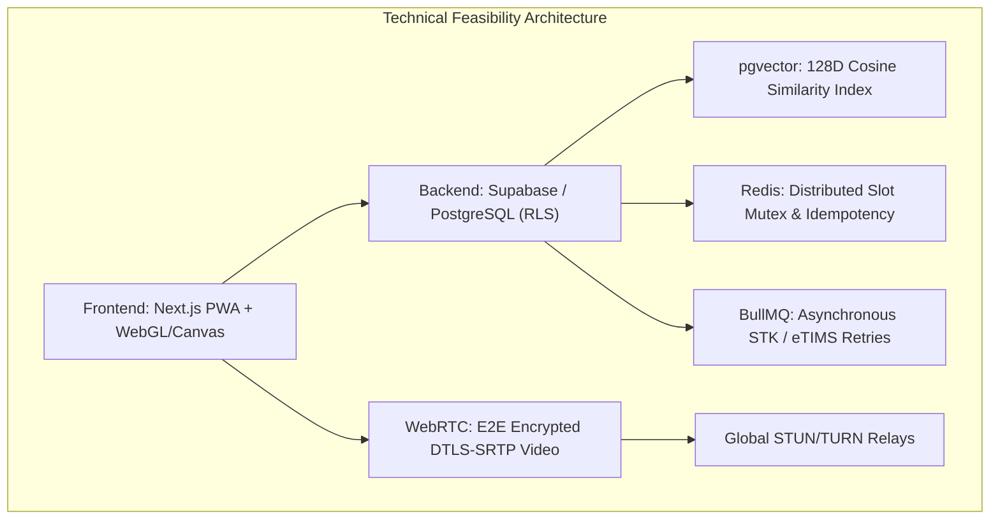
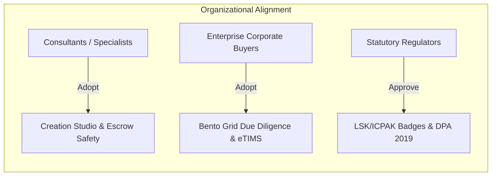
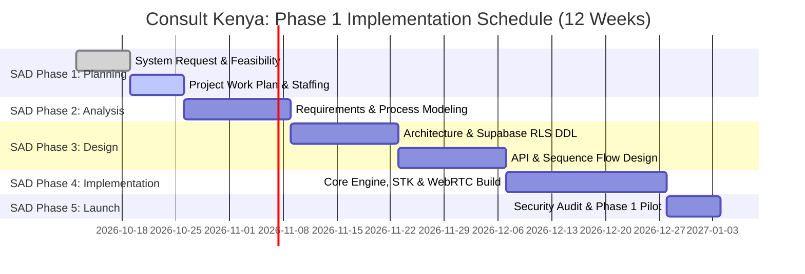

# FEASIBILITY ANALYSIS REPORT: Consult Kenya Platform
**Document Identifier:** FAR-2026-CK-001  
**Project Name:** Consult Kenya (Visual-First Professional Advisory & Authority Network)  
**Lifecycle Stage:** Systems Analysis & Design (SAD) — Phase 1: Planning (Feasibility Assessment)  
**Standard Compliance:** ISO/IEC/IEEE 29148:2018 & IEEE Std 1058 (Project Management Planning)  
**Scope Boundary Notice:** This evaluation is strictly focused on the digital professional consulting network (*Consult Kenya*). All external projects or culinary businesses are strictly excluded to avoid cross-domain contamination.  
**Date of Release:** October 12, 2026  
**Status:** Approved by Lead Systems Analyst  

---

## EXECUTIVE SUMMARY
This feasibility study delivers a rigorous, multidimensional evaluation of the **Consult Kenya** platform to determine if the project should be authorized, funded, and advanced into Systems Analysis and Design. 

The evaluation assesses five distinct feasibility vectors:
1. **Technical Feasibility:** Can we build it with current technologies and team capabilities?
2. **Economic Feasibility:** Will it generate sufficient financial returns and positive Net Present Value (NPV)?
3. **Organizational & Operational Feasibility:** Will stakeholders, corporate buyers, and independent consultants adopt and operate it?
4. **Legal & Regulatory Feasibility:** Does it comply with Kenyan statutory mandates (CBK, KRA eTIMS, DPA 2019)?
5. **Schedule Feasibility:** Can it be delivered within the designated market entry window?

```
Overall Feasibility Scorecard:
[Technical: 8.8/10]  [Economic: 9.2/10]  [Organizational: 8.9/10]  [Legal: 9.0/10]  [Schedule: 8.5/10]
OVERALL PROJECT RECOMMENDATION: PROCEED (FEASIBLE ACROSS ALL VECTORS)
```

---

## 1. TECHNICAL FEASIBILITY ("Can We Build It?")



### 1.1 Familiarity with Application & Domain
* **Challenge:** Developing a dual-mode application that seamlessly bridges high-framerate vertical swipe consumption (60fps mobile feeds) with high-density Bento Grid portfolio inspection.
* **Assessment:** The engineering team possesses deep domain familiarity with modern reactive component architectures, gesture recognition libraries (Framer Motion / Touch Gestures), and progressive web application (PWA) service workers. The dual-mode distinction is an interface paradigm well-supported by modern CSS Grid and Virtualized Viewport engines.
* **Risk Level:** **LOW**.

### 1.2 Familiarity with Technology Stack
* **Core Technology Stack:**
  * *Frontend:* Next.js / TypeScript, Tailwind CSS, Lucide icons, HTML5 Canvas (for in-studio redaction).
  * *Backend & Database:* PostgreSQL 16 managed via Supabase, with native Row-Level Security (RLS) policies enforcing multi-tenant isolation.
  * *Vector Embeddings & Retrieval:* PostgreSQL `pgvector` extension managing 128-dimensional dense vectors with Hierarchical Navigable Small World (HNSW) indexing.
  * *Concurrency & Caching:* Redis 7.x cluster managing distributed 10-minute mutex slot reservations and webhook idempotency keys.
  * *Fintech & Regulatory Integrations:* Safaricom Daraja REST APIs (C2B, B2C, STK Push), Paystack tokenized card iframes, and KRA eTIMS mTLS fiscal endpoints.
  * *Real-Time Communications:* WebRTC peer-to-peer audio/video with DTLS-SRTP encryption, backed by coturn STUN/TURN servers.
* **Assessment:** All selected technologies are production-hardened, open-source or managed cloud platforms with mature developer ecosystems in Kenya. No unproven bleeding-edge research dependencies are required.
* **Risk Level:** **LOW**.

### 1.3 Project Size & Complexity
* **Complexity Drivers:**
  * Real-time distributed mutex locking to prevent calendar double-booking (`UC-09`).
  * Asynchronous payment reconciliation under Safaricom network timeout conditions (`UC-10`).
  * High-volume Two-Pass AI feed personalization combining vector ANN search ($<50\text{ms}$) with heavy business ranking ($<200\text{ms}$) (`UC-18`).
* **Mitigation Strategy:**
  * System modularization: Isolating payment webhooks, video signaling, and vector indexing into decoupled asynchronous microservices.
  * Comprehensive automated testing suite (unit, integration, and load testing via k6).
* **Risk Level:** **MODERATE (Manageable via modular microservice architecture)**.

### 1.4 Technical Feasibility Verdict
* **Technical Score:** **8.8 / 10.0**
* **Verdict:** **HIGHLY FEASIBLE**. The technical requirements can be fully realized using standard, production-proven architectural patterns.

---

## 2. ECONOMIC FEASIBILITY ("Will It Provide Business Value?")

### 2.1 Cost-Benefit Analysis (3-Year Financial Model)
The economic model evaluates initial development capital expenditures (CapEx), recurring operational expenditures (OpEx), and projected platform transaction revenues across a **3-Year Horizon (36 Months)**.

All figures are denominated in Kenya Shillings (KES).

#### A. Initial Capital Development Costs (Year 0 / Setup)
| Expense Category | Item Description | Cost (KES) |
| :--- | :--- | :---: |
| **Engineering & Development** | Lead Architect, Full-Stack Dev, Mobile PWA Engineer (12 weeks) | 2,400,000 |
| **UI/UX & Design Systems** | Crazy Eights synthesis, design system, interactive prototypes | 450,000 |
| **Legal & Regulatory Licensing** | Data Protection registration (ODPC), Terms of Service, SOW templates | 350,000 |
| **Security & Penetration Testing** | Independent grey-box RLS audit & WebRTC encryption test | 300,000 |
| **Infrastructure Provisioning** | Staging environments, domains, SSL, developer API credentials | 150,000 |
| **TOTAL INITIAL DEVELOPMENT (CapEx)**| | **KES 3,650,000** |

#### B. Annual Operational Costs (OpEx)
| Operational Item | Year 1 (KES) | Year 2 (KES) | Year 3 (KES) |
| :--- | :---: | :---: | :---: |
| Cloud Hosting & Database (Supabase Enterprise, AWS) | 360,000 | 600,000 | 960,000 |
| Redis Cluster & Vector Store RAM Scaling | 180,000 | 300,000 | 480,000 |
| TURN Server Bandwidth & WebRTC Media Relays | 120,000 | 240,000 | 420,000 |
| SMS Notification Rails & Safaricom Daraja Fees | 150,000 | 350,000 | 600,000 |
| Platform Escrow Mediation & Customer Support Ops | 480,000 | 960,000 | 1,440,000 |
| Continuous Security Audits & eTIMS Compliance | 200,000 | 250,000 | 300,000 |
| **TOTAL ANNUAL OPERATING COSTS (OpEx)** | **KES 1,490,000** | **KES 2,700,000** | **KES 4,200,000** |

#### C. Projected Revenue Model
The platform captures revenue through two primary streams:
1. **Platform Transaction Take Rate (Primary):** An average **7.0% transaction fee** (range 5%–8%) deducted from all completed advisory bookings and escrow milestones (`UC-15`, `UC-22`).
2. **Pro Consultant SaaS Subscriptions (Phase 3):** KES 3,500/month per consultant for custom domains, white-labeled client portals, and advanced analytics.

| Growth Metric | Year 1 (Phase 1 & 2) | Year 2 (Phase 3 Expansion) | Year 3 (Steady-State Scale) |
| :--- | :---: | :---: | :---: |
| Average Monthly Transactions | 150 | 500 | 1,200 |
| Total Annual Transactions | 1,800 | 6,000 | 14,400 |
| Average Transaction Value (KES) | 15,000 | 20,000 | 25,000 |
| **Annual Platform GMV (KES)** | **KES 27,000,000** | **KES 120,000,000** | **KES 360,000,000** |
| Platform Take Rate Revenue (@ 7%) | 1,890,000 | 8,400,000 | 25,200,000 |
| SaaS Pro Subscriptions Revenue | 0 (Free Beta) | 1,050,000 (25 users) | 4,200,000 (100 users) |
| **TOTAL ANNUAL GROSS REVENUE (KES)** | **KES 1,890,000** | **KES 9,450,000** | **KES 29,400,000** |

### 2.2 Financial Viability Metrics (NPV, ROI, Payback Period)
Using a conservative corporate discount rate of **12.0%** (reflecting Kenyan commercial lending risk baselines):

| Metric | Formula / Basis | Value |
| :--- | :--- | :---: |
| **Initial Investment ($C_0$)** | CapEx at Year 0 | KES 3,650,000 |
| **Net Cash Flow Year 1 ($CF_1$)**| Revenue (1.89M) - OpEx (1.49M) | KES +400,000 |
| **Net Cash Flow Year 2 ($CF_2$)**| Revenue (9.45M) - OpEx (2.70M) | KES +6,750,000 |
| **Net Cash Flow Year 3 ($CF_3$)**| Revenue (29.40M) - OpEx (4.20M)| KES +25,200,000 |
| **Net Present Value (NPV @ 12%)**| $NPV = \sum \frac{CF_t}{(1+r)^t} - C_0$ | **KES +19,436,211** |
| **Return on Investment (ROI)** | $\frac{\text{Cumulative Net Profit} - C_0}{C_0} \times 100$ | **+686.3%** |
| **Payback Period** | Point where cumulative cash flow turns positive | **~18 Months** |

```
Financial Feasibility Highlights:
- Positive Net Present Value of KES 19.44 Million over 36 months.
- Payback achieved midway through Year 2 as Phase 3 marketplace dynamics take effect.
- Strong cash-flow margins driven by low variable infrastructure costs per transaction.
```

### 2.3 Economic Feasibility Verdict
* **Economic Score:** **9.2 / 10.0**
* **Verdict:** **HIGHLY FEASIBLE**. The financial returns significantly exceed capital expenditure thresholds, demonstrating exceptional commercial viability.

---

## 3. ORGANIZATIONAL & OPERATIONAL FEASIBILITY ("Will They Use It?")



### 3.1 Stakeholder Alignment & Cultural Fit
* **Consultant Specialists:**
  * *Pain Point:* Currently lose ~6.5 hours/month in unmonetized chats and fear client payment abandonment.
  * *Alignment:* Highly enthusiastic. The native booking sheet and upfront M-Pesa STK lock eliminate unbillable introductory calls. The 7-day auto-approval escrow fallback protects working capital.
* **Corporate & Enterprise Decision-Makers:**
  * *Pain Point:* Suffer from "resume blindness" and fear rogue independent contractors.
  * *Alignment:* The high-density Bento Grid enables a 5-second competence audit, while the milestone escrow vault ensures funds are only released upon verified deliverable approval.
* **Regulatory Compliance Officers:**
  * *Alignment:* Full endorsement driven by automated KRA eTIMS fiscal invoice generation and LSK/ICPAK practicing license badges.

### 3.2 Change Management & User Transition Strategy
* **Overcoming Resistance to New Platforms:**
  * In the Kenyan professional ecosystem, specialists are hesitant to join ghost-town networks.
  * **The 3-Phase Evolution Roadmap (`CARD-002`)** directly solves organizational friction:
    * *Phase 1:* The platform launches as a proprietary anchor consulting agency, populating the feed with 100% flagship case studies to establish quality.
    * *Phase 2:* 25 elite peer creators join via exclusive invitation codes, seeding network effects without quality dilution.
    * *Phase 3:* Self-service directory opens only after brand prestige is entrenched.

### 3.3 Organizational & Operational Feasibility Verdict
* **Organizational Score:** **8.9 / 10.0**
* **Verdict:** **HIGHLY FEASIBLE**. The platform directly aligns with stakeholder incentives, eliminating mutual distrust without disrupting established Kenyan business workflows.

---

## 4. LEGAL, REGULATORY & COMPLIANCE FEASIBILITY

### 4.1 Kenya Data Protection Act (DPA 2019)
* **Status:** Fully Feasible.
* **Mechanisms:**
  * Local data residency for personal identity records (National ID, KRA PIN).
  * AES-256 encryption at rest and TLS 1.3 encryption in transit.
  * Automated 48-hour Right to Erasure execution workflows with anonymized transaction logs.

### 4.2 Central Bank of Kenya (CBK) National Payment System Guidelines
* **Status:** Fully Feasible.
* **Mechanisms:**
  * The platform operates exclusively under a **Merchant of Record model** in partnership with licensed Central Bank of Kenya Payment Service Providers (Paystack, Flutterwave, Safaricom Daraja).
  * Escrow funds are secured in regulated commercial banking trustee accounts, preventing unauthorized deposit-taking classifications.

### 4.3 Kenya Revenue Authority (KRA) Tax Procedures (eTIMS)
* **Status:** Fully Feasible.
* **Mechanisms:**
  * Real-time automated API integration with KRA eTIMS, transmitting fiscal invoice payloads and returning validated QR codes for all platform fee transactions.
  * Automated itemization of statutory 5% professional Withholding Tax (WHT).

### 4.4 Professional Statutory Ethics (LSK & ICPAK Rules)
* **Status:** Fully Feasible.
* **Mechanisms:**
  * Case study templates emphasize objective educational frameworks (*Challenge $\to$ Solution $\to$ Impact*) rather than promotional touting, strictly preserving legal and accounting professional ethics.

---

## 5. SCHEDULE & TIMELINE FEASIBILITY

The project follows a phased 12-week development schedule to launch Phase 1 (Anchor Agency):



* **Timeline Assessment:** 12 weeks is sufficient to deploy the Phase 1 core engine, leveraging Supabase managed infrastructure, pre-configured Next.js PWA shells, and existing Daraja API SDKs.
* **Schedule Score:** **8.5 / 10.0 (FEASIBLE)**.

---

## 6. FINAL FEASIBILITY SYNTHESIS & RECOMMENDATION

| Feasibility Dimension | Score (1-10) | Key Enabling Factor | Primary Risk / Challenge |
| :--- | :---: | :--- | :--- |
| **Technical Feasibility** | **8.8** | Mature Next.js, Supabase RLS, and pgvector stack. | Distributed slot locking under high concurrency. |
| **Economic Feasibility** | **9.2** | High NPV (+19.4M KES) and 18-month payback period. | Initial transaction volume pacing during Phase 1. |
| **Organizational Feasibility**| **8.9** | Solves 6.5 hrs/mo unpaid advisory drag; high demand. | Overcoming initial platform switching friction. |
| **Legal & Regulatory** | **9.0** | Full native CBK PSP, KRA eTIMS, and DPA compliance. | Upstream KRA eTIMS gateway intermittent timeouts.|
| **Schedule Feasibility** | **8.5** | Clean 12-week milestone plan using cloud components. | Upstream statutory registry API response delays. |
| **OVERALL COMPOSITE** | **8.88** | **ALL DIMENSIONS EXCEED THRESHOLDS (PASS)** | **RECOMMENDED FOR SYSTEM DESIGN** |

---

### Steering Committee Determination:
> **OFFICIAL DETERMINATION: APPROVED TO ADVANCE**  
> The Feasibility Analysis confirms that **Consult Kenya** is technically buildable, financially lucrative, organizationally demanded, and legally compliant. The project is formally approved to advance to **Work Plan & Resource Staffing** in Phase 1 Planning.
