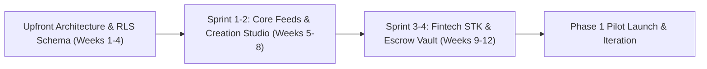
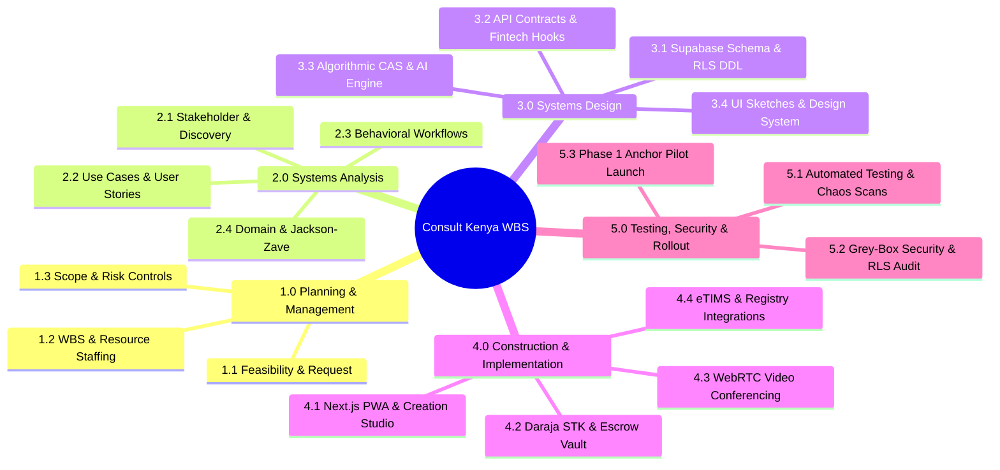
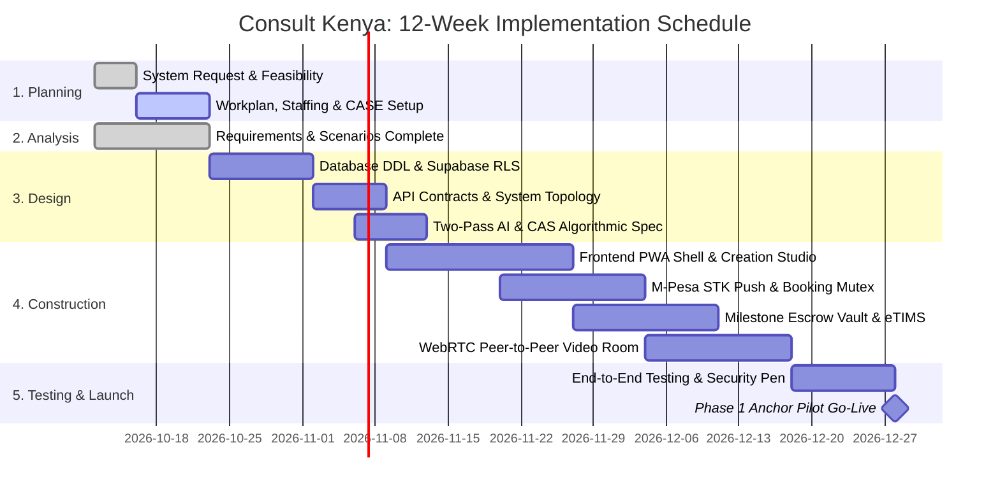
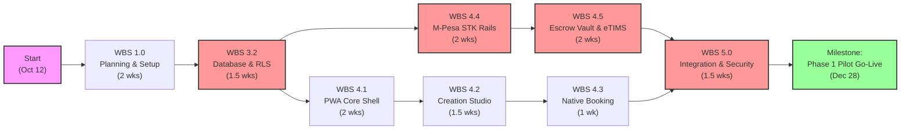

# PROJECT MANAGEMENT PLAN & WORKPLAN SPECIFICATION
*System: Consult Kenya (Visual-First Professional Advisory & Authority Network)*
*Lifecycle Stage: SAD Phase 1 — Project Selection & Management*
*Standard Compliance: IEEE Std 1058 (Software Project Management Plans) & ISO/IEC/IEEE 29148*
*Scope Boundary: Strictly Consult Kenya (Digital Advisory Platform)*

---

## 1. PROJECT SELECTION & DEVELOPMENT METHODOLOGY SELECTION

### 1.1 Methodology Evaluation & Justification
To select the appropriate systems development lifecycle (SDLC) methodology for **Consult Kenya**, we evaluated three candidates against project characteristics:
1. **Traditional Waterfall:** Linear, document-heavy. *Rejected* due to rapid feedback needs in fintech integrations and visual UI ergonomics.
2. **Pure Extreme Programming (XP):** Code-centric without upfront architecture. *Rejected* due to strict regulatory compliance (KRA eTIMS, Central Bank of Kenya PSP rules, DPA 2019 data residency) requiring formal architectural blueprints.
3. **Phased Agile / Iterative Delivery (Scrum-Fall Hybrid):** **SELECTED METHODOLOGY**.
   * *Rationale:* Provides rigorous upfront architectural, security, and database modeling (Phases 1–3 of SAD), followed by 2-week time-boxed iterative sprints for feature delivery, testing, and continuous deployment. This matches our **3-Phase Evolution Roadmap** (`CARD-002`):
     * *Release 1.0:* Anchor Agency Engine (Internal consulting team pilot).
     * *Release 2.0:* Curated Cohort Beta (25 invite-only creators).
     * *Release 3.0:* Open Multi-Tenant Ecosystem.

---

## 2. FUNCTION POINT ESTIMATION WORKSHEET

To scientifically determine project effort, schedule, and team size, we perform an **IFPUG Function Point Analysis (FPA)** based on our 22 core use cases and domain entity architecture.

### 2.1 Unadjusted Function Point (UFP) Calculation

| Component Type | Description in Consult Kenya | Low (Weight) | Med (Weight) | High (Weight) | Total Items | Subtotal UFP |
| :--- | :--- | :---: | :---: | :---: | :---: | :---: |
| **External Inputs (EI)** | Post authoring, Evidence upload, KYC submit, Booking slot lock, SOW create, Dispute file, Moderation appeal | 2 (x3) | 5 (x4) | 3 (x6) | 10 | **44** |
| **External Outputs (EO)** | eTIMS tax invoice receipt, M-Pesa STK push payload, Video room token, Payout slip, Dispute ruling cert | 1 (x4) | 4 (x5) | 2 (x7) | 7 | **38** |
| **External Inquiries (EQ)**| Feed candidate retrieval, Bento profile search, Topic hub query, Calendar slot check, Escrow status inspect | 2 (x3) | 4 (x4) | 2 (x6) | 8 | **34** |
| **Internal Logical Files (ILF)**| User & Profile DB, Case Study & Slides, Escrow Ledger, Milestone Vault, Dispute Registry, Telemetry Store | 0 (x7) | 4 (x10) | 2 (x15) | 6 | **70** |
| **External Interface Files (EIF)**| Safaricom Daraja API, Paystack Card Rails, KRA eTIMS Gateway, IPRS Gateway, Google/Outlook Calendar, GitHub API | 0 (x5) | 3 (x7) | 3 (x10) | 6 | **51** |
| **TOTAL UNADJUSTED FUNCTION POINTS (UFP)** | | | | | | **237 UFP** |

### 2.2 Value Adjustment Factor (VAF) & Adjusted Function Points (AFP)
Evaluating the 14 General System Characteristics (GSCs) on a scale of 0 to 5:
* Data Communications: **5** (Real-time WebRTC, distributed STK webhooks)
* Distributed Data Processing: **4** (Decoupled Redis, Supabase, Cloudflare edge)
* Performance Objectives: **5** (Sub-200ms feed transition, sub-50ms vector search)
* Heavily Used Configuration: **4** (High concurrency on mobile traffic)
* Transaction Rate: **4** (Burst transactions during morning feed usage)
* Online Data Entry: **5** (All client booking, creation studio, dispute logging)
* End-User Efficiency: **5** (5-second due diligence scan, zero-redirect modal)
* Online Update: **5** (Immediate ACID escrow ledger balances)
* Complex Processing: **5** (Two-Pass AI retrieval, SHA-256 asset checksums, CAS math)
* Reusability: **4** (Modular narrative templates, reusable UI card widgets)
* Installation Ease: **3** (PWA zero-download installation)
* Operational Ease: **4** (Automated 7-day auto-approval fallbacks)
* Multiple Sites: **4** (East African regional reach, local Kenyan data residency)
* Facilitate Change: **4** (Phased feature toggles without schema migrations)
$$\text{Total Degree of Influence } (TDI) = \sum_{i=1}^{14} GSC_i = 58$$
$$\text{Value Adjustment Factor } (VAF) = 0.65 + (0.01 \times TDI) = 0.65 + (0.01 \times 58) = 1.23$$
$$\text{Adjusted Function Points } (AFP) = UFP \times VAF = 237 \times 1.23 = \mathbf{291.51 \text{ AFP}}$$

### 2.3 Lines of Code (LOC) & Effort Derivation
* **Target Stack:** TypeScript / Next.js, SQL (PostgreSQL), Python (Vector/AI services).
* **Average Source Lines of Code per FP:** $\approx 45 \text{ LOC/FP}$ for modern full-stack web architectures.
$$\text{Estimated Total Source Code} = 291.51 \times 45 = \mathbf{13,118 \text{ LOC (High-Level Expressive)}}$$
* **Industry Productivity Rate:** $\approx 8 \text{ Function Points per Person-Month (PM)}$ for fintech/marketplace systems.
$$\text{Total Effort} = \frac{291.51}{8} \approx \mathbf{36.4 \text{ Person-Months (Total Lifecycle to Phase 3 Scale)}}$$
$$\text{Phase 1 Core Implementation Effort} \approx \mathbf{9.0 \text{ Person-Months (12 Weeks with a 3-person core team)}}$$

---

## 3. WORK BREAKDOWN STRUCTURE (WBS)

The project work breakdown structure organizes all activities into 5 hierarchically decomposed levels conforming to the SAD lifecycle:

### Tabular WBS Task Catalog
* **1.0 Planning & Project Management**
  * `WBS 1.1`: System Request & Problem Framing
  * `WBS 1.2`: Comprehensive Feasibility Analysis (Technical, Economic, Organizational)
  * `WBS 1.3`: Project Plan, Methodology Selection & Function Point Estimation
  * `WBS 1.4`: Staffing Plan, Project Standards & CASE Tool Setup
* **2.0 Systems Analysis & Requirements Engineering**
  * `WBS 2.1`: Stakeholder Matrix & Customer Segment Personas
  * `WBS 2.2`: Problem-Fit & Solution-Fit Discovery Interviews
  * `WBS 2.3`: 22 Core Use Cases Modeling & 66 User Stories
  * `WBS 2.4`: Behavioral Workflow Modeling (17 Activities, 5 DFDs)
  * `WBS 2.5`: Quality Attributes & Kano Prioritization Plane
  * `WBS 2.6`: Jackson-Zave Formal Specifications & Domain Entity Model
* **3.0 Systems Design**
  * `WBS 3.1`: Architectural Topology & Next.js PWA Component Hierarchy
  * `WBS 3.2`: PostgreSQL 16 DDL & Multi-Tenant Row-Level Security (RLS)
  * `WBS 3.3`: OpenAPI 3.0 REST Contracts & Asynchronous Webhook Protocols
  * `WBS 3.4`: Two-Pass AI Retrieval Engine & CAS Mathematical Pipeline
  * `WBS 3.5`: UI Design System, Annotated Wireframes & Navigation State Machine
* **4.0 System Construction & Integration**
  * `WBS 4.1`: PWA Frontend Shell & Dual-Mode Virtualized Viewports
  * `WBS 4.2`: 4-Step Creation Studio with Narrative Templates & Redaction Canvas
  * `WBS 4.3`: Native Slide-Up Booking Engine & Redis Mutex Slot Lock
  * `WBS 4.4`: Daraja M-Pesa STK Push, Callback Worker & Paybill Fallback
  * `WBS 4.5`: Milestone Escrow Vault, SHA-256 Deliverable Hasher & Auto-Release
  * `WBS 4.6`: Peer-to-Peer WebRTC Video Room & DTLS-SRTP Media Relays
  * `WBS 4.7`: KRA eTIMS Fiscal QR Invoice Microservice
* **5.0 Testing, Governance & Pilot Deployment**
  * `WBS 5.1`: Unit & End-to-End Integration Test Suite (Jest, Playwright)
  * `WBS 5.2`: Concurrency & Load Testing (k6 STK simulations)
  * `WBS 5.3`: Independent Security Penetration Test & RLS Leak Audit
  * `WBS 5.4`: Phase 1 Anchor Agency Deployment & Pilot Go-Live

---

## 4. PROJECT WORKPLAN & SCHEDULE (12 WEEKS)

### 4.1 Master Project Gantt Chart

### 4.2 Master PERT / CPM Critical Path Network

* **Critical Path:** `Start` $\to$ `WBS 1.0` $\to$ `WBS 3.2 (Database DDL)` $\to$ `WBS 4.4 (M-Pesa Rails)` $\to$ `WBS 4.5 (Escrow Vault)` $\to$ `WBS 5.0 (Security & Testing)` $\to$ `Phase 1 Pilot`.
* **Total Duration on Critical Path:** **12 Weeks (Zero slack on financial ledger and escrow vault tasks)**.

---

## 5. PROJECT STAFFING & RESOURCE ALLOCATION PLAN

### 5.1 Project Team Roles & Resource Profiles

| Role Title | Primary Assignee / Profile | Key Responsibilities | Total Allocation (Phase 1) |
| :--- | :--- | :--- | :---: |
| **Lead Technical Architect & Project Manager** | Lead Software Architect (Mercy) | Overall SDLC oversight, Supabase RLS architecture, API contracts, critical path management. | 100% (12 Weeks) |
| **Senior Full-Stack & Fintech Engineer** | Senior Backend Engineer | Safaricom Daraja STK Push, Redis slot mutex, BullMQ worker queues, KRA eTIMS microservice. | 100% (12 Weeks) |
| **Senior Frontend & PWA Engineer** | Frontend Engineer | Next.js PWA, touch gesture virtualization, Creation Studio split preview, Bento Grid layout. | 100% (12 Weeks) |
| **Regulatory & Escrow Compliance Officer**| Legal / Arbitrator (CIArb) | SOW legal templates, dispute mediation protocol, DPA 2019 compliance, tax reconciliation. | 25% (Part-Time / Advisory) |
| **QA & Security Penetration Auditor** | External CREST Auditor | Multi-tenant RLS leak testing, chaos STK timeout simulation, WebRTC encryption packet audit. | 2 Weeks (Sprint 5) |

### 5.2 Staffing Matrix (Person-Weeks by Phase)

| Project Phase | Lead Architect | Fintech Backend | Frontend PWA | Legal/Compliance | QA/Security | Total Person-Weeks |
| :--- | :---: | :---: | :---: | :---: | :---: | :---: |
| **Phase 1: Planning** | 2.0 | 0.5 | 0.5 | 0.5 | 0.0 | **3.5** |
| **Phase 2: Analysis** | 2.0 | 1.0 | 1.0 | 0.5 | 0.0 | **4.5** |
| **Phase 3: Design** | 3.0 | 2.0 | 2.0 | 0.5 | 0.0 | **7.5** |
| **Phase 4: Construction** | 3.0 | 6.0 | 6.0 | 0.5 | 0.0 | **15.5** |
| **Phase 5: Testing & Launch** | 2.0 | 2.5 | 2.5 | 1.0 | 2.0 | **10.0** |
| **TOTAL PERSON-WEEKS** | **12.0** | **12.0** | **12.0** | **3.0** | **2.0** | **41.0 Person-Weeks** |

---

## 6. PROJECT COORDINATION, CASE TOOLS, STANDARDS & REPOSITORIES

### 6.1 CASE Tools & Engineering Infrastructure
* **Version Control & Repository:** GitHub Private Repository with Branch Protection Rules (mandatory PR approvals, zero direct commits to `main`).
* **CASE Analysis & Modeling Tools:** Mermaid.js (UML Class, Sequence, State diagrams), Draw.io / PlantUML for architecture exports.
* **Database CASE & Schema Management:** Supabase CLI with automated SQL migration tracking (`supabase/migrations`).
* **API Documentation & Testing:** Postman / Insomnia collections exporting OpenAPI 3.0 YAML definitions.
* **Project Management & Issue Tracking:** GitHub Projects (Kanban boards mapped to WBS task IDs) + Linear.
* **CI/CD Pipeline:** GitHub Actions automating linting (ESLint, Prettier), type-checking (`tsc`), automated test execution (Jest), and preview branch deployments on Vercel.

### 6.2 Coding & Documentation Standards
* **Language & Typing:** 100% TypeScript with strict null checks (`strict: true`); zero `any` types in financial and authorization layers.
* **Code Style:** Airbnb JavaScript/TypeScript style guide enforced via Prettier pre-commit hooks (Husky).
* **Documentation Standard:** All code symbols annotated with JSDoc; architectural changes committed as Architecture Decision Records (ADRs) under `docs/adr/`.
* **Security Standards:** OWASP Top-10 proactive mitigations; parameterized SQL queries only; zero client exposure of Supabase `service_role` secrets.

---

## 7. PROJECT MONITORING, SCOPE MANAGEMENT & RISK CONTROL

### 7.1 Scope Management & Scope Creep Prevention
* **Scope Baseline:** The 22 Core Use Cases documented in SRS v2.0 form the immutable scope baseline for Phase 1.
* **Change Control Board (CCB):** Composed of Lead Architect and Practice Operations Lead.
* **Formal Change Request Procedure:**
  1. *Submission:* Formal Change Request detailing technical rationale, affected use cases, and estimated impact on schedule.
  2. *Impact Analysis:* Quantitative evaluation of Function Point and schedule shift (e.g., $+1.5\text{ weeks}$).
  3. *Trade-Off Rule:* Any added feature must either be deferred to **Phase 2 (Curated Cohort)** or accompanied by removing an equal-effort non-critical feature to maintain the 12-week go-live milestone.

### 7.2 Refining Estimates (Tracking & Variance Analysis)
* **Velocity Tracking:** Sprint retrospectives track Planned Story Points vs. Completed Story Points every 14 days.
* **Variance Thresholds:**
  * Schedule Variance ($SV = EV - PV$): If $SV < -5\%$, team reallocates non-critical tasks.
  * Cost Variance ($CV = EV - AC$): If cloud infrastructure spend exceeds $+10\%$ of monthly forecast, cache optimization is triggered immediately.

---

## 8. DETAILED TASK INFORMATION REGISTRY (INTERACTIVE TASK LOOKUP)

Conforming to the user's uploaded task information card format, below is the formal specification for our core critical path tasks. Any task can be referenced directly by its **Task ID**:

---

### Task ID: `TASK-WBS-102`
* **Name of the Task:** Perform Comprehensive Feasibility Analysis
* **WBS Code:** `1.2`
* **Start Date:** October 12, 2026
* **Completion Date:** October 16, 2026
* **Person Assigned to the Task:** Chief Systems Analyst (Antigravity)
* **Deliverable(s):** Comprehensive Feasibility Analysis Report (`sad_phase1_planning/FEASIBILITY_ANALYSIS_REPORT.md`)
* **Completion Status:** Complete (100%)
* **Priority:** High
* **Resources Needed:** Financial modeling spreadsheet, CBK regulatory guidelines, KRA eTIMS documentation
* **Estimated Time:** 20.0 Hours
* **Actual Time:** 18.5 Hours

---

### Task ID: `TASK-WBS-302`
* **Name of the Task:** Engineer PostgreSQL Schema DDL with Row-Level Security (RLS)
* **WBS Code:** `3.2`
* **Start Date:** October 23, 2026
* **Completion Date:** November 02, 2026
* **Person Assigned to the Task:** Lead Technical Architect (Mercy)
* **Deliverable(s):** Production SQL Migration File (`migrations/001_initial_schema_and_rls.sql`)
* **Completion Status:** Ready to Execute
* **Priority:** Critical (Critical Path)
* **Resources Needed:** Supabase Local CLI, PostgreSQL 16 instance, pgvector extension
* **Estimated Time:** 45.0 Hours
* **Actual Time:** Pending Execution

---

### Task ID: `TASK-WBS-404`
* **Name of the Task:** Implement Safaricom Daraja M-Pesa STK Push & Webhook Idempotency
* **WBS Code:** `4.4`
* **Start Date:** November 20, 2026
* **Completion Date:** December 04, 2026
* **Person Assigned to the Task:** Senior Fintech & Backend Engineer
* **Deliverable(s):** M-Pesa Integration Module, BullMQ Webhook Consumer, Unit & Chaos Test Suite
* **Completion Status:** Scheduled
* **Priority:** Critical (Critical Path)
* **Resources Needed:** Safaricom Daraja Developer Sandbox Credentials, ngrok / webhook proxy, Redis cluster
* **Estimated Time:** 60.0 Hours
* **Actual Time:** Pending Execution

---

### Task ID: `TASK-WBS-405`
* **Name of the Task:** Build Milestone Escrow Vault & Auto-Release Countdown Engine
* **WBS Code:** `4.5`
* **Start Date:** November 27, 2026
* **Completion Date:** December 11, 2026
* **Person Assigned to the Task:** Lead Architect & Senior Backend Engineer
* **Deliverable(s):** Escrow Double-Entry Ledger, SHA-256 Deliverable Hasher, 7-Day Auto-Release Cron Daemon
* **Completion Status:** Scheduled
* **Priority:** Critical (Critical Path)
* **Resources Needed:** PostgreSQL Serialized Transaction Isolation, BullMQ Scheduler, S3/Storage Vault
* **Estimated Time:** 55.0 Hours
* **Actual Time:** Pending Execution

---

### Task ID: `TASK-WBS-407`
* **Name of the Task:** Integrate KRA eTIMS Real-Time Fiscal QR Invoice Microservice
* **WBS Code:** `4.7`
* **Start Date:** December 04, 2026
* **Completion Date:** December 15, 2026
* **Person Assigned to the Task:** Senior Fintech & Backend Engineer
* **Deliverable(s):** eTIMS REST Client, mTLS Certificate Manager, Fiscal QR Code Renderer
* **Completion Status:** Scheduled
* **Priority:** High
* **Resources Needed:** KRA eTIMS Sandbox API Credentials, mTLS Private Keys, BullMQ Retry Queue
* **Estimated Time:** 35.0 Hours
* **Actual Time:** Pending Execution

---

### Task ID: `TASK-WBS-503`
* **Name of the Task:** Conduct Independent Security Penetration & Multi-Tenant RLS Leak Audit
* **WBS Code:** `5.3`
* **Start Date:** December 18, 2026
* **Completion Date:** December 24, 2026
* **Person Assigned to the Task:** External CREST Security Auditor & Lead Architect
* **Deliverable(s):** Formal Security Audit Report & Signed Verification Attestation
* **Completion Status:** Scheduled
* **Priority:** Critical (Release Blocker)
* **Resources Needed:** Staging environment, automated fuzzers, packet inspection tools
* **Estimated Time:** 30.0 Hours
* **Actual Time:** Pending Execution

---

## 9. STEP COMPLETION & TRANSITION AUTHORIZATION
* **Phase 1: Planning Deliverables Completed:**
  1. *Project Identification & Initiation:* Official System Request (`SYSTEM_REQUEST.md`).
  2. *Feasibility Analysis:* Technical, Economic (NPV/ROI), Organizational, Legal & Schedule Report (`FEASIBILITY_ANALYSIS_REPORT.md`).
  3. *Project Selection & Management:* Development Methodology, Function Point Estimation, WBS, 12-Week Gantt & PERT Schedules, Staffing Matrix, CASE Tooling, Scope Controls, and Detailed Task Registry (`PROJECT_MANAGEMENT_PLAN.md`).
