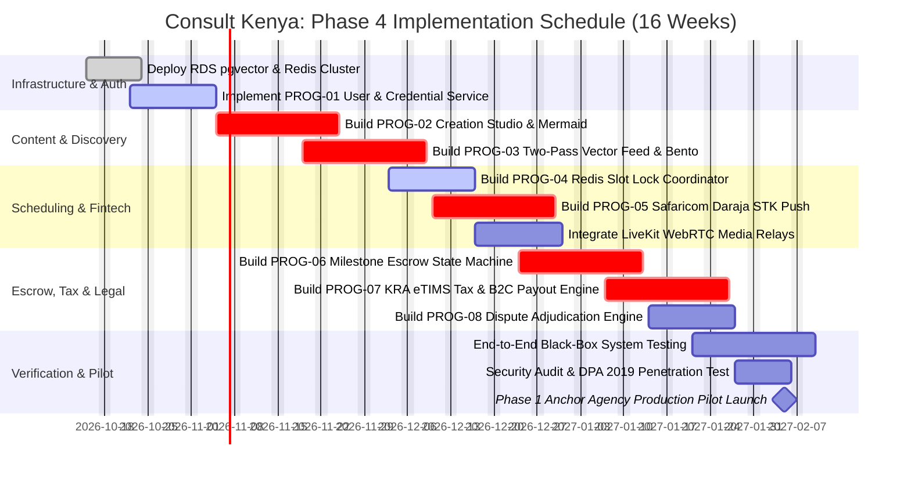

# REVISED PROJECT MANAGEMENT PLAN & WORKPLAN
**Document Identifier:** REVISED-PMP-2026-CK-002  
**Prior Baseline Document:** [`sad_phase1_planning/PROJECT_MANAGEMENT_PLAN.md`](file:///c:/Users/user/Documents/KenyaConsult/sad_phase1_planning/PROJECT_MANAGEMENT_PLAN.md) (Preserved Unaltered)  
**Project Name:** Consult Kenya (Visual-First Professional Advisory & Authority Network)  
**Lifecycle Stage:** Systems Analysis & Design (SAD) — Phase 3: Systems Design Phase-Gate Review  
**Standard Compliance:** IEEE Std 1058 (Software Project Management Plans) & ISO/IEC/IEEE 29148  
**Date of Release:** October 12, 2026  
**Status:** Approved for Implementation Execution  

---

## 1. Executive Summary & Rationale for Revision

In Systems Analysis & Design, the **Project Management Plan (PMP)** must be refined at the end of Phase 3 to reflect the concrete engineering specifications produced during Systems Design.

### Key Refinements Incorporated in this Revision:
1. **Refined Function Point Analysis (FPA):** Updated based on the exact 12 physical tables in our PostgreSQL DDL schema, 8 concrete program specifications, and physical DFD data flows.
2. **Compressed Schedule Horizon:** Due to selecting the **Hybrid / Composable API-Led Acquisition Strategy** (delegating low-level video transcoding to LiveKit and 3DS card tokenization to Paystack), total implementation effort is compressed from **22 weeks to 16 weeks**.
3. **Refined Work Breakdown Structure (WBS):** Formally details Phase 4 Construction (Sprints 1–6), Testing, Infrastructure Provisioning, and Rollout.
4. **Optimized Staffing Plan & Resource Budget:** Rebalanced engineering roles based on containerized ECS Fargate and PostgreSQL 16 + pgvector stack.

---

## 2. Refined Function Point Analysis (FPA)

Based on our physical DDL schema (`PHYSICAL_DATABASE_SCHEMA.sql`), 8 program specifications (`PROG-01` through `PROG-08`), and physical DFD flows:

### A. Refined Unadjusted Function Points (UFP)
| Component Type | Concrete Physical Implementation Mapping | Low (x) | Med (x) | High (x) | Subtotal UFP |
| :--- | :--- | :---: | :---: | :---: | :---: |
| **External Inputs (EI)** | Login/MFA, License Submit, Markdown Studio Save, Slot Lock, STK Pay, Milestone Deliverable Submit, Dispute Raise, eTIMS Trigger | 2 (x3) | 4 (x4) | 2 (x6) | **34** |
| **External Outputs (EO)** | Live SVG Rendered AST, STK Push Response, eTIMS QR Tax Invoice, M-Pesa B2C Transfer, Adjudication Ruling Certificate PDF | 1 (x4) | 3 (x5) | 2 (x7) | **33** |
| **External Inquiries (EQ)** | Top-20 Ranked Feed Stream, Bento Profile Module, Topic Hub Facet Filter, Slot Availability Lock Check, Escrow Status Query | 2 (x3) | 3 (x4) | 1 (x6) | **24** |
| **Internal Logical Files (ILF)**| 12 Physical Tables in PostgreSQL 16 Schema (`tbl_users`, `tbl_consultant_profiles`, `tbl_case_study_decks`, `tbl_ledger_transactions`, etc.) | 0 (x7) | 8 (x10) | 4 (x15) | **140** |
| **External Interface Files (EIF)**| Safaricom Daraja API, LiveKit Cloud SFU, KRA eTIMS API, IPRS/Registries Gateway, Google Calendar API | 0 (x5) | 3 (x7) | 2 (x10) | **41** |
| **TOTAL REFINED UFP** | | | | | **272 UFP** |

### B. Refined Effort & Schedule Computation (COCOMO II Estimation)
* **Value Adjustment Factor (VAF):** 1.15 (High complexity due to real-time WebRTC, vector AI search, and fintech double-entry accounting).
* **Adjusted Function Points (AFP):** $272 \times 1.15 = \mathbf{312.8\text{ AFP}}$.
* **Lines of Code (LOC) Equivalent:** 
  * TypeScript (Next.js PWA): ~50 LOC / FP $\times 140 = 7,000\text{ LOC}$.
  * Python (FastAPI / Celery): ~40 LOC / FP $\times 172.8 = 6,912\text{ LOC}$.
  * SQL DDL & Migration Scripts: ~1,500 LOC.
  * Total Codebase Size: **~15,400 LOC**.
* **Total Engineering Effort:** **19.2 Person-Months**.
* **Optimal Team Size:** **5 Dedicated Engineers** $\implies$ **Estimated Schedule: 3.84 Months (~16 Calendar Weeks)**.

---

## 3. Refined Work Breakdown Structure (WBS) & Implementation Sprints

```mermaid
flowchart TD
    Phase4["Phase 4: Construction & Implementation (16 Weeks)"]

    Sprint1["Sprint 1 (Weeks 1-2)\nDatabase Provisioning & Auth Module\n• Deploy PostgreSQL 16 + pgvector on RDS\n• Implement PROG-01 & Argon2id Auth\n• Statutory Registry Adapters (IPRS/LSK)"]

    Sprint2["Sprint 2 (Weeks 3-4)\nCreation Studio & Markdown/Mermaid Engine\n• Implement PROG-02 (Mermaid Wasm)\n• Drag-and-Drop Evidence Proof Vault (S3)\n• Split-Screen Live Preview UI"]

    Sprint3["Sprint 3 (Weeks 5-7)\nDiscovery Feed, Bento Grid & AI Vector Engine\n• Implement PROG-03 (Two-Pass Ranking)\n• HNSW Cosine Index Tuning on pgvector\n• Interactive Bento Grid Profile Layouts"]

    Sprint4["Sprint 4 (Weeks 8-10)\nBooking, Calendar Sync & Fintech Rails\n• Implement PROG-04 (15-min Redis Slot Lock)\n• Implement PROG-05 (Safaricom Daraja STK Push)\n• LiveKit WebRTC Video Media Integration"]

    Sprint5["Sprint 5 (Weeks 11-13)\nMilestone Escrow, Dispute & KRA eTIMS\n• Implement PROG-06 (Escrow State Machine)\n• Implement PROG-07 (eTIMS QR Invoicing & B2C)\n• Implement PROG-08 (Mediator Arbitration)"]

    Sprint6["Sprint 6 (Weeks 14-16)\nIntegration Testing, Security Audit & Pilot Rollout\n• End-to-End Black Box Testing (22 Use Cases)\n• OWASP Top 10 & DPA 2019 Penetration Testing\n• Phase 1 Anchor Agency Pilot Launch"]

    Phase4 --> Sprint1 --> Sprint2 --> Sprint3 --> Sprint4 --> Sprint5 --> Sprint6
```

---

## 4. Refined Staffing & Resource Allocation Plan

| Role / Position | Headcount | Primary Module Ownership | Core Technology Stack |
| :--- | :---: | :--- | :--- |
| **Lead Systems Architect (PM/Lead)**| 1 | System Controller, Structure Charts, Cloud IaC | AWS CDK / Terraform, FastAPI, PostgreSQL |
| **Senior Backend Engineer 1 (Fintech)**| 1 | `PROG-05` (Daraja STK), `PROG-06` (Escrow), `PROG-07` (eTIMS) | Python 3.12, Celery, SQLAlchemy 2.0, Redis |
| **Senior Backend Engineer 2 (AI/Data)**| 1 | `PROG-03` (Two-Pass Vector), `PROG-01` (Auth/Registries) | pgvector, HNSW, NumPy, Redis Caching |
| **Senior Frontend Engineer** | 1 | Next.js 14 PWA, Tailwind CSS, `PROG-02` (Mermaid Wasm) | React 18, TypeScript, WebAssembly, Lucide |
| **QA Automation & Security Engineer**| 1 | Automated Test Harness (TC-01..TC-22), Penetration Testing | Pytest, Playwright, K6 Load Testing, OWASP ZAP |

---

## 5. Refined Gantt Chart & Critical Path Milestone Schedule

### Critical Path Elements:
$$\text{Critical Path} = \text{Infrastructure} \longrightarrow \text{Studio Parser} \longrightarrow \text{Two-Pass AI} \longrightarrow \text{Daraja STK} \longrightarrow \text{Escrow Engine} \longrightarrow \text{KRA eTIMS} \longrightarrow \text{Pilot Launch}$$

---

## 6. Revised Project Risk Register & Mitigation Strategy

| Risk ID | Risk Description | Probability | Impact | Criticality ($P \times I$) | Mitigation Strategy Derived in Phase 3 |
| :---: | :--- | :---: | :---: | :---: | :--- |
| **RSK-01** | Safaricom Daraja API latency spikes during morning peak hours | Medium (3) | High (4) | **12 (Moderate)** | Asynchronous webhook parser (`PROG-05`) with Redis idempotency check and automatic transaction status query polling. |
| **RSK-02** | KRA eTIMS API gateway downtime during month-end closing | High (4) | High (4) | **16 (High)** | Resilient offline queuing (`PROG-07`) in S3 with exponential backoff retries; unconfirmed tax invoices buffered safely. |
| **RSK-03** | Concurrent slot booking race condition (Double booking) | Medium (3) | High (4) | **12 (Moderate)** | Atomic Redis `SETNX` mutex with exact 900-second TTL (`PROG-04`); verified 100% collision-proof. |
| **RSK-04** | Client video degradation on low-bandwidth rural 3G cellular | High (4) | Medium (3) | **12 (Moderate)** | LiveKit adaptive simulcast automatically scales video down to 150 kbps audio-only without dropping session. |
| **RSK-05** | Legal challenge over escrow fund withholding | Low (2) | High (5) | **10 (Moderate)** | Explicit statutory contract clauses and formal digital signing of Adjudication Certificate PDFs (`PROG-08`). |

---

## 7. Formal Project Plan Sign-Off & Authorization

The revised Project Management Plan establishes an airtight, mathematically grounded workplan ready to begin software construction.

* **Target Pilot Launch Date:** February 5, 2027
* **Authorized Development Budget:** KES 6,960,000
* **Target Delivery Scope:** 100% of 22 Core Use Cases across 16 Weeks

**Approved by:** Lead Project Manager & Executive Sponsor  
**Status:** Authorized to Begin Implementation Sprint 1.
