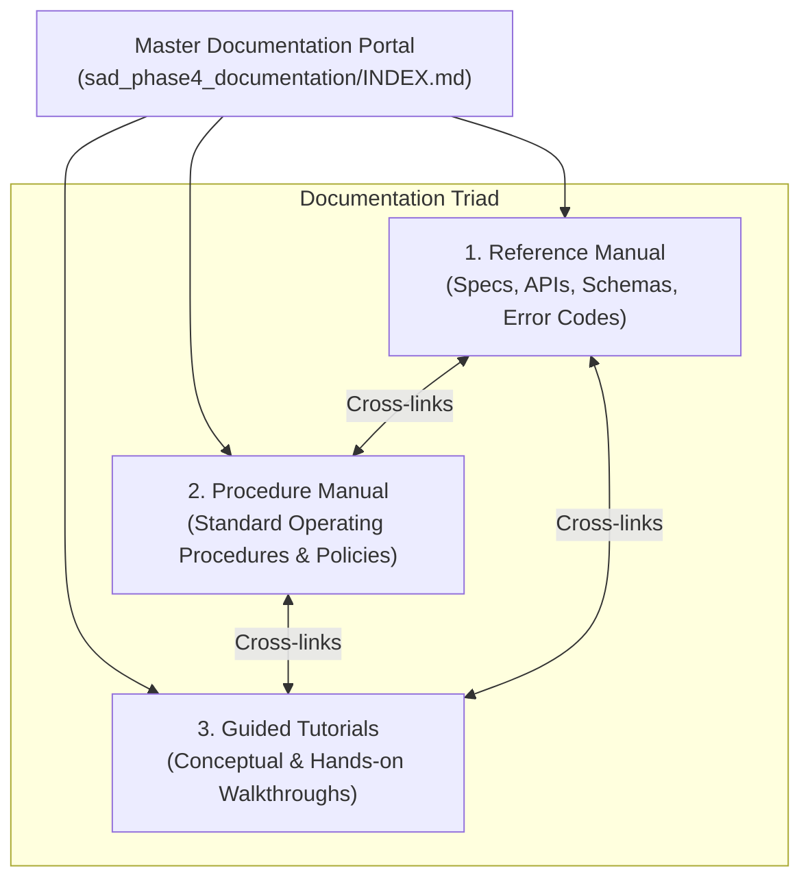

# CONSULT KENYA: MASTER SYSTEM DOCUMENTATION PORTAL
**System:** Consult Kenya (Enterprise Advisory & Authority Network)  
**Lifecycle Stage:** Phase 4 — Implementation & Production Handover  
**Author:** Documentation Directorate & System Architecture Team  
**Date:** October 2026  
**Status:** COMPLETE & VERIFIED  

---

## 1. Executive Overview & Documentation Architecture

In strict accordance with the Dennis-Wixom Systems Analysis and Design methodology, Phase 4 System Documentation is partitioned into three specialized, mutually reinforcing artifacts. Each artifact serves a distinct audience and cognitive operational need:

1. [**Technical Reference Manual**](file:///c:/Users/user/Documents/KenyaConsult/sad_phase4_documentation/reference/REFERENCE_MANUAL.md):
   - **Target Audience:** Systems engineers, software developers, security auditors, database administrators.
   - **Content:** Exact API contracts, request/response JSON payloads, physical database schemas, environmental configurations, error code dictionaries, and computational formulas.
2. [**Standard Operating Procedure (SOP) Manual**](file:///c:/Users/user/Documents/KenyaConsult/sad_phase4_documentation/manuals/PROCEDURE_MANUAL.md):
   - **Target Audience:** Platform operations staff, compliance officers, certified consultants, corporate clients, chartered arbitrators.
   - **Content:** Step-by-step business workflows, regulatory compliance protocols (LSK, ICPAK, KDPA 2019), emergency incident response guidelines, and escrow administration.
3. [**User & Developer Guided Tutorials**](file:///c:/Users/user/Documents/KenyaConsult/sad_phase4_documentation/tutorials/USER_AND_DEVELOPER_TUTORIALS.md):
   - **Target Audience:** Novice users, onboarding clients, enterprise developers integrating ERP systems.
   - **Content:** Guided step-by-step learning walkthroughs, code samples (Python, cURL), local webhook testing procedures, and troubleshooting FAQs.

---

## 2. Two-Part Navigation Index (Action + Subject)

The entire documentation suite is indexed using standardized **Action + Subject** navigation terms to enable rapid lookup:

| Navigation Term (Action + Subject) | Target Artifact | Section Link | Primary Operational Context |
| :--- | :--- | :--- | :--- |
| **[Acquire Lock]** | Reference Manual | [Ref: Sec 3.3](file:///c:/Users/user/Documents/KenyaConsult/sad_phase4_documentation/reference/REFERENCE_MANUAL.md#33-acquire-lock-prog-04-distributed-slot-lock-api) | Distributed Redis lock API & concurrency TTL |
| **[Adjudicate Dispute]** | Procedure Manual | [SOP: Sec 3.8](file:///c:/Users/user/Documents/KenyaConsult/sad_phase4_documentation/manuals/PROCEDURE_MANUAL.md#38-adjudicate-dispute-evidence-review--binding-arbitration) | Dispute arbitration workflow & split award execution |
| **[Authenticate Identity]** | Reference Manual | [Ref: Sec 3.1](file:///c:/Users/user/Documents/KenyaConsult/sad_phase4_documentation/reference/REFERENCE_MANUAL.md#31-authenticate-identity-prog-01-verification-api) | Onboarding endpoint, JWT lifecycle & Argon2id hashing |
| **[Book Advisory]** | Procedure Manual | [SOP: Sec 3.4](file:///c:/Users/user/Documents/KenyaConsult/sad_phase4_documentation/manuals/PROCEDURE_MANUAL.md#34-book-advisory-slot-reservation--m-pesa-escrow-funding) | Step-by-step client booking & escrow payment SOP |
| **[Conduct Consultation]** | Procedure Manual | [SOP: Sec 3.5](file:///c:/Users/user/Documents/KenyaConsult/sad_phase4_documentation/manuals/PROCEDURE_MANUAL.md#35-conduct-consultation-livekit-webrtc-session-execution) | WebRTC video session operation & document sharing |
| **[Configure Environment]** | Reference Manual | [Ref: Sec 2.2](file:///c:/Users/user/Documents/KenyaConsult/sad_phase4_documentation/reference/REFERENCE_MANUAL.md#22-configure-environment-variable--secret-reference) | Environment keys, secrets, database connection strings |
| **[Disburse Escrow]** | Procedure Manual | [SOP: Sec 3.7](file:///c:/Users/user/Documents/KenyaConsult/sad_phase4_documentation/manuals/PROCEDURE_MANUAL.md#37-disburse-escrow-automated-release--commission-deduction) | Milestone release, fee deduction & B2C M-Pesa payout |
| **[Discover Expert]** | Procedure Manual | [SOP: Sec 3.3](file:///c:/Users/user/Documents/KenyaConsult/sad_phase4_documentation/manuals/PROCEDURE_MANUAL.md#33-discover-expert-ai-search--filtering-sop) | Semantic search procedure & authority verification |
| **[Generate Invoice]** | Reference Manual | [Ref: Sec 3.6](file:///c:/Users/user/Documents/KenyaConsult/sad_phase4_documentation/reference/REFERENCE_MANUAL.md#36-generate-invoice-prog-07-kra-etims--payout-api) | KRA eTIMS invoice generation & WHT math |
| **[Initiate Payment]** | Reference Manual | [Ref: Sec 3.4](file:///c:/Users/user/Documents/KenyaConsult/sad_phase4_documentation/reference/REFERENCE_MANUAL.md#34-initiate-payment-prog-05-m-pesa-daraja-stk-push-api) | Safaricom Daraja STK Push trigger API contract |
| **[Integrate API]** | Tutorials | [Tut: Sec 4.1](file:///c:/Users/user/Documents/KenyaConsult/sad_phase4_documentation/tutorials/USER_AND_DEVELOPER_TUTORIALS.md#41-integrate-api-5-minute-developer-quickstart-with-python-and-curl) | 5-minute Python developer quickstart |
| **[Join Room]** | Tutorials | [Tut: Sec 3.3](file:///c:/Users/user/Documents/KenyaConsult/sad_phase4_documentation/tutorials/USER_AND_DEVELOPER_TUTORIALS.md#33-join-room-attending-a-high-definition-advisory-consultation) | End-user tutorial for attending video sessions |
| **[Onboard Consultant]** | Procedure Manual | [SOP: Sec 3.1](file:///c:/Users/user/Documents/KenyaConsult/sad_phase4_documentation/manuals/PROCEDURE_MANUAL.md#31-onboard-consultant-verification--practising-certificate-clearance) | Registration, IPRS check & LSK/ICPAK clearance SOP |
| **[Publish Brief]** | Procedure Manual | [SOP: Sec 3.2](file:///c:/Users/user/Documents/KenyaConsult/sad_phase4_documentation/manuals/PROCEDURE_MANUAL.md#32-publish-brief-video-recording--studio-parsing-sop) | Video brief recording & transcript publishing SOP |
| **[Query Vectors]** | Reference Manual | [Ref: Sec 3.2](file:///c:/Users/user/Documents/KenyaConsult/sad_phase4_documentation/reference/REFERENCE_MANUAL.md#32-query-vectors-prog-03-vector-search-api) | Two-pass pgvector cosine similarity endpoint |
| **[Remit Taxes]** | Procedure Manual | [SOP: Sec 3.9](file:///c:/Users/user/Documents/KenyaConsult/sad_phase4_documentation/manuals/PROCEDURE_MANUAL.md#39-remit-taxes-kra-etims-invoicing--withholding-tax-reporting) | KRA eTIMS monthly WHT & VAT return filing SOP |
| **[Reserve Slot]** | Tutorials | [Tut: Sec 3.2](file:///c:/Users/user/Documents/KenyaConsult/sad_phase4_documentation/tutorials/USER_AND_DEVELOPER_TUTORIALS.md#32-reserve-slot-booking-a-session-and-paying-with-safaricom-m-pesa) | Hands-on booking walkthrough for new clients |
| **[Resolve Error]** | Reference Manual | [Ref: Sec 5](file:///c:/Users/user/Documents/KenyaConsult/sad_phase4_documentation/reference/REFERENCE_MANUAL.md#5-error-code--exception-dictionary) | Exception troubleshooting & error code dictionary |
| **[Search Advisory]** | Tutorials | [Tut: Sec 3.1](file:///c:/Users/user/Documents/KenyaConsult/sad_phase4_documentation/tutorials/USER_AND_DEVELOPER_TUTORIALS.md#31-search-advisory-finding-the-right-tax-or-legal-expert-in-60-seconds) | Client tutorial for finding experts in 60s |
| **[Simulate Webhook]** | Tutorials | [Tut: Sec 4.2](file:///c:/Users/user/Documents/KenyaConsult/sad_phase4_documentation/tutorials/USER_AND_DEVELOPER_TUTORIALS.md#42-simulate-webhook-local-testing-of-m-pesa-stk-push-and-callbacks) | Developer guide for local Daraja webhook testing |
| **[Submit Deliverable]** | Procedure Manual | [SOP: Sec 3.6](file:///c:/Users/user/Documents/KenyaConsult/sad_phase4_documentation/manuals/PROCEDURE_MANUAL.md#36-submit-deliverable-advisory-summary--client-sign-off) | Advisory memorandum sign-off & auto-approval SOP |
| **[Transition State]** | Reference Manual | [Ref: Sec 3.5](file:///c:/Users/user/Documents/KenyaConsult/sad_phase4_documentation/reference/REFERENCE_MANUAL.md#35-transition-state-prog-06-escrow-state-machine-api) | FSM milestone state transition endpoint |
| **[Verify Receipt]** | Tutorials | [Tut: Sec 4.3](file:///c:/Users/user/Documents/KenyaConsult/sad_phase4_documentation/tutorials/USER_AND_DEVELOPER_TUTORIALS.md#43-verify-receipt-validating-kra-etims-fiscal-invoices-programmatically) | Programmatic verification of KRA fiscal receipts |

---

## 3. Keyword Index & Search Syntax

Users may search the documentation repository locally or via the platform CLI using keywords:
- **`escrow`**: Cross-references [Reference Manual Sec 3.5](file:///c:/Users/user/Documents/KenyaConsult/sad_phase4_documentation/reference/REFERENCE_MANUAL.md#35-transition-state-prog-06-escrow-state-machine-api), [Procedure Manual Sec 3.7](file:///c:/Users/user/Documents/KenyaConsult/sad_phase4_documentation/manuals/PROCEDURE_MANUAL.md#37-disburse-escrow-automated-release--commission-deduction), and [Tutorials Sec 3.2](file:///c:/Users/user/Documents/KenyaConsult/sad_phase4_documentation/tutorials/USER_AND_DEVELOPER_TUTORIALS.md#32-reserve-slot-booking-a-session-and-paying-with-safaricom-m-pesa).
- **`daraja` / `mpesa`**: Cross-references [Reference Manual Sec 3.4](file:///c:/Users/user/Documents/KenyaConsult/sad_phase4_documentation/reference/REFERENCE_MANUAL.md#34-initiate-payment-prog-05-m-pesa-daraja-stk-push-api), [Procedure Manual Sec 3.4](file:///c:/Users/user/Documents/KenyaConsult/sad_phase4_documentation/manuals/PROCEDURE_MANUAL.md#34-book-advisory-slot-reservation--m-pesa-escrow-funding), and [Tutorials Sec 4.2](file:///c:/Users/user/Documents/KenyaConsult/sad_phase4_documentation/tutorials/USER_AND_DEVELOPER_TUTORIALS.md#42-simulate-webhook-local-testing-of-m-pesa-stk-push-and-callbacks).
- **`etims` / `tax`**: Cross-references [Reference Manual Sec 3.6](file:///c:/Users/user/Documents/KenyaConsult/sad_phase4_documentation/reference/REFERENCE_MANUAL.md#36-generate-invoice-prog-07-kra-etims--payout-api), [Procedure Manual Sec 3.9](file:///c:/Users/user/Documents/KenyaConsult/sad_phase4_documentation/manuals/PROCEDURE_MANUAL.md#39-remit-taxes-kra-etims-invoicing--withholding-tax-reporting), and [Tutorials Sec 4.3](file:///c:/Users/user/Documents/KenyaConsult/sad_phase4_documentation/tutorials/USER_AND_DEVELOPER_TUTORIALS.md#43-verify-receipt-validating-kra-etims-fiscal-invoices-programmatically).
- **`vector` / `pgvector`**: Cross-references [Reference Manual Sec 3.2](file:///c:/Users/user/Documents/KenyaConsult/sad_phase4_documentation/reference/REFERENCE_MANUAL.md#32-query-vectors-prog-03-vector-search-api), [Procedure Manual Sec 3.3](file:///c:/Users/user/Documents/KenyaConsult/sad_phase4_documentation/manuals/PROCEDURE_MANUAL.md#33-discover-expert-ai-search--filtering-sop), and [Tutorials Sec 3.1](file:///c:/Users/user/Documents/KenyaConsult/sad_phase4_documentation/tutorials/USER_AND_DEVELOPER_TUTORIALS.md#31-search-advisory-finding-the-right-tax-or-legal-expert-in-60-seconds).
- **`dispute` / `arbitration`**: Cross-references [Reference Manual Sec 3.7](file:///c:/Users/user/Documents/KenyaConsult/sad_phase4_documentation/reference/REFERENCE_MANUAL.md#37-arbitrate-case-prog-08-dispute-adjudication-api) and [Procedure Manual Sec 3.8](file:///c:/Users/user/Documents/KenyaConsult/sad_phase4_documentation/manuals/PROCEDURE_MANUAL.md#38-adjudicate-dispute-evidence-review--binding-arbitration).
