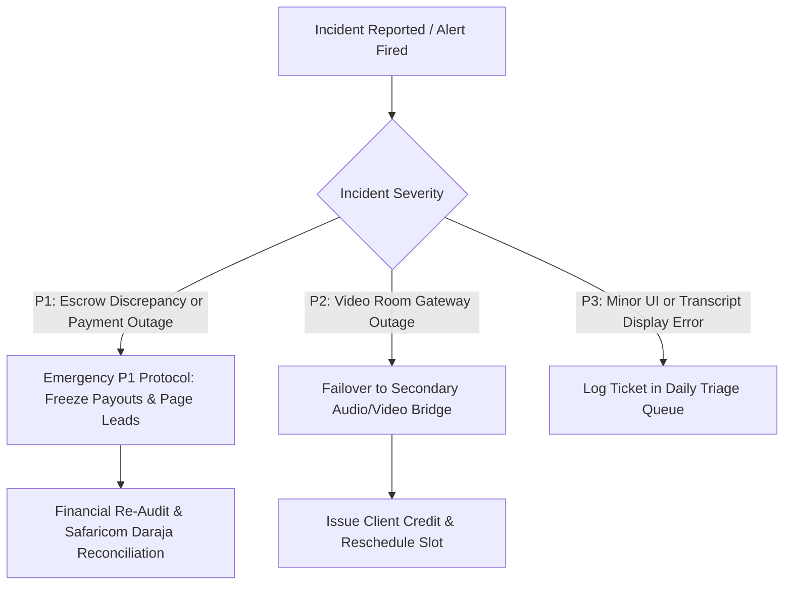

# CONSULT KENYA: STANDARD OPERATING PROCEDURE (SOP) MANUAL
**Document Type:** Formal System Procedure Manual  
**Audience:** Platform Operations Staff, Corporate Clients, Verified Consultants, Certified Arbitrators  
**Lifecycle Stage:** Phase 4 — Implementation & Operations  
**Version:** 1.0 (Production Master)  

---

## 1. Table of Contents & Navigation Index

- [1. Table of Contents & Navigation Index](#1-table-of-contents--navigation-index)
- [2. Operational Guidelines & Policy Framework](#2-operational-guidelines--policy-framework)
- [3. Standard Operating Procedures (SOPs)](#3-standard-operating-procedures-sops)
  - [3.1 [Onboard Consultant] Verification & Practising Certificate Clearance](#31-onboard-consultant-verification--practising-certificate-clearance)
  - [3.2 [Publish Brief] Video Recording & Studio Parsing SOP](#32-publish-brief-video-recording--studio-parsing-sop)
  - [3.3 [Discover Expert] AI Search & Filtering SOP](#33-discover-expert-ai-search--filtering-sop)
  - [3.4 [Book Advisory] Slot Reservation & M-Pesa Escrow Funding](#34-book-advisory-slot-reservation--m-pesa-escrow-funding)
  - [3.5 [Conduct Consultation] LiveKit WebRTC Session Execution](#35-conduct-consultation-livekit-webrtc-session-execution)
  - [3.6 [Submit Deliverable] Advisory Summary & Client Sign-Off](#36-submit-deliverable-advisory-summary--client-sign-off)
  - [3.7 [Disburse Escrow] Automated Release & Commission Deduction](#37-disburse-escrow-automated-release--commission-deduction)
  - [3.8 [Adjudicate Dispute] Evidence Review & Binding Arbitration](#38-adjudicate-dispute-evidence-review--binding-arbitration)
  - [3.9 [Remit Taxes] KRA eTIMS Invoicing & Withholding Tax Reporting](#39-remit-taxes-kra-etims-invoicing--withholding-tax-reporting)
- [4. Emergency Escalation & Incident Management](#4-emergency-escalation--incident-management)
- [5. Two-Part Navigation Index & Keyword Directory](#5-two-part-navigation-index--keyword-directory)

---

## 2. Operational Guidelines & Policy Framework
Consult Kenya operates strictly in accordance with:
1. **The Advocates Act (Cap 16, Laws of Kenya):** Regulating the delivery of legal advisory services in Kenya.
2. **The Kenya Data Protection Act (2019):** Safeguarding biometric identities, video consultations, and personal corporate data.
3. **The Tax Procedures Act (2015) & KRA eTIMS Regulations:** Ensuring all advisory invoices comply with digital fiscal signatures.

---

## 3. Standard Operating Procedures (SOPs)

### 3.1 [Onboard Consultant] Verification & Practising Certificate Clearance
- **Responsible Actor:** Applicant Consultant & Compliance Verification Officer.
- **Trigger:** Submission of new registration request.
- **Step-by-Step Procedure:**
  1. Consultant navigates to `/register/consultant` and inputs full legal name, phone number, Kenyan National ID / Alien ID, and professional regulatory body (LSK, ICPAK, EBK).
  2. Upload valid annual Practising Certificate (PDF format, max 10MB) and a clear biometric photo (JPEG/PNG).
  3. System initiates automated IPRS background identity query to verify national registration records.
  4. If IPRS query matches, the profile status transitions from `PENDING_REVIEW` to `CREDENTIAL_VERIFIED`.
  5. Compliance Officer reviews uploaded professional certificate against public regulatory register (e.g., LSK Advocate Search) within 24 business hours.
  6. Upon approval, consultant receives SMS confirmation and access to their advisory calendar console.
- **Cross-Reference:** Technical details in [Reference Manual: Section 3.1](file:///c:/Users/user/Documents/KenyaConsult/sad_phase4_documentation/reference/REFERENCE_MANUAL.md#31-authenticate-identity-prog-01-verification-api).

### 3.2 [Publish Brief] Video Recording & Studio Parsing SOP
- **Responsible Actor:** Verified Consultant.
- **Trigger:** Initial profile activation or publishing a new advisory domain brief.
- **Step-by-Step Procedure:**
  1. Access the Consultant Studio at `/studio/upload`.
  2. Upload a concise video brief (1 to 5 minutes duration) introducing specialized advisory competence (e.g., "Structuring East Africa Trade Joint Ventures").
  3. The system automated ingestion pipeline (`PROG-02`) inspects the container, transcodes video for mobile bandwidth, and extracts the audio track.
  4. Whisper speech-to-text pipeline transcribes the audio, generates timestamped segments, and builds 256-dimensional semantic embeddings.
  5. The consultant reviews the generated transcript preview, makes minor textual edits to specialized legal/technical terminology if needed, and clicks **Publish to Authority Network**.

### 3.3 [Discover Expert] AI Search & Filtering SOP
- **Responsible Actor:** Corporate or SME Client.
- **Trigger:** Need for verified professional counsel.
- **Step-by-Step Procedure:**
  1. Access the Consult Kenya home portal at `/`.
  2. Enter a natural language inquiry into the search box (e.g., *"Need help appealing a KRA tax assessment notice for VAT penalties"*).
  3. The two-pass vector engine matches semantic intent against video transcripts and profiles.
  4. Browse the ranked consultant results showing authority score badges, hourly rates, verified body affiliations, and playable 30-second video introductions.
  5. Click **View Availability** to open the real-time calendar picker.

### 3.4 [Book Advisory] Slot Reservation & M-Pesa Escrow Funding
- **Responsible Actor:** Client.
- **Trigger:** Selecting an available consultation slot.
- **Step-by-Step Procedure:**
  1. Select desired date and time slot in the calendar.
  2. The system triggers `PROG-04` to acquire a distributed Redis lock (valid for 15 minutes / 900 seconds) preventing concurrent booking.
  3. The checkout drawer displays fee breakdown: Consultant Fee, Platform Commission (7%), and total escrow deposit.
  4. Input Safaricom mobile number and click **Deposit to Escrow**.
  5. An M-Pesa STK push prompt is delivered to the user's mobile device.
  6. User inputs M-Pesa PIN.
  7. Upon receipt of Safaricom webhook confirmation (`ResultCode: 0`), funds are credited to the system escrow ledger (`PROG-06`), and the slot status transitions to `CONFIRMED`.

### 3.5 [Conduct Consultation] LiveKit WebRTC Session Execution
- **Responsible Actor:** Client and Consultant.
- **Trigger:** Scheduled consultation session start time.
- **Step-by-Step Procedure:**
  1. 10 minutes prior to session, both participants receive SMS and email session links (`/session/room-<UUID>`).
  2. Upon entering the room, both participants perform an automated audio/video hardware test.
  3. Session room connects securely using WebRTC end-to-end media channels over LiveKit SFU.
  4. A real-time timer indicates remaining consultation time.
  5. Participants utilize screen sharing, collaborative document review, and secure note-taking.
  6. Upon conclusion, the host clicks **End Session**, triggering the deliverable submission phase.

### 3.6 [Submit Deliverable] Advisory Summary & Client Sign-Off
- **Responsible Actor:** Consultant & Client.
- **Trigger:** Concluded consultation session or completed milestone.
- **Step-by-Step Procedure:**
  1. Within 24 hours of session end, consultant uploads a formal written advisory memorandum (PDF) or deliverables specified in the engagement scope.
  2. System changes milestone status to `SUBMITTED` and notifies the client.
  3. The client reviews the deliverable and has 72 hours to either click **Approve Deliverable & Release Escrow** or **Request Minor Revisions**.
  4. If the client takes no action within 72 hours, the platform auto-approval rule is executed.

### 3.7 [Disburse Escrow] Automated Release & Commission Deduction
- **Responsible Actor:** Automated Platform Engine (`PROG-06` / `PROG-07`).
- **Trigger:** Client approval or 72-hour auto-approval timeout.
- **Step-by-Step Procedure:**
  1. Milestone status transitions from `SUBMITTED` to `APPROVED_RELEASED`.
  2. The automated tax engine (`PROG-07`) calculates:
     - 5% Withholding Tax (WHT) retained for KRA remittance.
     - 7% Platform fee retained by Consult Kenya.
     - 16% VAT assessed on the platform fee (paid by Consult Kenya out of its 7% fee).
     - Net payout remaining for consultant.
  3. Safe B2C M-Pesa payout API instruction is dispatched to Safaricom Daraja.
  4. Consultant receives funds directly in their M-Pesa mobile wallet within 30 seconds.

### 3.8 [Adjudicate Dispute] Evidence Review & Binding Arbitration
- **Responsible Actor:** Client, Consultant, and Chartered Arbitrator.
- **Trigger:** Client or consultant files a formal dispute before milestone approval.
- **Step-by-Step Procedure:**
  1. Claimant clicks **Lodge Formal Dispute** and submits specific grounds and documentation within 7 days of delivery.
  2. Milestone funds are frozen in escrow.
  3. Respondent has 48 hours to upload counter-evidence into the dispute dossier.
  4. An independent, certified arbitrator (CIArb Kenya member) is assigned from the platform arbitration panel.
  5. Arbitrator reviews all session logs, contract scopes, and uploaded evidence in the confidential Arbitrator Console.
  6. Arbitrator enters binding split ruling (e.g., 60% client refund, 40% consultant payout) along with written legal justification.
  7. System executes automated split disbursements to both parties' M-Pesa accounts immediately upon ruling submission. Case is closed.

### 3.9 [Remit Taxes] KRA eTIMS Invoicing & Withholding Tax Reporting
- **Responsible Actor:** Finance Directorate & Automated System Daemon.
- **Trigger:** Execution of any paid transaction.
- **Step-by-Step Procedure:**
  1. On each escrow release, `PROG-07` generates an eTIMS electronic tax invoice payload.
  2. Payload is sent to KRA Online Sales Control Unit (OSCU) via cryptographic API.
  3. KRA returns official fiscal signature and invoice QR code.
  4. System compiles monthly WHT return schedule (Withholding Tax Certificate Form W2) detailing consultant KRA PINs and withheld taxes.
  5. System generates monthly VAT-3 return for platform commissions.

---

## 4. Emergency Escalation & Incident Management

- **Emergency Hotline:** `+254 700 000 000` (Operations Command Center, Nairobi).
- **Incident Channel:** Slack `#incident-war-room-kenya`.

---

## 5. Two-Part Navigation Index & Keyword Directory

| Two-Part Term (Action + Subject) | Procedure Manual Link | Primary Actor |
| :--- | :--- | :--- |
| **[Adjudicate Dispute]** | [Section 3.8](#38-adjudicate-dispute-evidence-review--binding-arbitration) | Chartered Arbitrator |
| **[Book Advisory]** | [Section 3.4](#34-book-advisory-slot-reservation--m-pesa-escrow-funding) | Corporate / SME Client |
| **[Conduct Consultation]** | [Section 3.5](#35-conduct-consultation-livekit-webrtc-session-execution) | Client & Consultant |
| **[Disburse Escrow]** | [Section 3.7](#37-disburse-escrow-automated-release--commission-deduction) | Automated Platform |
| **[Discover Expert]** | [Section 3.3](#33-discover-expert-ai-search--filtering-sop) | Corporate / SME Client |
| **[Escalate Incident]** | [Section 4](#4-emergency-escalation--incident-management) | Platform Operations Staff |
| **[Onboard Consultant]** | [Section 3.1](#31-onboard-consultant-verification--practising-certificate-clearance) | Consultant & Compliance |
| **[Publish Brief]** | [Section 3.2](#32-publish-brief-video-recording--studio-parsing-sop) | Verified Consultant |
| **[Remit Taxes]** | [Section 3.9](#39-remit-taxes-kra-etims-invoicing--withholding-tax-reporting) | Finance Directorate |
| **[Submit Deliverable]** | [Section 3.6](#36-submit-deliverable-advisory-summary--client-sign-off) | Consultant & Client |
