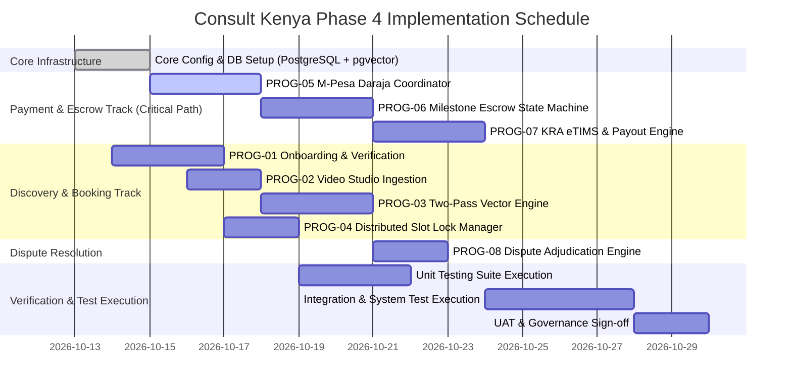
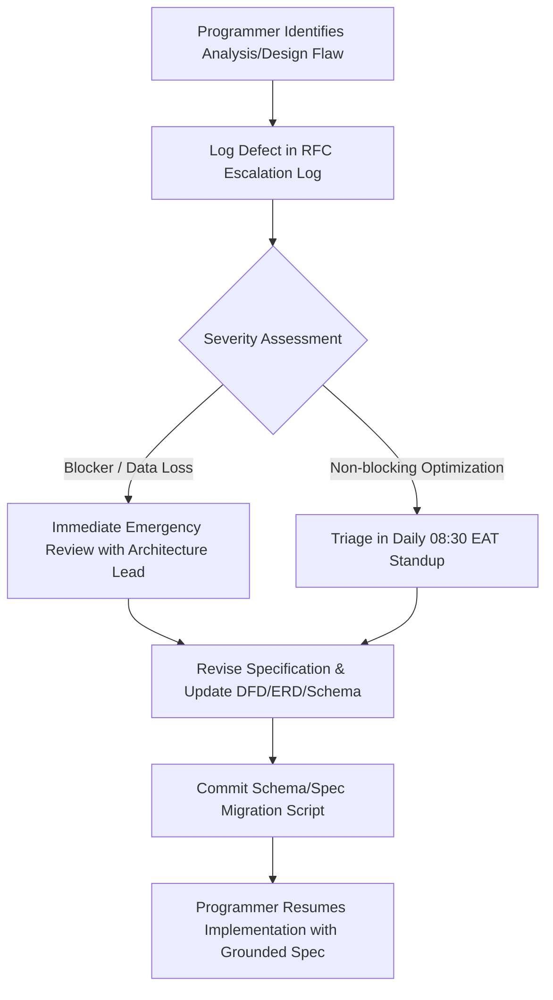

# PROGRAMMING PROCESS MANAGEMENT & COORDINATION PROTOCOL
**System:** Consult Kenya (Enterprise Advisory & Authority Network)  
**Lifecycle Stage:** Phase 4 — Implementation & Construction  
**Author:** Quality Assurance & Implementation Management Directorate  
**Date:** October 2026  
**Status:** ACTIVE / OPERATIONAL  

---

## 1. Executive Summary & Purpose
The implementation phase of **Consult Kenya** translates the architectural specifications, physical DFDs, structure charts, and relational schemas developed in Phase 3 into high-performance, resilient, and verifiable executable code. To eliminate development bottlenecks, regression cascades, and scope creep, this document establishes the governing framework for:
1. **Resource Task Assignments & Skill Matrix:** Role demarcations across core backend subsystems.
2. **Activity Coordination Protocols:** Continuous integration rules, branch strategies, pair programming sessions, and daily synchronization.
3. **Schedule & Critical Path Management:** Milestone Gantt tracking, burn-down metrics, and work package deadlines.
4. **Programmer Defect & Design Flaw Escalation Loop:** A structured bidirectional channel allowing implementation engineers to report analytical ambiguities or design edge-case oversights before committing code to production.

---

## 2. Work Breakdown & Programming Task Assignments

The application logic is partitioned into eight discrete program modules derived from the Dennis-Wixom Structure Charts and Program Specifications (`PROG-01` through `PROG-08`):

| Module ID | Program Description | Lead Role / Assigned Engineer | Complexity | Prerequisite Data Stores | Primary Tech Stack |
| :--- | :--- | :--- | :--- | :--- | :--- |
| **PROG-01** | Consultant Onboarding, IPRS & Biometric Verification | Security & Identity Lead | High (Tier 1) | `D1: Users`, `D2: Consultants`, `D3: VerificationAudit` | FastAPI, Pydantic, OAuth2/JWT, Cryptography |
| **PROG-02** | Advisory Media Ingestion & Chunking Pipeline | Media Pipeline Specialist | Medium | `D4: MediaAssets`, `D5: VideoTranscripts` | FFmpeg Wrapper, Whisper API Client, AsyncIO |
| **PROG-03** | Two-Pass AI Vector Matching Engine | ML & Search Engineer | High (Tier 1) | `D5: Transcripts`, `D6: ConsultantProfiles` | pgvector (HNSW), Gemini Embeddings, NumPy |
| **PROG-04** | Distributed Consultation Slot Lock Manager | Distributed Systems Engineer | Medium | `D7: Schedules`, `D8: Bookings` | Redis TTL Distributed Locks, PostgreSQL Row-Locks |
| **PROG-05** | M-Pesa Daraja STK Push & Webhook Coordinator | Payments & Fintech Lead | High (Tier 1) | `D9: Transactions`, `D10: PaymentAudit` | Safaricom Daraja APIv2, HMAC-SHA256, Celery |
| **PROG-06** | Milestone-Based Escrow State Machine | Core Logic & Fintech Lead | High (Tier 1) | `D9: Transactions`, `D11: EscrowAccounts` | Finite State Machine (FSM), PostgreSQL Serializable |
| **PROG-07** | KRA eTIMS Tax Invoicing & Automated Payouts | Compliance & Integrations Lead | High (Tier 2) | `D11: Escrow`, `D12: TaxInvoices`, `D13: Payouts` | KRA OSCU API Client, B2C M-Pesa API, Decimal |
| **PROG-08** | Multi-Tier Dispute Adjudication Engine | Workflow & Ops Specialist | Medium | `D14: Disputes`, `D15: DisputeEvidence` | State Workflow Engine, S3 Pre-signed URLs |

---

## 3. Programming Coordination Protocols

### 3.1 Branching Strategy (Git Flow / Trunk-Based Hybrid)
- **`main`**: Protected branch. Deploys exclusively to Production upon passing all Phase 4 Unit, Integration, System, and Acceptance suites.
- **`staging`**: Mirror of production environment for continuous integration and automated system testing.
- **`feature/PROG-XX-<slug>`**: Short-lived feature branches cut from `staging`. Merging requires:
  1. 100% pass rate on unit test suites.
  2. Peer review approval by the designated Subsystem Lead.
  3. No newly introduced static analysis defects (Zero flake8/mypy/Bandit violations).

### 3.2 Daily Activity Coordination & Standup Cadence
- **08:30 EAT — Daily Sync (15 Minutes):**
  - What module tasks were closed yesterday?
  - What will be implemented today?
  - Are there any architectural blockers, third-party sandbox latencies (e.g., Safaricom Daraja sandbox downtime), or database schema discrepancies?
- **16:30 EAT — Merge & Integration Window:**
  - Automated deployment of daily builds to Staging.
  - Automated regression smoke testing execution.

---

## 4. Schedule & Critical Path Milestones

---

## 5. Programmer Feedback & Design Flaw Escalation Loop

To ensure that developers do not write brittle workarounds when discovering unexpected edge cases or architectural oversights, the following formal protocol is enforced:

### 5.1 Flaw Classification Taxonomy
1. **Class A — Schema Inconsistency:** An attribute required by business logic is absent or ill-typed in `PHYSICAL_DATABASE_SCHEMA.sql` (e.g., missing currency scale or timezone offsets).
2. **Class B — Sequence & Concurrency Conflict:** A race condition identified in multi-user concurrent operations (e.g., double-locking of an advisory slot).
3. **Class C — Third-Party Contract Deviation:** An external sandbox response deviates from official documentation (e.g., Daraja STK Push payload structure or KRA eTIMS XML schemas).
4. **Class D — Computational Complexity / Latency Bottleneck:** An algorithm specified in design fails to meet the sub-200ms API SLA under production data volumes.

### 5.2 Escalation Process Workflow

### 5.3 Feedback Logging Template
Developers discovering flaws submit a structured issue ticket containing:
- **Module ID & File:** e.g., `PROG-06` (`src/app/modules/prog06_escrow_state_machine.py`)
- **Observed Design Flaw:** Specific description of why the logical specification breaks in physical implementation.
- **Proposed Architectural Correction:** Proposed schema alter statement or state transition rule.
- **Impact Assessment:** Impact on downstream modules (e.g., `PROG-07` or `PROG-08`).
