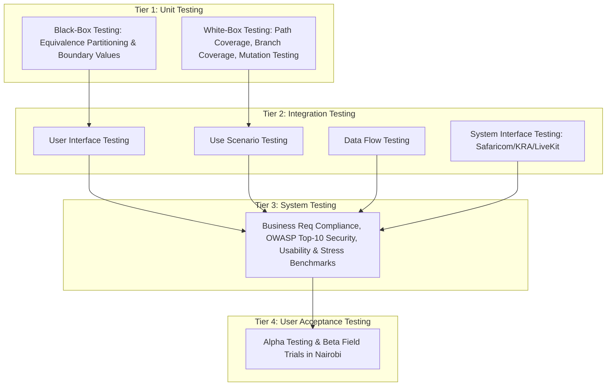

# TESTING STRATEGY, COMBINATORIAL ANALYSIS & VERIFICATION FRAMEWORK
**System:** Consult Kenya (Enterprise Advisory & Authority Network)  
**Lifecycle Stage:** Phase 4 — Implementation & Quality Assurance  
**Author:** Chief Test Architect & Quality Directorate  
**Date:** October 2026  
**Status:** APPROVED FOR TEST SUITE EXECUTION  

---

## 1. Quality Philosophy & Four-Tier Testing Hierarchy

Consult Kenya processes high-value monetary escrows, confidential intellectual property, biometric consultant validations, and real-time WebRTC communications. Testing cannot be an ad-hoc validation pass; it is structured as an exhaustive, mathematically grounded 4-tier verification hierarchy based on the Dennis, Wixom & Roth systems development lifecycle methodology:

---

## 2. Combinatorial Input & Situation Analysis

### 2.1 The Combinatorial Explosion Problem
A modern consulting platform involves multi-dimensional state spaces. To understand the total testing universe, we define the orthogonal parameter axes:

1. **User Role ($R$):** Client, Independent Consultant, Firm Partner, Dispute Arbitrator, System Administrator ($|R| = 5$).
2. **Authentication & Identity Status ($I$):** Unverified, IPRS Verified, Biometric Matched, Suspended, Expired ($|I| = 5$).
3. **Network & Connectivity Conditions ($N$):** High-speed Fiber (Safaricom Home/Office), Intermittent 4G/LTE (Safaricom/Airtel mobile), High-Latency Edge (Rural 3G / 2000ms latency), Completely Offline / Reconnecting ($|N| = 4$).
4. **Advisory Session State ($S$):** Available, Slot-Locked, Confirmed, In-Session (LiveKit WebRTC), Completed, Cancelled ($|S| = 6$).
5. **Payment & Escrow Lifecycle ($P$):** Pending STK, STK Timeout, STK User Cancel, Funds In Escrow, Milestone In-Progress, Milestone Released, Disputed Split ($|P| = 7$).
6. **Input Boundary Types ($D$):** Valid Canonical, Min Value, Max Value, Off-by-one Boundary, Null/Empty, Malformed/Nonsense String, SQL Injection / XSS Payload ($|D| = 7$).
7. **Dispute Resolution Disposition ($A$):** No Dispute, Client 100% Refund, Consultant 100% Payout, 50/50 Amicable Split, Escalated to Legal/Chartered Arbitrator ($|A| = 5$).

### 2.2 Mathematical Calculation of Total Combinations
The theoretical Cartesian product across all operational dimensions is:
$$\Omega = |R| \times |I| \times |N| \times |S| \times |P| \times |D| \times |A|$$
$$\Omega = 5 \times 5 \times 4 \times 6 \times 7 \times 7 \times 5 = 147,000 \text{ theoretical state combinations}$$

When factoring in arbitrary input lengths, payment amounts (KES 100 to KES 2,500,000), and concurrent multi-party bookings, the raw permutation space exceeds $10^9$ possibilities. Exhaustive testing of all $10^9$ states is computationally intractable and economically unfeasible.

### 2.3 Combinatorial Reduction Strategy: Pairwise Orthogonal Arrays & Equivalence Partitioning
To maintain mathematically sound coverage without testing 147,000 states, we employ **Orthogonal Array Testing (OATS)** and **Domain Equivalence Partitioning**:
- **Pairwise (2-way) Interaction Coverage:** NIST combinatorial-testing studies (Kuhn et al.) found that most failures in the systems studied were triggered by one factor or an interaction of two factors (e.g., *Role = Client* interacting with *Payment = STK Timeout*).
- **Equivalence Class Partitioning (ECP):** Partition inputs into mutually exclusive equivalence bins (Valid, Sub-minimum, Super-maximum, Malformed, Illegal Encoding).
- **Boundary Value Analysis (BVA):** Select test inputs strictly at the exact boundaries: $\{Min - 1, Min, Min + 1, Nominal, Max - 1, Max, Max + 1\}$.
- **Reduced Test Execution Universe:** By applying 2-way combinatorial orthogonal arrays and strict BVA, the execution space is compressed from **147,000 combinations down to 104 designed test cases/scenarios** (64 unit, 24 integration, 10 system, 6 acceptance). **Coverage target:** at least 90% branch coverage on the money paths (PROG-05/06/07), to be measured when the plans are executed. No coverage has been measured yet.

### 2.4 Mandatory Minimum Test Thresholds
Every individual test plan in the Consult Kenya repository must adhere to the following non-negotiable minimum thresholds. **No test plan may be committed or marked passed if it drops below these numbers:**
- **Unit Test Plan (UTP):** Minimum **8 discrete test cases** per module (must include at least 4 Black-Box and 4 White-Box/Path tests).
- **Integration Test Plan (ITP):** Minimum **6 multi-step integration scenarios** per category.
- **System Test Plan (STP):** Minimum **10 end-to-end operational test specifications** (covering performance, security, and load).
- **Acceptance Test Plan (ATP):** Minimum **5 formal user verification criteria** with explicit user sign-off metrics.

---

## 3. Specialized Testing Methodologies

### 3.1 Nonsense Inputs & Malformed Data Defense
Consult Kenya operates on public endpoints in Kenya where unpredictable mobile input, network line noise, and malicious attacks occur. The test suites inject:
1. **Gibberish & Unicode Chaos:** Strings like `𝕿𝖊𝖘𝖙 123`, `\x00\x00\x00`, zalgo text, unescaped emoji sets, and 10MB single-line strings into text boxes.
2. **Ill-Formatted Phone Numbers:** `+2540700000000`, `0110000000`, `2547123`, `abcdef`, `+1-800-SAFARICOM`.
3. **Financial Anomalies:** Negative amounts (`-500.00 KES`), zero amounts (`0.00`), floating-point epsilon tricks (`0.0000001 KES`), and super-cap overflows (`999,999,999,999.99 KES`).
4. **Time & Calendar Inversions:** Booking an appointment in 1970, booking an appointment ending before it starts, booking across leap-second intervals.

### 3.2 Keystroke Sequence Scripts & Monkey Testing
To simulate rapid-fire user interactions, double clicks, and impatient user behavior (e.g., tapping "Pay with M-Pesa" 10 times in 2 seconds):
- **Keystroke Automation Scripts:** Automated headless browser drivers execute scripted event bursts (keydown, rapid tab, double enter, rapid backspace during asynchronous autocomplete queries).
- **Idempotency Verification:** Ensuring that 10 consecutive clicks on a payment submission button trigger exactly one network call and create exactly one checkout token with zero duplicate ledger entries.

### 3.3 Test Stubs & Mocking Infrastructure for External Integrations
Real-world sandbox environments for Kenyan fintech and government APIs exhibit frequent maintenance windows or rate limits. The test suites feature high-fidelity, deterministic stubs:
1. **Safaricom Daraja Stub (`DarajaSimulatorStub`):** Simulates instantaneous `ResultCode: 0` (Success), `ResultCode: 1032` (Cancelled by user), `ResultCode: 1037` (Timeout / phone unreachable), and network drops.
2. **KRA eTIMS OSCU Stub (`KRAeTIMSMockStub`):** Simulates fiscal receipt signing, cryptographic hash generation, and tax clearance responses.
3. **LiveKit Cloud WebRTC Stub (`LiveKitSessionStub`):** Simulates room creation, token issuance, audio/video peer joins, and network disconnect events without spinning up real media servers.
4. **IPRS Identity Stub (`IPRSLookupStub`):** Simulates National ID and Alien ID biometric verification queries.
