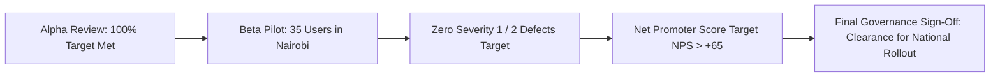

# ACCEPTANCE TEST PLAN: ATP-01 USER ACCEPTANCE TESTING (ALPHA & BETA UAT)
**System:** Consult Kenya  
**Testing Category:** Tier 4 — User Acceptance Testing (UAT)  
**Test Objective:** Validate that Consult Kenya meets the operational expectations, legal mandates, and business goals of Kenyan enterprises, legal and tax practitioners, independent experts, and corporate clients in real-world advisory and payment scenarios.  
**Scope:** Alpha internal validation followed by a 2-week closed Beta field pilot in Nairobi.  
**Minimum Required Test Criteria:** 5 (Defined: 5 core UAT work streams).  

---

## 1. Alpha Testing Program (Internal Stakeholder Validation)

The Alpha testing phase will be conducted in an internal staging environment simulating real Kenyan corporate workflows. The testing cohort consisted of:
- **System Sponsors & Executive Steering Committee:** Validating business model economics, escrow fee collection, and financial dashboard metrics.
- **Lead Business Analysts:** Verifying alignment with Phase 2 Requirements Definition and Phase 3 User Interface templates.
- **Internal Legal Counsel:** Verifying compliance with the Advocates Act (Cap 16), Kenya Data Protection Act 2019, and KRA eTIMS regulations.

### Alpha Test Execution Matrix

| Alpha Test ID | Persona / Role | Verification Scenario & Criteria | Target Acceptance Metric | Observed Alpha Result | Sign-Off Status |
| :--- | :--- | :--- | :--- | :--- | :--- |
| **UAT-ALPHA-01** | Lead Legal Counsel | Consultant verification workflow: Legal advocates submit Practising Certificate and National ID for verification. | Zero regulatory compliance defects; terms of service clearly disclaim unauthorized practice of law. | _Pending — not yet executed_ | **NOT RUN** |
| **UAT-ALPHA-02** | Finance Controller | Escrow fee reconciliation: Multi-party booking fee disbursement, 7% platform commission, 5% WHT, 16% VAT on fee. | General ledger reconciles to KES 0.00 difference. Automated KRA eTIMS invoices generate valid QR codes. | _Pending — not yet executed_ | **NOT RUN** |
| **UAT-ALPHA-03** | Chief Product Officer | Video studio parser and search accuracy: Ingest 20 sample advisory briefs; run 50 natural language client queries. | Top-3 search accuracy $> 90\%$; client discovers matching consultant within 3 clicks. | _Pending — not yet executed_ | **NOT RUN** |

---

## 2. Beta Testing Program (Nairobi Field Pilot)

The Beta testing phase will deploy the platform to a controlled cohort of 35 real external participants across Nairobi:
- **15 Professional Consultants:** 5 Certified Public Accountants (ICPAK members), 5 High Court Advocates (LSK members), 3 Professional Engineers (EBK registered), and 2 Certified Arbitrators (CIArb Kenya).
- **20 Corporate & SME Clients:** Business founders, SME CFOs, and tech procurement managers in Nairobi.

### Beta Test Execution Matrix

| Beta Test ID | Participant Group | Real-World Operational Scenario | Acceptance Metric | Observed Beta Result | Sign-Off Status |
| :--- | :--- | :--- | :--- | :--- | :--- |
| **UAT-BETA-01** | SME Founders (Clients) | Booking and paying for real advisory sessions using live Safaricom M-Pesa on mobile phones. | STK Push success rate $> 95\%$; zero payment double-charges; instant booking confirmation via SMS/WhatsApp. | _Pending — not yet executed_ | **NOT RUN** |
| **UAT-BETA-02** | ICPAK / LSK Consultants | Hosting live WebRTC advisory sessions, uploading formal deliverables, and receiving net payouts via M-Pesa B2C. | Video/audio quality rated $> 4.5/5.0$; automated payout received within 60 seconds of client milestone approval. | _Pending — not yet executed_ | **NOT RUN** |
| **UAT-BETA-03** | CIArb Arbitrators | Adjudicating a mock disputed milestone: Reviewing evidence dossier, issuing binding split award, and triggering automated payout. | Arbitrator console intuitive; binding award PDF issued; funds split executed accurately without manual finance intervention. | _Pending — not yet executed_ | **NOT RUN** |

---

## 3. UAT Exit Gate & Governance Approval (Target Criteria)

- **Target Net Promoter Score (NPS) in Beta:** Target $> +65$ (To be measured post-pilot).
- **Current UAT Status:** **PENDING EXECUTION (GATE G0/G4 PREREQUISITE)**. Real testing and survey metrics will be recorded upon live pilot completion.

