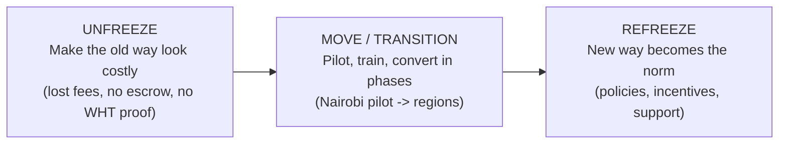

# 01 — MIGRATION PLAN & CONVERSION STRATEGY
**System:** Consult Kenya | **SDLC Phase:** 5 — Transition to the New System
**Method:** Dennis, Wixom & Roth (Ch. "Transition to the New System")
**Status:** PLAN (not yet executed)

---

> [!IMPORTANT]
> **Readiness baseline (true as of 13 Oct 2026).** The backend in `src/app/` exists and **13 automated pytest tests pass** against SQLite, an in-memory Redis stand-in and stubbed external services (Daraja, KRA eTIMS, IPRS, LiveKit). **None of the Phase 4 test plans (UTP/ITP/STP/ATP) have been run against real infrastructure, and no Alpha/Beta UAT has happened.** Their "observed results" columns must be treated as *pending*. This plan therefore makes real test execution a hard gate (Gate G0, §6) before any conversion step.

> [!WARNING]
> **Parameter mismatch to fix before conversion.** Code (`src/app/core/config.py`) uses **7% commission, 900 s slot lock, 256-dim embeddings**. The Phase 4 test plans and manuals say **10%, 600 s, 1536-dim**. One source of truth must be chosen (a CR-001 change request, see doc 03) and the documents or code brought into line.

---

## 1. What Are We Transitioning *From*?

Consult Kenya is a **greenfield** system: there is no legacy software to switch off. The "as-is system" is the informal, manual way Kenyan professionals get advisory work today (documented in Phase 2):

| As-Is Practice (Old "System") | To-Be Replacement (Consult Kenya) |
| :--- | :--- |
| Referrals, WhatsApp groups, LinkedIn DMs to find an advisor | Visual discovery feed + two-pass vector search (PROG-03) |
| Phone/WhatsApp back-and-forth to set a meeting time | Calendar slot lock & booking (PROG-04) |
| Direct M-Pesa to the consultant's personal number/Till, or bank transfer; no protection | STK Push into escrow (PROG-05, PROG-06) |
| Paper/WhatsApp-PDF credentials, trust by word of mouth | Statutory registry verification — LSK/ICPAK/EBK/KRA/IPRS (PROG-01) |
| Manual invoices; WHT often not withheld; eTIMS done separately or not at all | Automated eTIMS invoice + WHT + VAT ledger (PROG-07) |
| Disputes settled by phone, small claims, or simply lost | Structured dispute adjudication (PROG-08) |

So the "conversion" is mainly **migrating people, habits and a small amount of data** (waitlist consultant profiles, credentials, existing case-study content), not migrating a database from an old application.

---

## 2. Kurt Lewin's Three-Step Change Model Applied

| Lewin Stage | Objective for Consult Kenya | Concrete Actions | Exit Evidence |
| :--- | :--- | :--- | :--- |
| **Unfreeze** | Get consultants and clients to see that the old way is costly and risky | • Show unpaid-invoice and no-show stories from Phase 2 interviews • Point out the KRA eTIMS requirement for compliant invoices • Brief professional bodies (LSK, ICPAK, EBK branch chapters) | Waitlist sign-ups; ≥ 60% of interviewed consultants say they'd try escrow |
| **Move** | Shift real engagements onto the platform in controlled steps | • Pilot (§4) with a small, chosen group • Hands-on training (doc 02 §7) • Concierge onboarding: staff help create the first profile and case study | Pilot exit criteria met (§4.4) |
| **Refreeze** | Make the new way stick | • Revised policies (doc 02 §4): escrow-only payments, off-platform payment rules • Authority-tier incentives • Ongoing support & maintenance (doc 03) | 90-day retention; % of bookings paid through escrow vs off-platform |

---

## 3. Migration Plan Components

The Dennis-Wixom migration plan has three parts:

1. **Technical** — conversion strategy (§4), technology preparation (§5)
2. **Organisational** — preparing people (doc 02)
3. **Business continuity** — contingency plan (§6)

---

## 4. Selecting the Conversion Strategy

A conversion strategy has three dimensions. Each option is assessed below and one is chosen per dimension.

### 4.1 Conversion Style — *how* users switch

| Option | What it means for Consult Kenya | Risk | Cost | Time |
| :--- | :--- | :---: | :---: | :---: |
| **Direct (cold-turkey)** | Users stop the old way and start using the platform on day 1 | High | Low | Short |
| **Parallel** | Users keep the old way going while also using the platform, and compare | Low | High | Long |

**Analysis.** A true parallel run of *payments* is impractical and confusing: a client cannot pay a consultant both directly and into escrow for the same session. But a parallel run of *discovery and booking* is natural, because consultants keep their WhatsApp and referral channels anyway.

**Selected — Hybrid:**
- **Discovery, profiles, booking:** *parallel*. Consultants keep their existing channels; the platform is added on top.
- **Payments, escrow, eTIMS:** *direct*, per engagement. Once a booking goes through Consult Kenya, money only moves through escrow. This is backed by the Contingency Plan (§6), which can fall back to manual settlement.

### 4.2 Conversion Location — *where* it happens first

| Option | What it means | Risk | Cost | Time |
| :--- | :--- | :---: | :---: | :---: |
| **Pilot** | One location/segment first, then everyone | Low | Medium | Medium-Long |
| **Phased** | Location by location (Nairobi → Mombasa → Kisumu → Nakuru/Eldoret → rest) | Medium | Medium | Long |
| **Simultaneous** | Nationwide on launch day | High | High (support load) | Short |

**Selected — Pilot then Phased:**
1. **Pilot — Nairobi, 3 professions:** about 30 consultants (10 LSK advocates, 10 ICPAK CPAs, 10 EBK engineers) and about 100 invited SME clients. Duration: 6 weeks.
2. **Phase A — Nairobi open:** all professions in Nairobi metro (Westlands, Upper Hill, CBD, Kilimani clusters).
3. **Phase B — Mombasa & Kisumu.**
4. **Phase C — Nakuru, Eldoret, Nyeri, Machakos, Thika.**
5. **Phase D — National, open registration.**

### 4.3 Conversion Modules — *what* is switched on

| Option | What it means | Risk | Cost | Time |
| :--- | :--- | :---: | :---: | :---: |
| **Whole-system** | All 8 programs live at once | High | Low | Short |
| **Modular** | Programs switched on in groups | Low | Medium | Longer |

**Selected — Modular**, ordered by dependency and risk:

| Wave | Programs | Why this order |
| :--- | :--- | :--- |
| **M1 — Identity & Content** | PROG-01 Auth & Verification, PROG-02 Studio Parser | No money involved; builds supply (profiles, case studies) before demand arrives |
| **M2 — Discovery & Booking** | PROG-03 Vector/CAS Engine, PROG-04 Slot Lock | Needs content from M1 so the feed is not empty; low financial risk |
| **M3 — Money In** | PROG-05 Daraja STK, PROG-06 Escrow FSM | Highest risk; only after Daraja **production** go-live approval and sandbox reconciliation tests have actually been run |
| **M4 — Money Out & Compliance** | PROG-07 eTIMS & Payout, PROG-08 Disputes | Needs real escrow balances from M3; needs KRA eTIMS OSCU production credentials and B2C shortcode approval |

During M3, before M4 is live, released escrow is paid out **manually** by Finance (B2C portal + manual eTIMS invoice). This is a deliberate, temporary operating procedure.

### 4.4 Pilot Exit Criteria (must all be true to move to Phase A)

- Zero unreconciled escrow shillings: daily Daraja statement = ledger.
- ≥ 50 completed paid sessions.
- No Severity-1 defect open; no more than 3 Severity-2.
- STK Push success rate ≥ 90% (failures due to user cancel excluded).
- Median time from search to booking under 5 minutes, measured from real logs.
- Pilot users' satisfaction survey run (SUS, NPS) and results recorded, whatever they are.

### 4.5 Evaluation of Choices — Alternatives Matrix

Each strategy is scored 1–5 (5 = best) on the three Dennis-Wixom criteria, with weights reflecting Consult Kenya's priorities. Money handling makes risk dominant.

| Strategy Combination | Risk (×0.5) | Cost (×0.25) | Time (×0.25) | Weighted Score |
| :--- | :---: | :---: | :---: | :---: |
| Direct + Simultaneous + Whole-system | 1 | 4 | 5 | **2.75** |
| Parallel + Phased + Modular | 5 | 1 | 1 | **3.00** |
| Direct + Pilot + Whole-system | 3 | 3 | 3 | **3.00** |
| **Hybrid (Parallel discovery / Direct payments) + Pilot→Phased + Modular** ✅ | **4** | **3** | **3** | **3.50** |

### 4.6 Characteristics of the Selected Strategy

| Dimension | Choice | Risk | Cost | Time |
| :--- | :--- | :--- | :--- | :--- |
| Style | Hybrid | Medium-Low: payments are direct but have a manual fallback | Medium | Medium |
| Location | Pilot → Phased | Low: problems stay within 30 consultants | Medium: extra support staff during each phase | ~6 weeks pilot + ~4 weeks per phase |
| Modules | Modular (M1→M4) | Low: money flows go live last | Medium: manual payout procedure in M3 | M1–M4 over ~10 weeks, overlapping with pilot |

### 4.7 Indicative Transition Timeline

```mermaid
flowchart LR
    G0["G0: Real test execution\n+ parameter fix\n(2-3 wks)"] --> M1["M1 Identity & Content\nconcierge onboarding\n(2 wks)"]
    M1 --> M2["M2 Discovery & Booking\n(2 wks)"]
    M2 --> P["Nairobi Pilot + M3 Money In\n(6 wks)"]
    P --> M4["M4 Payout/eTIMS/Disputes\n(within pilot wk 4-6)"]
    M4 --> A["Phase A Nairobi open\n(4 wks)"]
    A --> B["Phase B Mombasa/Kisumu"]
    B --> C["Phase C secondary towns"]
    C --> D["Phase D National"]
```

### 4.8 Transition Cost Estimate (KES, indicative)

| Item | Basis | Estimate |
| :--- | :--- | ---: |
| Real test execution (staging infra, Daraja sandbox, pen-test vendor) | 3 weeks | 1,200,000 |
| Concierge onboarding staff (2 people × 3 months) | KES 120k/mo each | 720,000 |
| Training (venues, materials, video tutorials) | §7 doc 02 | 450,000 |
| Pilot incentives (fee waivers for first 50 sessions, client vouchers) | 7% commission waived + KES 1,000 vouchers | 300,000 |
| Professional body chapter events (LSK, ICPAK, EBK) | 4 events | 400,000 |
| Extra support during phases (help desk hours) | 4 phases | 600,000 |
| Contingency reserve (15%) | | 550,500 |
| **Total transition budget** | | **≈ 4,220,500** |

> [!NOTE]
> These are planning estimates, not quotes. They should be checked against the Revised Project Management Plan and Revised Feasibility Analysis in `sad_phase3_design/`. They were not part of those documents' original cost lines and may affect the NPV there.

---

## 5. Preparing the Technology

| Area | Task | Owner | Gate |
| :--- | :--- | :--- | :--- |
| **Infrastructure** | Provision production per Phase 3 architecture (ECS Fargate Multi-AZ, RDS PostgreSQL 16 + pgvector, ElastiCache Redis, S3 KMS, Cloudflare). Infrastructure-as-code (Terraform) reviewed. | DevOps Lead | G1 |
| **Database** | Apply `PHYSICAL_DATABASE_SCHEMA.sql` **plus** the missing `tbl_dispute_cases` table the developer found (now in ORM, not yet in DDL). Generate Alembic migrations from the ORM; check ORM = DDL. | DBA | G1 |
| **Data migration** | Import waitlist consultants (CSV → `tbl_users`, `tbl_consultant_profiles`) with validation: E.164 phone, KRA PIN regex, de-duplication. Imported credentials start as `PENDING` and **must re-verify**; nothing is trusted from spreadsheets. | Data Lead | G2 |
| **External integrations** | Safaricom Daraja: production go-live (STK + B2C shortcodes). KRA eTIMS: OSCU/VSCU production device registration. IPRS / professional-body access agreements. LiveKit production project. | Integrations Lead | G2 (M3), G3 (M4) |
| **Secrets & security** | AWS Secrets Manager; rotate all sandbox keys; pen-test closed before M3. KDPA 2019: register with ODPC as data controller/processor; Data Protection Impact Assessment (DPIA) done. | Security Lead | G2 |
| **Observability** | Logs, metrics, alerts (payment failure rate, ledger imbalance > KES 0, lock contention, eTIMS queue depth). Status page. | DevOps | G1 |
| **Code fixes before go-live** | Replace `datetime.utcnow()` (88 deprecation warnings in the real test run); fix commission/TTL/embedding parameter mismatch; remove SQLite/in-memory Redis fallbacks from production config. | Dev Lead | G0 |
| **User devices** | Mobile web works on low-end Android (Chrome Go) over 3G; test on Tecno/Infinix/Samsung A-series devices. | QA | G1 |

---

## 6. Business Contingency Plan

The Contingency Plan says what the business does if parts of the new system fail during transition. Its purpose is that **no client loses money and no consultant goes unpaid because of a system failure**.

### 6.1 Go / No-Go Gates

| Gate | Before | Must be true |
| :--- | :--- | :--- |
| **G0** | Anything | All UTP/ITP/STP plans **actually executed** with observed results recorded; parameter mismatch resolved; real pytest suite expanded and green on PostgreSQL + real Redis |
| **G1** | M1 | Production infra live; monitoring on; backups restore-tested |
| **G2** | M3 (money in) | Daraja production approved; pen-test High/Critical findings closed; ODPC registration; reconciliation test with real KES 1 transactions |
| **G3** | M4 (money out) | eTIMS production device; B2C shortcode; Finance sign-off on ledger reconciliation for ≥ 2 weeks of M3 |
| **G4** | Each new phase | Previous phase exit criteria met |

### 6.2 Failure Scenarios & Fallbacks

| # | Failure | Detection | Immediate Response | Fallback Procedure | Owner |
| :--- | :--- | :--- | :--- | :--- | :--- |
| C1 | Daraja STK outage | STK failure rate > 30% for 10 min | Show banner; pause new paid bookings; keep slot locks | Manual Paybill payment with booking reference; Finance reconciles by hand and marks booking confirmed | Finance Ops |
| C2 | Escrow ledger imbalance (≠ KES 0) | Hourly reconciliation job | **Freeze all payouts** | Finance reconciles from Daraja statements; payouts resume only after sign-off | CFO |
| C3 | KRA eTIMS OSCU down | eTIMS queue > 1 h | Queue invoices (already designed in PROG-07) | If down > 48 h, issue invoices through KRA's eTIMS web portal by hand | Tax Officer |
| C4 | B2C payout failure | Payout result ≠ success | Retry ×3 | Manual B2C via M-Pesa org portal or bank EFT; consultant notified | Finance Ops |
| C5 | LiveKit video failure | Room join failure rate > 10% | Offer reschedule at no cost | Fallback to Google Meet/Zoom link issued by support; session still billed through escrow | Support |
| C6 | Registry/IPRS unavailable | Timeout | Mark `PENDING_MANUAL_REVIEW` (designed in PROG-01) | Compliance officer checks LSK/ICPAK/EBK public rolls by hand | Compliance |
| C7 | Critical security incident / data breach | SIEM alert | Incident response; isolate | Notify ODPC within 72 h (KDPA s.43); notify affected users; roll back affected release | Security Lead |
| C8 | Phase fails exit criteria | Phase review | Stop expansion | Stay in current phase; fix; re-review in 2 weeks | Steering Committee |
| C9 | Severe defect in a newly released module | Error rate spike | Feature flag **off** for that module | Previous module wave keeps running; M3/M4 roll back to manual procedures (§4.3) | Dev Lead |

### 6.3 Rollback Principle

Each module wave is behind a **feature flag** and each release keeps the previous container image. Rollback = flip flag + redeploy previous image. Database migrations must be **backward-compatible (expand → migrate → contract)** so a rollback never needs a destructive schema change.

---

## 7. Summary of Decisions

| Decision | Choice |
| :--- | :--- |
| Change model | Lewin: Unfreeze → Move → Refreeze |
| Conversion style | Hybrid: parallel for discovery/booking, direct for payments, with manual fallback |
| Conversion location | Nairobi pilot (30 consultants / ~100 clients, 6 weeks) → phased by region |
| Conversion modules | Modular: M1 Identity/Content → M2 Discovery/Booking → M3 Money In → M4 Money Out/Compliance |
| Hard prerequisite | Gate G0: run the Phase 4 test plans for real and fix the parameter mismatch |
| Contingency | 9 failure scenarios with manual fallbacks; feature-flag rollback; payout freeze on any ledger imbalance |
