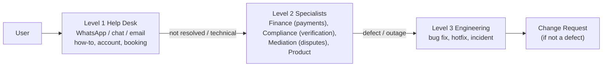

# 03 — POST-IMPLEMENTATION ACTIVITIES
**System:** Consult Kenya | **SDLC Phase:** 5 — Transition (Post-Implementation)
**Method:** Dennis, Wixom & Roth
**Status:** PLAN

The three post-implementation activities are **System Support**, **System Maintenance** and **Project Assessment**.

---

## 1. System Support

### 1.1 Online Support (self-service first)
- In-app help and contextual tips; searchable FAQ built from the Phase 4 Procedure Manual and Tutorials.
- English and Kiswahili explainer videos.
- Status page (`status.consultkenya.co.ke`) for Daraja/eTIMS/video incidents, so users can see the problem is known before they call.

### 1.2 Help Desk — Tiered Model



| Level | Handles | Target First Response | Target Resolution |
| :--- | :--- | :--- | :--- |
| L1 | How-to, login, profile, booking questions | 15 min (business hours) | 4 h |
| L2 | Payment not reflecting, payout delay, verification stuck, dispute process | 1 h | 24 h (payments: same day) |
| L3 | Defects, outages, data issues | Sev-1: 15 min, 24/7 on-call | Sev-1: 4 h workaround |

### 1.3 Problem Reports
Every ticket records: user, role, module (PROG-xx), steps, expected vs actual, device/network, screenshots, M-Pesa receipt if relevant. Tickets are tagged so trends show up; the top 5 recurring topics go into training and change requests each month.

### 1.4 Severity Definitions

| Severity | Definition | Example |
| :--- | :--- | :--- |
| Sev-1 | Money at risk, data breach, or platform down | Ledger imbalance; payouts to wrong number; site down |
| Sev-2 | Core task blocked for many users, workaround exists | STK failing for one network segment; eTIMS queue stuck |
| Sev-3 | Minor function broken | Case-study diagram not rendering |
| Sev-4 | Cosmetic / suggestion | Typo; colour tweak |

---

## 2. System Maintenance — Handling Change Requests

Maintenance is usually the largest part of a system's lifetime cost. Every change, from a bug fix to a new feature, goes through one controlled process.

### 2.1 Sources of Change Requests
- Problem reports from support (defects).
- User suggestions (consultants, clients).
- Regulatory change: KRA eTIMS spec updates, Finance Act changes to WHT/VAT rates, KDPA guidance, LSK rule changes.
- Third-party change: Daraja API versions, LiveKit SDK updates.
- Business strategy: new professions, new regions, pricing changes.
- Project assessment findings (§3).

### 2.2 Change Request Process

```mermaid
flowchart TD
    A[Change Request submitted] --> B[Logged & triaged by Product Owner]
    B --> C{Type}
    C -->|Defect Sev-1/2| H[Hotfix path: fix, test, deploy, post-mortem]
    C -->|Enhancement / Regulatory| D[Impact analysis: modules, schema, cost, risk]
    D --> E{Change Control Board}
    E -->|Approved| F[Scheduled into release]
    E -->|Deferred| G[Backlog]
    E -->|Rejected| R[Requester informed with reason]
    F --> T[Design -> Build -> Test (regression) -> Docs update]
    T --> DEP[Release behind feature flag -> monitor]
```

**Change Control Board (CCB):** Product Owner (chair), Tech Lead, Finance (for any money flow), Compliance (for regulated features). Meets weekly. Regulatory changes with a legal deadline take priority.

### 2.3 Change Request Form

| Field | Description |
| :--- | :--- |
| CR ID | `CR-YYYY-NNN` |
| Requester / Date | |
| Type | Defect / Enhancement / Regulatory / Technical debt |
| Module(s) affected | PROG-01 … PROG-08, UI, DB |
| Description & reason | |
| Business value / legal deadline | |
| Impact analysis | Schema change? API change? Docs/training change? |
| Effort & cost estimate | |
| Risk | Especially money-flow risk |
| CCB decision & date | Approved / Deferred / Rejected |
| Target release | |
| Test evidence | Link to **actually executed** test results |
| Status | Open → Analysed → Approved → In Progress → Tested → Released → Closed |

### 2.4 Change Request Log (opening entries from known issues)

| CR ID | Type | Module | Description | Priority | Status |
| :--- | :--- | :--- | :--- | :--- | :--- |
| **CR-2026-001** | Defect / Docs | PROG-03, 04, 06, 07; Phase 4 docs | Parameter mismatch: aligned all test plans and manuals to code truth: 7% commission, 900s slot lock, 256-dim embeddings, correct escrow states. | High (G0) | **RESOLVED** (13 Oct 2026) |
| **CR-2026-002** | Defect / Process | Phase 4 test suite | Reset fabricated observed results across 14 test plans to *Pending*; replaced hardcoded fake test runner with real pytest & ledger verification harness. | High (G0) | **RESOLVED** (13 Oct 2026) |
| **CR-2026-003** | Schema | DB / PROG-08 | `tbl_dispute_cases` exists in ORM but not in `PHYSICAL_DATABASE_SCHEMA.sql`; add to DDL and Alembic migrations. | High (G1) | Open |
| **CR-2026-004** | Tech debt | All | Replace deprecated `datetime.utcnow()` (88 warnings in real test run) with `datetime.now(datetime.UTC)`. | Medium | Open |
| **CR-2026-005** | Tech debt | Core | Production config must not fall back to SQLite / in-memory Redis. | High (G1) | Open |
| **CR-2026-006** | Financial Defect | PROG-07 Payouts | Refactor `prog07_kra_etims_payout.py` from `float` + `round()` to Python `Decimal` to ensure zero cent-drift under edge-case amounts. | High (G0) | Open |

### 2.5 Types of Maintenance & Planned Effort Split

| Type | Meaning | Expected Share (year 1) |
| :--- | :--- | :---: |
| Corrective | Fix defects | ~35% |
| Adaptive | Regulatory/third-party change (KRA, Daraja, Finance Act) | ~30% |
| Perfective | Enhancements from users | ~25% |
| Preventive | Refactoring, dependency upgrades, security patching | ~10% |

---

## 3. Project Assessment

Assessment happens after the system has been in use long enough for its effects to show: **project team review about 2 weeks after pilot exit; system review about 3–6 months after Phase A.**

### 3.1 Project Team Review — *how did we work?*

Purpose: learn from how the project was run, so the team and the organisation improve. Each member reflects individually, then the team discusses. The focus is lessons, not blame.

**Review questions:**

| Area | Question |
| :--- | :--- |
| Estimation | How did actual effort and duration compare with the Revised Project Management Plan (16 weeks, 312.8 AFP)? Where were estimates furthest off, and why? |
| Requirements | Which requirements changed late? Which ones did Phase 2 analysis miss (e.g., the missing dispute table)? |
| Design → build | Which design decisions held up in code, and which did developers have to change? Were they reported through the escalation loop? |
| Testing | **Were test results recorded honestly and from real runs?** (Lesson already known: in Phase 4, test plans were filled with expected outcomes presented as observed results. Rule going forward: observed results only from actual execution, with evidence links.) |
| Documentation | Did code and documentation stay in sync? (Known lesson: parameter drift between config and docs.) |
| Tools & AI assistance | Where did AI-generated artefacts help, and where did they need human verification? |
| Communication | Did daily syncs, CCB and escalation work? |
| Individual | What would each member do differently? What skills should they build? |

**Output:** *Project Team Review Report*: lessons learned, process changes, individual development notes. Stored in the project repository.

**Template — Lessons Learned Register:**

| # | What happened | Impact | Root cause | Lesson / Action | Owner |
| :--- | :--- | :--- | :--- | :--- | :--- |
| L1 | Phase 4 test plans recorded un-run results as passed | False confidence in readiness | Results written at plan time, not run time; no evidence requirement | Observed-result fields must link to CI run IDs; reviewer checks evidence | QA Lead |
| L2 | Config values diverged from test plans and manuals | Inconsistent documentation | Docs written in parallel with code, no single source | Generate parameter tables in docs from `config.py` | Tech Lead |
| L3 | Dispute entity missing from physical DDL | Schema change during build | ERD → DDL step skipped an entity | Automated ORM-vs-DDL diff in CI | DBA |
| L4… | *(to be filled at review)* | | | | |

### 3.2 System Review — *did the system deliver what it promised?*

Purpose: compare the **actual** benefits and costs with what the Feasibility Analysis predicted (Revised: NPV +KES 44.4M, 538% ROI). Decide what to improve.

**Review dimensions, metrics and data sources:**

| Dimension | Promised / Target | Metric | Data Source | Actual |
| :--- | :--- | :--- | :--- | :---: |
| Business value | Revenue per Revised Feasibility | GMV through escrow; commission revenue | Ledger | *TBD* |
| Adoption | Phase targets | Active verified consultants; MAU clients; repeat-booking rate | Analytics | *TBD* |
| Payment reliability | STK success ≥ 90% (excluding user cancel) | STK success rate; median time to confirm | PROG-05 logs | *TBD* |
| Escrow integrity | KES 0 unreconciled | Daily reconciliation exceptions | Finance | *TBD* |
| Payout speed | Target set in pilot | Median approval → M-Pesa receipt time | PROG-07 logs | *TBD* |
| Compliance | 100% of paid sessions have an eTIMS invoice | eTIMS coverage %; queue backlog | PROG-07 | *TBD* |
| Discovery quality | Users find relevant experts | Search → profile view → booking conversion | Analytics | *TBD* |
| Disputes | Low and fair | Dispute rate; median resolution time; appeals/complaints | PROG-08 | *TBD* |
| Performance | Phase 3 NFRs (e.g., feed p95 latency) | p95/p99 latency | APM | *TBD* |
| Security & privacy | No breaches; DSR handled in 30 days | Incidents; DSR turnaround | Security log | *TBD* |
| Usability | SUS ≥ 70 (industry "good") | SUS, NPS from real surveys | Surveys | *TBD* |
| Cost | Phase 3 cloud BOM ≈ USD 925/month | Actual monthly AWS/LiveKit/Cloudflare bill | Billing | *TBD* |

> [!NOTE]
> The *Actual* column is deliberately empty. It must be filled with measured data at review time, not projected values.

**Output:** *System Review Report* covering:
1. Actual vs predicted benefits and costs, with a recalculated NPV/ROI.
2. Requirements met / partly met / not met.
3. Recommended change requests (fed into §2).
4. Decision on the next rollout phase or redesign.

---

## 4. Post-Implementation Calendar

| When | Activity |
| :--- | :--- |
| Daily | Escrow reconciliation; support ticket triage |
| Weekly | CCB meeting; support trend report |
| Monthly | Maintenance release; training content refresh from top ticket topics; security patching |
| Pilot exit + 2 weeks | **Project Team Review** |
| Phase A + 3–6 months | **System Review** |
| Annually | Re-verification of credentials; DPIA refresh; disaster-recovery restore test |
