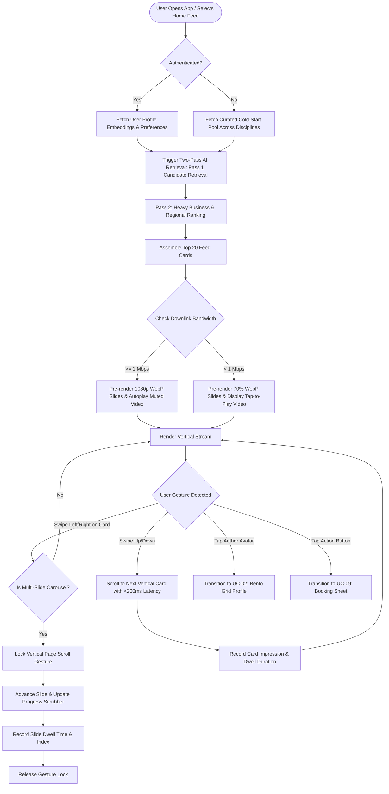

# UC-01: Discover Content via Dual-Mode Feeds
*Diagram Type: UML Activity Diagram (Swimlane Process Flow)*

This workflow models the control logic for client feed scrolling, media prefetching, horizontal carousel swiping, and adaptive network degradation.

