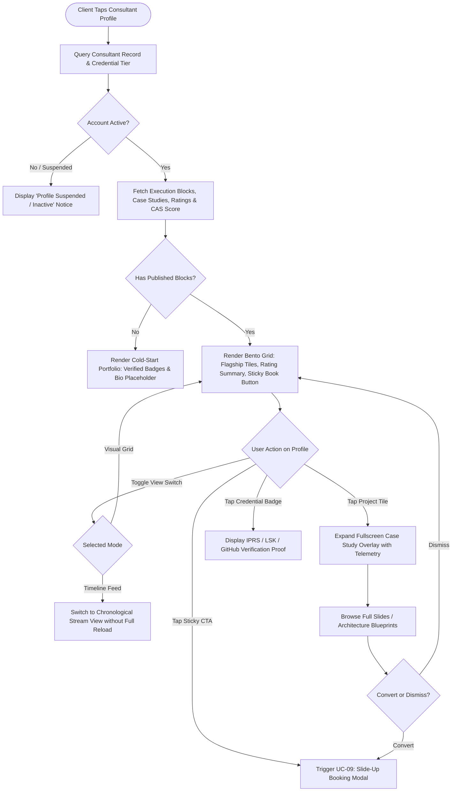

# UC-02: Inspect Consultant Portfolio (Bento Grid)
*Diagram Type: UML Activity Diagram (Due Diligence & Layout Switch)*

Models the inspection flow when a client lands on a consultant's profile, including the 5-second authority audit and view mode switching.

