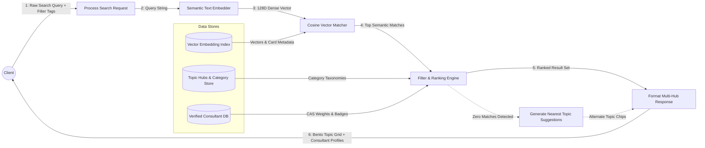

# UC-03: Search & Filter Topic Hubs
*Diagram Type: Data Flow Diagram (DFD Level 1 - Semantic Query Pipeline)*

Specifies how user search tokens flow into dense vector embeddings, topic filtering, and ranked card retrieval.

