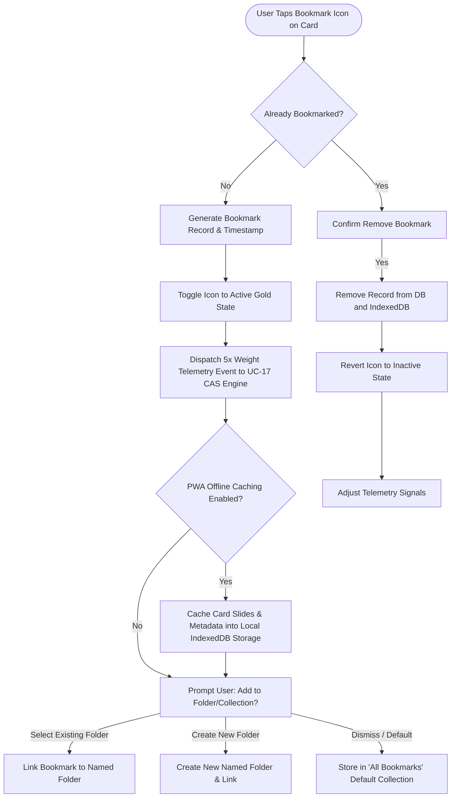

# UC-04: Bookmark & Organize Case Studies
*Diagram Type: UML Activity Diagram (Client Storage & Telemetry Signal)*

Models bookmark toggling, folder classification, PWA offline synchronization, and telemetry dispatch.

