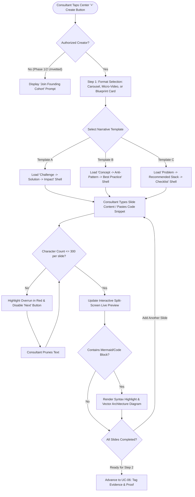

# UC-05: Compose Case Study via Creation Studio
*Diagram Type: UML Activity Diagram (Authoring & Validation Engine)*

Models the 4-step creation studio: format selection, narrative template drafting, character validation, and live preview rendering.

