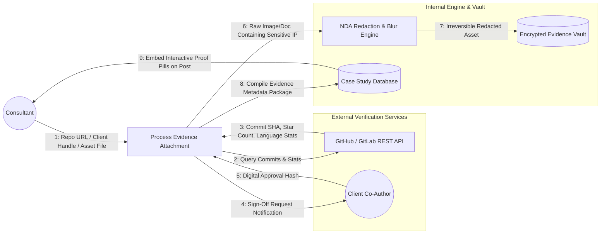

# UC-06: Tag Evidence & Proof of Execution
*Diagram Type: Data Flow Diagram (DFD Level 1 - Evidence Verification)*

Traces how proof artifacts (GitHub repos, client co-author confirmations, PDF audit memos, and NDA redaction masks) are verified and attached to a case study.

