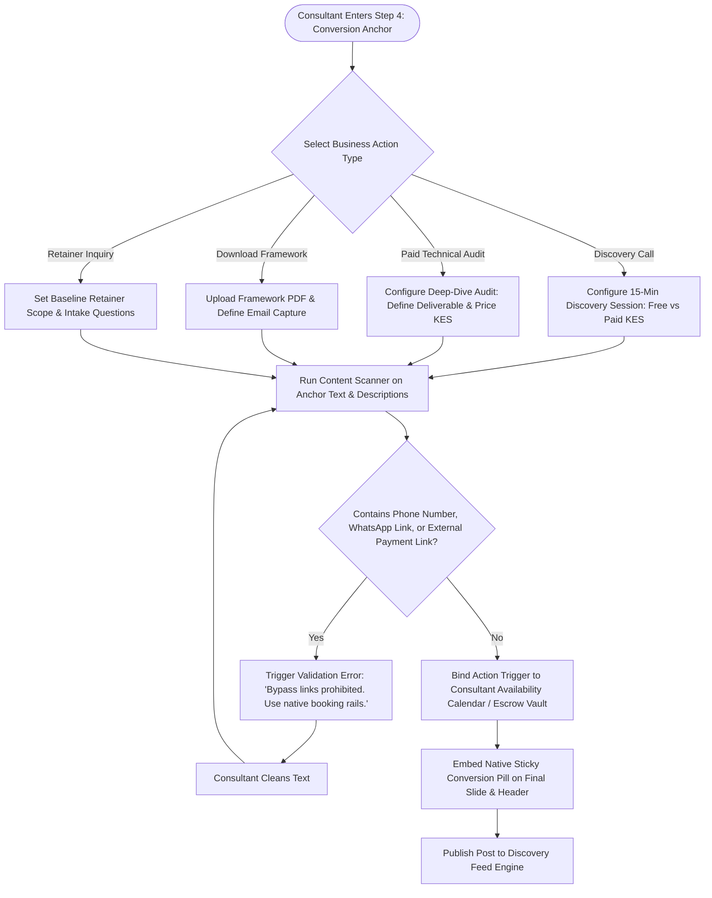

# UC-07: Attach Conversion Anchor Call-to-Action
*Diagram Type: UML Activity Diagram (Business Hook Validation)*

Models attaching commercial conversion buttons, screening against external bypass links, and configuring intake parameters.

