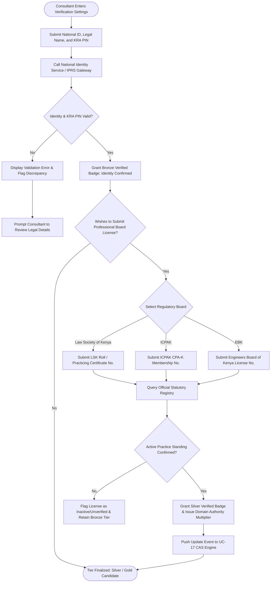

# UC-08: Verify Professional Identity & Credentials
*Diagram Type: UML Activity Diagram (Identity & Multi-Tier Registry Verification)*

Models government identity validation, KRA PIN compliance, professional statutory board verification, and badge issuance.

