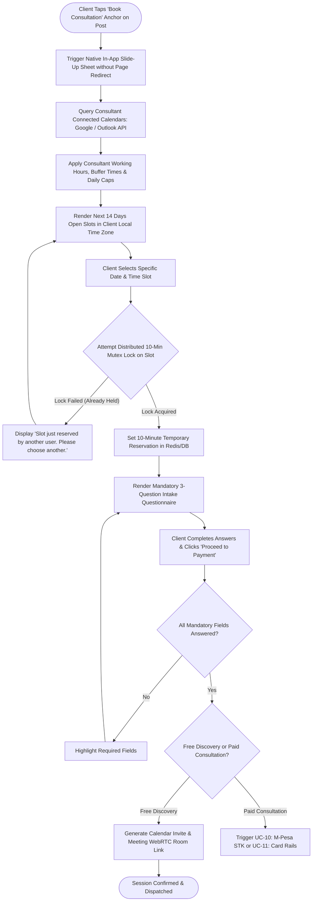

# UC-09: Book In-App Advisory Consultation
*Diagram Type: UML Activity Diagram (Native Scheduling & Slot Reservation)*

Models native slide-up sheet rendering, dynamic calendar availability fetch, 10-minute slot locking, and questionnaire completion.

