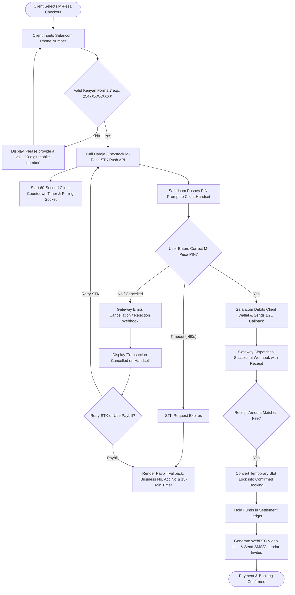

# UC-10: Process Payment via M-Pesa STK Push
*Diagram Type: UML Activity Diagram (Fintech STK Push & Reconciliation)*

Models mobile STK dispatch, user PIN entry, asynchronous webhook reconciliation, and Paybill fallback.

