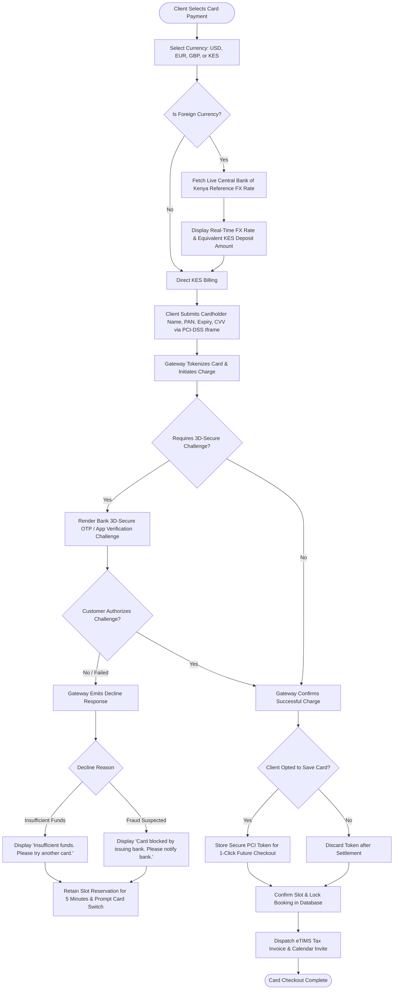

# UC-11: Process Cross-Border Card Payment
*Diagram Type: UML Activity Diagram (Multi-Currency Card & 3D-Secure)*

Models multi-currency payment selection, 3D-Secure challenge, tokenization, and Central Bank of Kenya reference exchange conversion.

