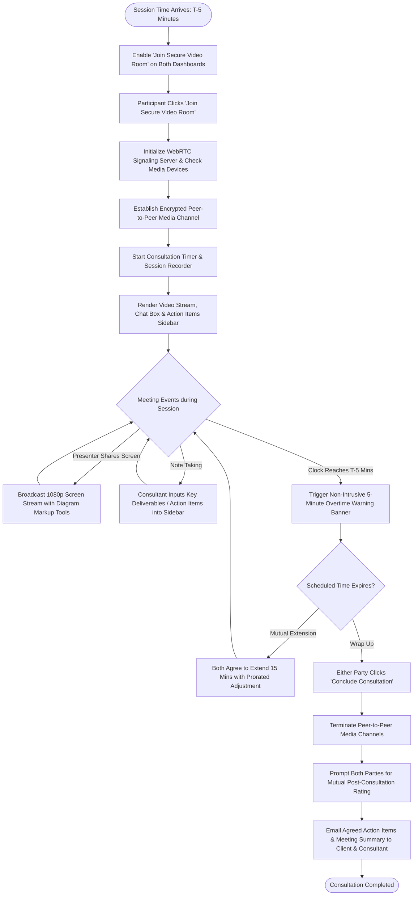

# UC-12: Conduct Secure Live Consultation
*Diagram Type: UML Activity Diagram (WebRTC Media Session & Timekeeping)*

Models live peer-to-peer browser video consultation, interactive screen-sharing, countdown timekeeping, and action item summary generation.

