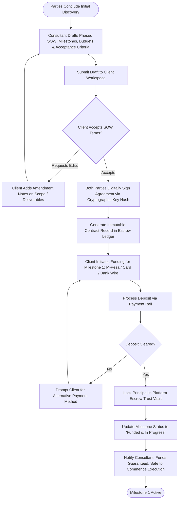

# UC-13: Fund Milestone Escrow Contract
*Diagram Type: UML Activity Diagram (B2B Contract Phasing & Deposit Locking)*

Models Statement of Work (SOW) milestone drafting, digital signatures, escrow deposit locking, and project kickoff.

