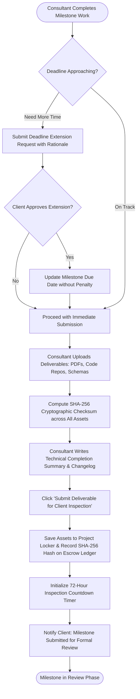

# UC-14: Submit Project Milestone Deliverable
*Diagram Type: UML Activity Diagram (Asset Submission & SHA-256 Proof Generation)*

Models milestone deliverable asset upload, cryptographic hashing, inspection timer initialization, and deadline extension exceptions.

