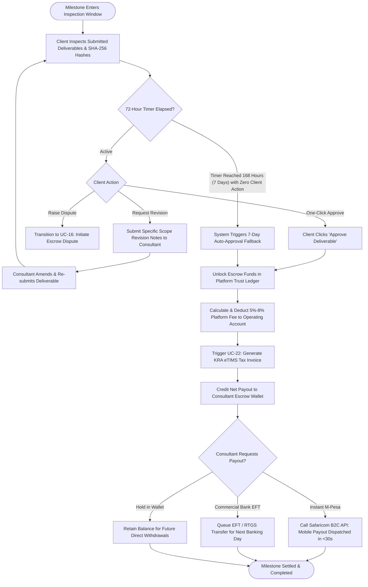

# UC-15: Review & Approve Escrow Milestone
*Diagram Type: UML Activity Diagram (Approval, Auto-Release & B2C Disbursement)*

Models client inspection, deliverable sign-off, take-rate deduction, instant B2C M-Pesa payout, and 7-day auto-approval fallback.

