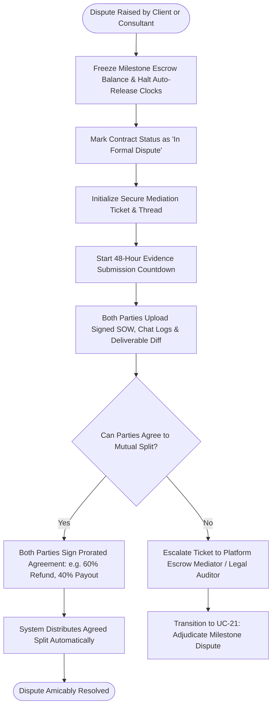

# UC-16: Initiate Escrow Dispute & Mediation
*Diagram Type: UML Activity Diagram (Dispute Escalation & Evidence Freezing)*

Models freezing funds upon deliverable contestation, mutual 48-hour evidence submission, amicable settlement, and formal mediation handoff.

