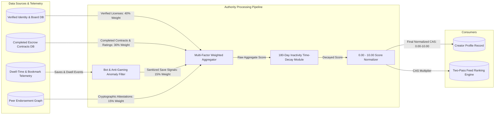

# UC-17: Calculate Creator Authority Score (CAS)
*Diagram Type: Data Flow Diagram (DFD Level 1 - Authority Computation Pipeline)*

Traces incoming signals from credential registries, completed contracts, telemetry dwell-times, and peer endorsements into the normalized Creator Authority Score.

