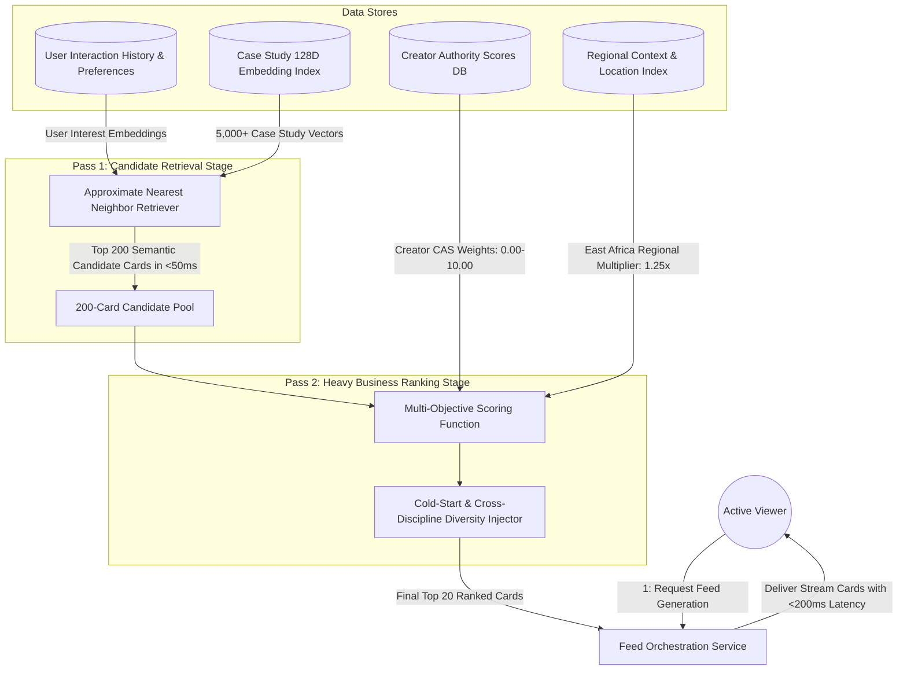

# UC-18: Personalize Two-Pass Discovery Feed
*Diagram Type: Data Flow Diagram (DFD Level 1 - Two-Pass Feed Recommendation Engine)*

Details the two-pass retrieval architecture: Pass 1 fast vector candidate generation ($<50\text{ms}$) followed by Pass 2 heavy business ranking with East Africa weighting.

