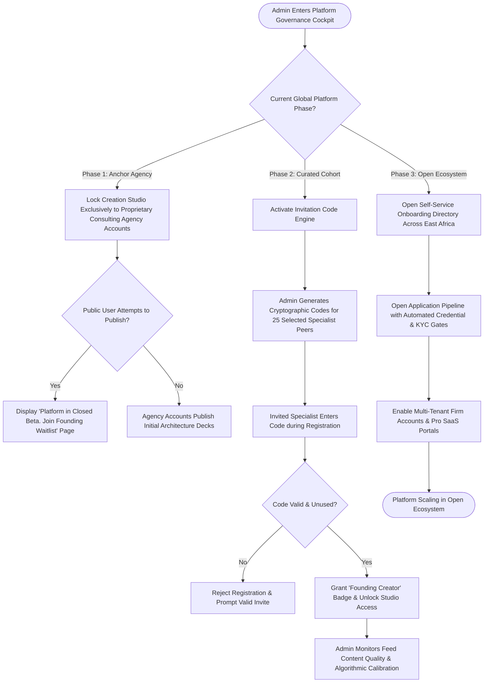

# UC-19: Manage Phased Rollout & Creator Onboarding
*Diagram Type: UML Activity Diagram (Phase Transition & Access Gate Control)*

Models platform progression across Phase 1 (Anchor Agency lockdown), Phase 2 (Curated Cohort invite codes), and Phase 3 (Open Multi-Tenant onboarding).

