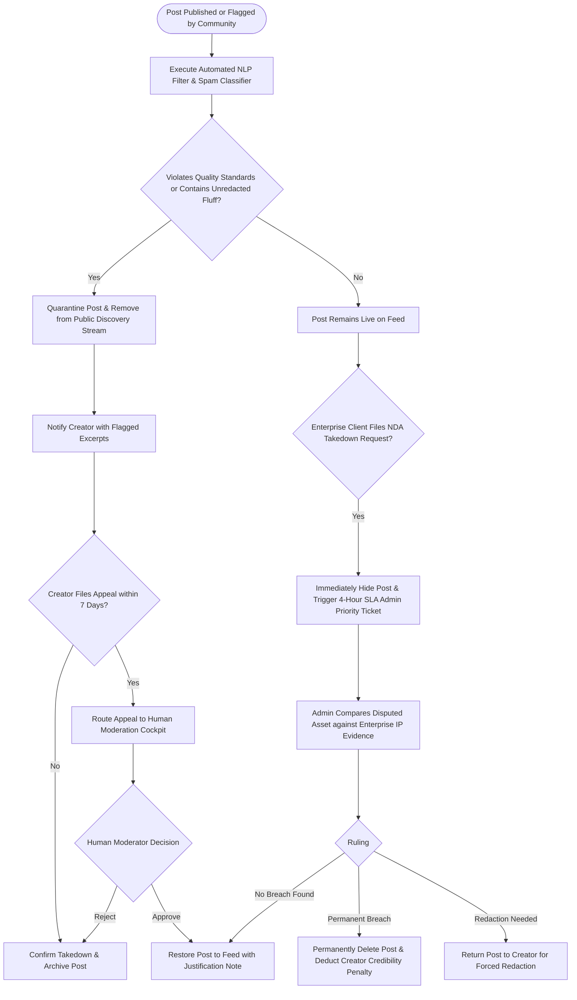

# UC-20: Moderate Platform Content & Enforce NDAs
*Diagram Type: UML Activity Diagram (Content Moderation & IP Protection SLA)*

Models automated text screening for spam/fluff, enterprise NDA breach takedown workflows, and creator appeals.

