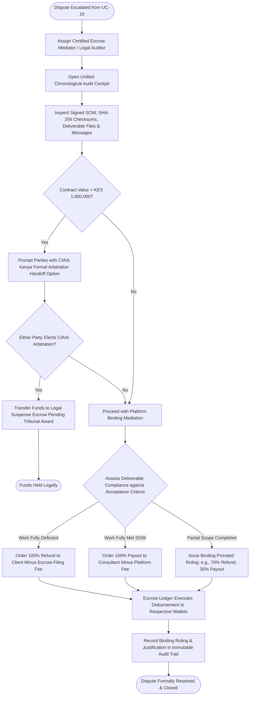

# UC-21: Adjudicate Milestone Dispute
*Diagram Type: UML Activity Diagram (Mediation Adjudication & Binding Disbursement)*

Models mediator evidence review across the SOW and SHA-256 asset delivery proofs, binding percentage disbursement rulings, and high-value legal arbitration handoffs.

