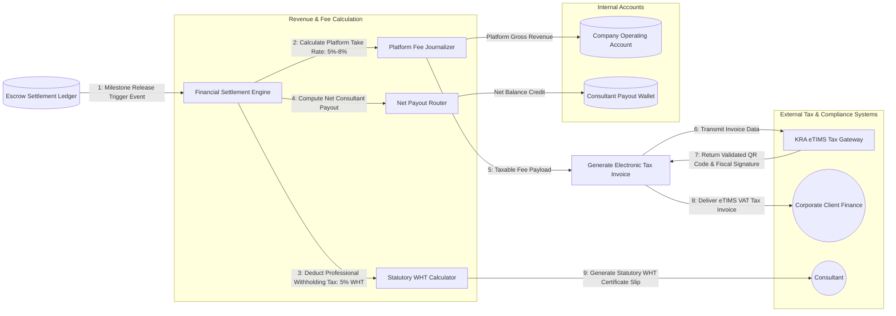

# UC-22: Audit Financial Settlement & Tax Compliance
*Diagram Type: Data Flow Diagram (DFD Level 1 - Financial Audit & eTIMS Tax Engine)*

Traces fund distributions, automated 5–8% platform take rate accounting, KRA eTIMS invoice generation, and withholding tax certification.

